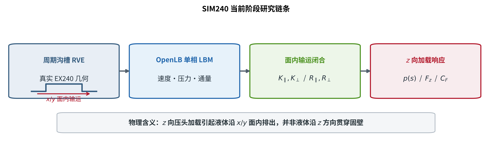
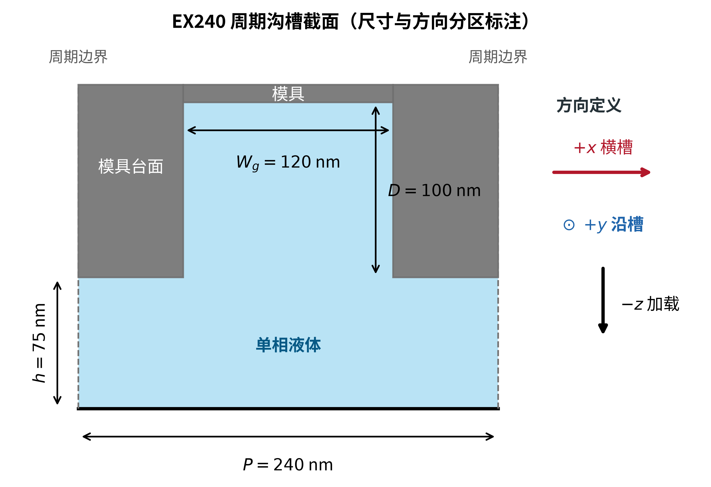
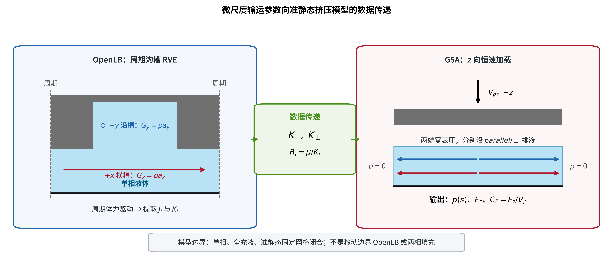
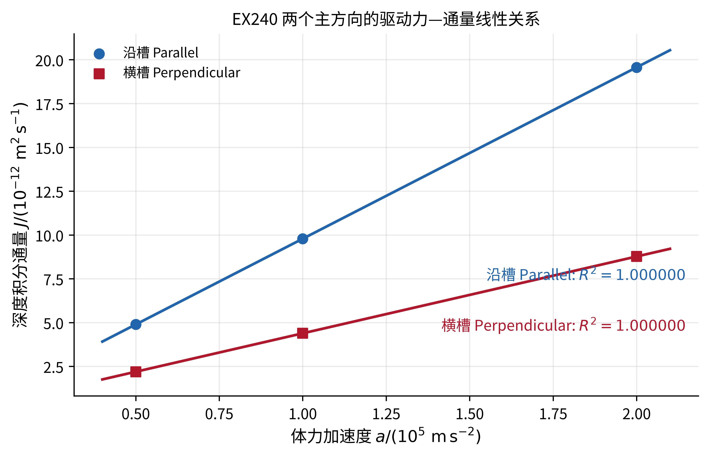
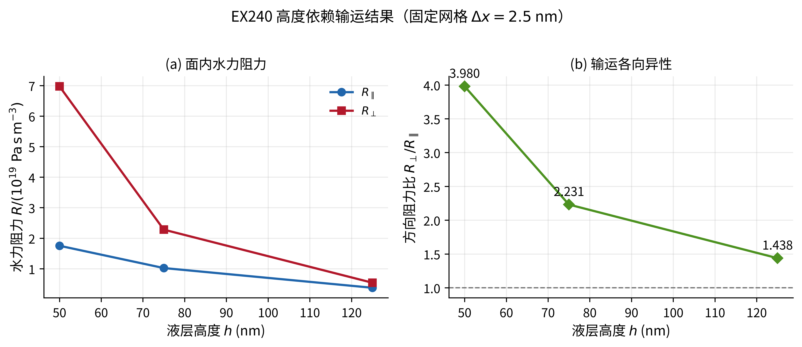
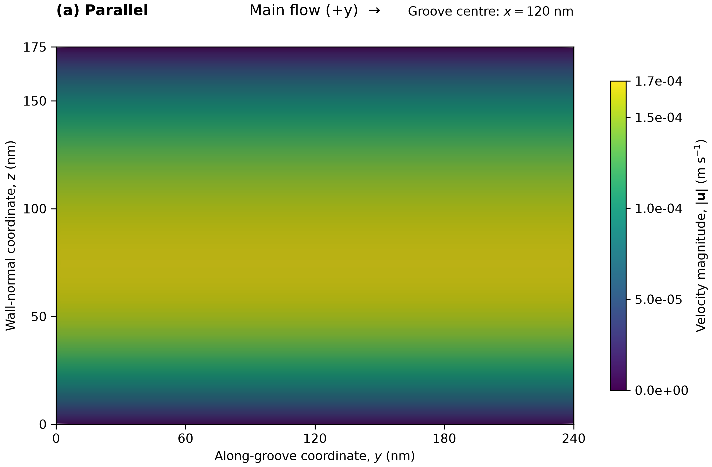
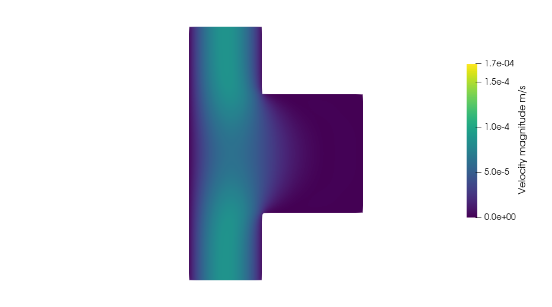
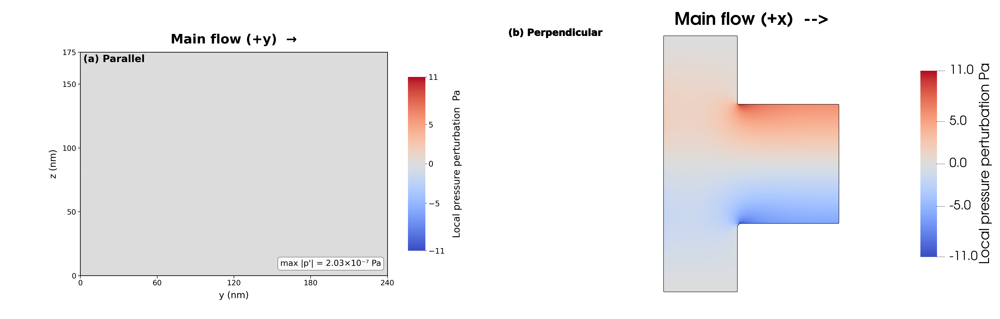

# SIM240 周期纳米沟槽方向性输运阶段总结

## 1. 当前结论

本阶段建立了从 EX240 周期纳米沟槽微尺度输运，到 $z$ 向恒速加载下准静态排液响应的证据链。当前结果支持以下结论：

- 沿槽方向（Parallel，$+y$）的有效迁移率高于横槽方向（Perpendicular，$+x$）；
- 在相同排液通量下，横槽方向需要更高的压力梯度和更大的水力阻力；
- 在 $z$ 向恒速加载下，横槽方向对应更高的内部压力、垂向载荷和挤压阻抗；
- 液层高度增加后，沟槽诱导的方向性减弱。

**综合结论：本阶段已经建立了“EX240 周期沟槽结构 → 面内方向性输运 → 准静态挤压压力与载荷响应”的候选闭合链条。** G1-v3 光滑平板基准已通过，为当前 LBM 实现提供了数值基准；EX240 高度序列和 G5A 挤压结果支持沟槽方向性对面内排液阻力及加载响应的影响，但仍属于固定网格候选闭合。

这些结论属于单相、全充液、准静态和固定网格候选闭合的范围，不等同于移动边界 OpenLB 或两相填充模拟。

### 1.1 $h=75\ \mathrm{nm}$ 基准结果

在 $L=W=1\ \mathrm{mm}$、$V_p=75\ \mathrm{nm/s}$ 的 G5A 候选闭合中：

| 排液方向 | 面内阻力 $R=\mu/K$ ($\mathrm{Pa\,s/m^3}$) | $p_{\max}$ | $F_z$ | $C_F=F_z/V_p$ |
|---|---:|---:|---:|---:|
| 沿槽 $y$（Parallel） | $1.0222\times10^{19}$ | $95.8\ \mathrm{kPa}$ | $0.0639\ \mathrm{N}$ | $8.52\times10^5\ \mathrm{N\,s/m}$ |
| 横槽 $x$（Perpendicular） | $2.2803\times10^{19}$ | $213.8\ \mathrm{kPa}$ | $0.1425\ \mathrm{N}$ | $1.90\times10^6\ \mathrm{N\,s/m}$ |

$$
\frac{R_{\perp}}{R_{\parallel}}
=\frac{C_{F,\perp}}{C_{F,\parallel}}
=\frac{K_{\parallel}}{K_{\perp}}
=2.2307.
$$

在恒速下压时，总排液量由体积守恒决定：

$$
Q_{\mathrm{out}}=LWV_p=7.5\times10^{-14}\ \mathrm{m^3/s}.
$$

因此，两个方向的主要差异不是总排液量不同，而是维持相同排液量所需的压力和载荷不同。当前 G5A 分别计算沿 $x$ 和沿 $y$ 的一维双侧排液工况，尚不能给出有限二维压头下 $Q_x/Q_y$ 的同时排液分配比例。

### 1.2 高度趋势

| $h$ (nm) | $R_{\parallel}$ ($\mathrm{Pa\,s/m^3}$) | $R_{\perp}$ ($\mathrm{Pa\,s/m^3}$) | $R_{\perp}/R_{\parallel}$ |
|---:|---:|---:|---:|
| 50 | $1.7525\times10^{19}$ | $6.9739\times10^{19}$ | 3.980 |
| 75 | $1.0222\times10^{19}$ | $2.2803\times10^{19}$ | 2.231 |
| 125 | $3.7633\times10^{18}$ | $5.4108\times10^{18}$ | 1.438 |

该高度序列来自 $\Delta x=2.5\ \mathrm{nm}$ 固定网格，可用于当前趋势和介尺度验证，但不能表述为所有高度均已完成独立网格无关验证。

## 2. 研究问题与物理范围

### 2.1 科学问题

本阶段回答：

> 周期纳米沟槽如何改变不同面内方向的水力输运，并如何将这种方向性输运转化为 $z$ 向加载所需的压力、载荷和挤压阻抗？

研究链条为：

$$
\text{周期沟槽}
\rightarrow \text{OpenLB 单相 LBM}
\rightarrow K_{\parallel},K_{\perp}
\rightarrow R_{\parallel},R_{\perp}
\rightarrow \text{$z$ 向加载响应}.
$$

### 2.2 研究边界

- $x/y$ 是液体实际输运的面内方向；$z$ 是压头加载方向；
- 第一阶段采用连续介质、牛顿、单相、等温、低 Reynolds 数模型；
- 周期体力只用于固定几何 RVE 的线性输运闭合，不代表真实压印外部驱动；
- 当前 G5A 是准静态固定几何闭合，不是移动边界 LBM；
- 两相、润湿、困气、非牛顿和固化不属于本阶段结论。

**图 1.** 当前研究链条：由 EX240 周期沟槽几何出发，通过 OpenLB 单相 LBM 提取面内方向迁移率与水力阻力，再计算 $z$ 向加载所需的压力、载荷和挤压阻抗。

## 3. 几何、模型与数值协议

### 3.1 EX240 周期单胞

| 参数 | 符号 | 当前采用值 |
|---|---:|---:|
| 周期 | $P$ | 240 nm |
| 沟槽宽度 | $W_g$ | 120 nm |
| 单胞两侧半台阶 | — | 60 nm + 60 nm |
| 沟槽深度 | $D$ | 100 nm |
| 台面下液层高度 | $h$ | 50、75、125 nm |
| 面内输运方向 | — | 沿槽 $+y$；横槽 $+x$ |

**图 2.** EX240 周期沟槽截面及方向定义。图中以 $h=75\ \mathrm{nm}$ 示意，沿槽方向为 $+y$，横槽方向为 $+x$，压头沿 $z$ 方向加载。

### 3.2 OpenLB-LBM 设置

| 项目 | 已使用设置 |
|---|---|
| 求解器 | OpenLB 1.8r1 |
| 格子模型 | D3Q19 |
| 碰撞模型 | ForcedBGK |
| 流体模型 | 单相、牛顿、等温、低 Reynolds 数 |
| 固壁 | 零速度 link-wise Bouzidi；当前解析 half-link 为 $q\approx0.5$ |
| 面内边界 | $x/y$ 双周期 |
| 驱动 | 周期体力，对应等效压力梯度 $\nabla p=\rho\boldsymbol a$ |
| 基准驱动力 | $a=1.0\times10^5\ \mathrm{m/s^2}$ |
| 生产网格 | $\Delta x=2.5\ \mathrm{nm}$ |
| 流体参数 | $\rho=1000\ \mathrm{kg/m^3}$，$\mu=10^{-3}\ \mathrm{Pa\,s}$ |

面内深度积分通量、迁移率与阻力定义为

$$
J_i=\frac{1}{A_{\mathrm{plan}}}\int_{V_f}u_i\,\mathrm dV,
\qquad K_i=\frac{\mu J_i}{\rho a_i},
\qquad R_i=\frac{\Delta P}{Q_i}=\frac{\mu}{K_i}.
$$

周期体力用于提取压力梯度—通量关系；微尺度单胞内的瞬时 $p_{\max}-p_{\min}$ 不作为宏观压降。

### 3.3 G5A 准静态加载模型

压头以 $V_p=75\ \mathrm{nm/s}$ 沿 $z$ 方向加载，液体沿 Parallel 或 Perpendicular 方向排出，输出压力 $p$、垂向载荷 $F_z$ 和

$$
C_F=\frac{F_z}{V_p}.
$$

$C_F$ 描述维持给定下压速度所需的载荷，不是独立的 $z$ 向贯穿流动阻力。

**图 3.** 微尺度输运参数向准静态挤压模型的数据传递。G5A 使用微尺度输运闭合参数计算压力、垂向载荷与挤压阻抗，并不直接模拟移动边界或两相填充。

## 4. 证据链与状态

| 环节 | 当前证据能够支持的判断 | 状态边界 |
|---|---|---|
| G0 边界与几何审计 | 周期通信、材料区域、固壁 links、Bouzidi 距离和 fallback 处理已审计 | 实现审计通过不等于物理精度通过 |
| G1 光滑平板验证 | 当前 LBM 设置能够复现 $K=h^3/12$，并通过驱动力线性与细网格精度门槛 | 5 nm 历史 FAIL 基线仍保留 |
| G2 EX240 方向输运 | 支持 $K_{\parallel}>K_{\perp}$ 及稳定的方向性输运差异 | Step 3 的最细 Perpendicular 质量门限问题仍保留，不能写成全部九点无条件 PASS |
| 高度序列 | 支持阻力随高度增加而下降、方向比减小的趋势 | 固定网格候选，不称为网格无关参数面 |
| G5A | 支持微尺度方向性闭合能够传递到压力、载荷和挤压阻抗 | `RESULT_PASS=true` 不等于移动边界或两相模型已验证 |

## 5. 结果

### 5.1 面内输运：线性响应与基准方向性

Parallel 与 Perpendicular 均完成三个驱动力点的稳态计算：

$$
a=5\times10^4, 1\times10^5, 2\times10^5\ \mathrm{m/s^2}.
$$

两方向的 $J$—驱动力拟合均得到 $R^2\approx1$，说明当前计算范围处于线性响应区。

**图 3-1.** EX240 沿槽与横槽方向的驱动力—通量关系。

在 $h=75\ \mathrm{nm}$ 的生产网格上：

| 指标 | 沿槽 Parallel | 横槽 Perpendicular | 方向关系 |
|---|---:|---:|---:|
| $K$ ($\mathrm{m^3}$) | $9.7824\times10^{-23}$ | $4.3853\times10^{-23}$ | $K_{\parallel}/K_{\perp}=2.2307$ |
| $R=\mu/K$ ($\mathrm{Pa\,s/m^3}$) | $1.0222\times10^{19}$ | $2.2803\times10^{19}$ | $R_{\perp}/R_{\parallel}=2.2307$ |

**图 3-2.** 固定网格 $\Delta x=2.5\ \mathrm{nm}$ 下，EX240 沿槽/横槽水力阻力及方向阻力比随液层高度的变化。

### 5.2 局部速度与压力场

**图 3-3.** Parallel 沟槽中心纵截面（$x=120\ \mathrm{nm}$）的速度模值云图。主流沿 $+y$ 方向。

**图 3-4.** Perpendicular 代表性 $x$-$z$ 截面（$y=120\ \mathrm{nm}$）的速度模值云图。主流沿 $+x$ 方向。

**图 3-5.** 方向一致的纵截面局部压力扰动：

- （a）Parallel：$y$-$z$ 截面，$x=120\ \mathrm{nm}$；
- （b）Perpendicular：$x$-$z$ 截面，$y=120\ \mathrm{nm}$。

两方向均按 $p'=p-\langle p\rangle_{\mathrm{slice}}$ 归一化，并使用相同的 `coolwarm` 色图和 $[-11,11]\ \mathrm{Pa}$ 色标。Parallel 扰动为 $O(10^{-7}\ \mathrm{Pa})$，在共同色标下表现为近似均匀场；Perpendicular 出现约 $10.41\ \mathrm{Pa}$ 的局部重分布。该图显示的是周期单胞内局部重分布，不能将 $p_{\max}-p_{\min}$ 当作宏观压降或额外压降。

局部压力图只能作为机理辅助证据。方向阻力的定量结论仍以 $K$、$R$、通量线性关系和耗散/收敛证据为准。

### 5.3 $z$ 向加载下的压力与挤压阻抗

G5A 条件为 $L=W=1\ \mathrm{mm}$、$V_p=75\ \mathrm{nm/s}$、两端表压为零。

| $h$ (nm) | 排液方向 | $p_{\max}$ (Pa) | $F_z$ (N) | $C_F$ ($\mathrm{N\,s/m}$) |
|---:|---|---:|---:|---:|
| 50 | Parallel | $1.643\times10^5$ | $1.095\times10^{-1}$ | $1.460\times10^6$ |
| 50 | Perpendicular | $6.538\times10^5$ | $4.359\times10^{-1}$ | $5.812\times10^6$ |
| 75 | Parallel | $9.584\times10^4$ | $6.389\times10^{-2}$ | $8.519\times10^5$ |
| 75 | Perpendicular | $2.138\times10^5$ | $1.425\times10^{-1}$ | $1.900\times10^6$ |
| 125 | Parallel | $3.528\times10^4$ | $2.352\times10^{-2}$ | $3.136\times10^5$ |
| 125 | Perpendicular | $5.073\times10^4$ | $3.382\times10^{-2}$ | $4.509\times10^5$ |

**图 3-6.** $z$ 向恒速加载下的面内压力分布。横槽排液能力较低，因此维持相同下压速度需要更高的内部压力。

**图 3-7.** 不同液层高度下的挤压阻抗。液层增厚后，压力和垂向加载阻抗均明显降低。

**图 3-8.** 横槽/沿槽挤压阻抗比随液层高度的变化。

在相同宏观尺寸、边界条件和下压速度下：

$$
\frac{C_{F,\perp}}{C_{F,\parallel}}
=\frac{R_{\perp}}{R_{\parallel}}
=\frac{K_{\parallel}}{K_{\perp}}.
$$

不能定义或报告 $R_z/R_{xy}$：当前 $R_{\parallel},R_{\perp}$ 是面内体积流量阻力，而 $C_F$ 是垂向载荷/速度，两者量纲不同。

## 6. 证据边界

- G2 三网格的 Richardson/GCI 数学分析可用于评估趋势，但最细网格横槽工况的质量门限问题必须保留；数学 GCI 不自动把该运行改写为完整 PASS；
- $\Delta x=2.5\ \mathrm{nm}$ 是当前生产/参数网格，是精度与计算成本的折中；
- 高度序列和 G5A 的输入状态为 `CANDIDATE_FIXED_GRID`，不能称为完整网格无关参数面；
- G5A 是准静态单相挤压响应，不是移动边界 OpenLB，也不是两相填充模拟；
- 局部压力极差不能代替宏观压降，局部压力图不能单独证明阻力机制；
- 只有在补入可比的速度、剪切或耗散场后，才能进一步定量判断阻力差异主要来自哪一局部区域。

## 7. 下一步工作

研究重点是周期沟槽的水力阻力。下一步先冻结阻力定义，再进行多周期阻力收敛。

### 7.1 单周期阻力基线

固定 $h=75\ \mathrm{nm}$、$\Delta x=2.5\ \mathrm{nm}$、OpenLB 数值设置、物性参数和周期体力协议，分别计算：

$$
a=5\times10^4,
\quad 1\times10^5,
\quad 2\times10^5\ \mathrm{m/s^2}.
$$

统一提取

$$
J_i(a),
\qquad K_i=\frac{\mu J_i}{\rho a_i},
\qquad R_i=\frac{\mu}{K_i}.
$$

验证输出包括：

- $J_{\parallel}(a)$ 与 $J_{\perp}(a)$；
- 两方向线性拟合及 $R^2$；
- $K_{\parallel}$、$K_{\perp}$ 和单周期阻力基线；
- 质量、Mach、截面通量和 boundary-link 审计；
- 完整日志与独立退出码。

只有上述证据满足同一 G2 协议后，才冻结

$$
R_{\parallel}^{(1)},
\qquad R_{\perp}^{(1)}.
$$

### 7.2 多周期阻力收敛

由于沟槽沿 $y$ 方向延伸，优先增加横向 $x$ 方向的周期数，保持 $N_y=1$：

$$
N_x=1,\ 2,\ 4,\ 8.
$$

对每个 $N_x$ 重复同一组三驱动力计算，得到

$$
R_{\parallel}^{(N_x)},
\qquad R_{\perp}^{(N_x)},
\qquad
R_{\perp}^{(N_x)}/R_{\parallel}^{(N_x)}.
$$

重点检查相邻周期扩展的相对变化：

$$
\frac{|R^{(2N_x)}-R^{(N_x)}|}{R^{(N_x)}}.
$$

连续两个周期扩展达到预先冻结的收敛阈值后，才报告多周期阻力已收敛。周期体力结果与入口/出口模型结果不得混用。

### 7.3 执行顺序

1. **三驱动力单周期验证**
2. **冻结 $h=75\ \mathrm{nm}$ 单周期阻力基线**
3. **同协议下进行 $N_x=2,4,8$ 多周期阻力收敛**
4. **再开展网格收敛和高度/角度参数化**

因此，当前执行链为：

$$
\text{三驱动力线性验证}
\rightarrow
h=75\ \mathrm{nm}\ \text{单周期正式冻结}
\rightarrow
\text{横向多周期阻力收敛}
\rightarrow
\text{同协议网格收敛}
\rightarrow
\text{高度/角度参数化}.
$$
