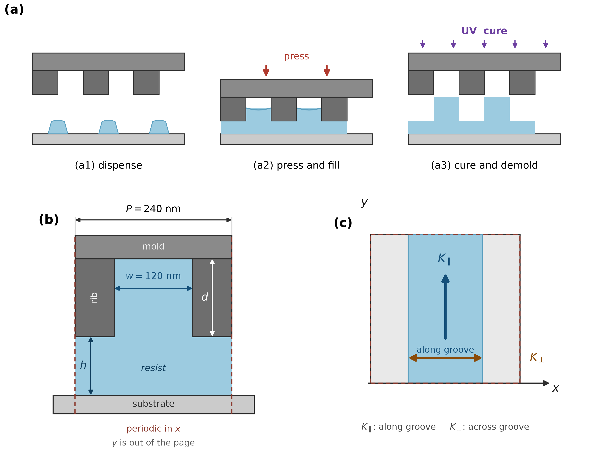
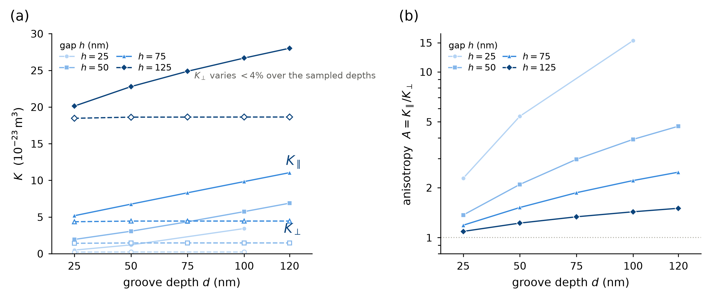
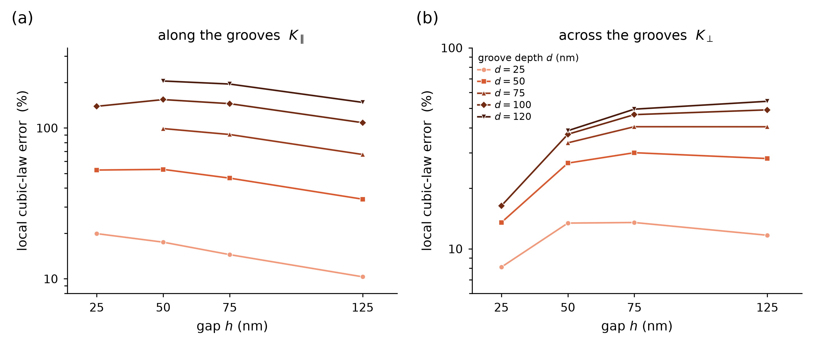
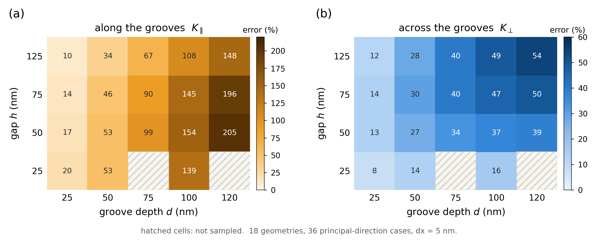
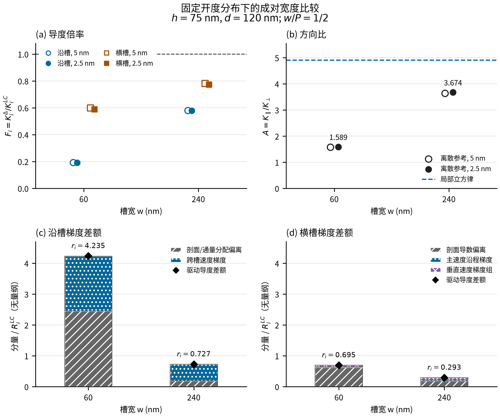
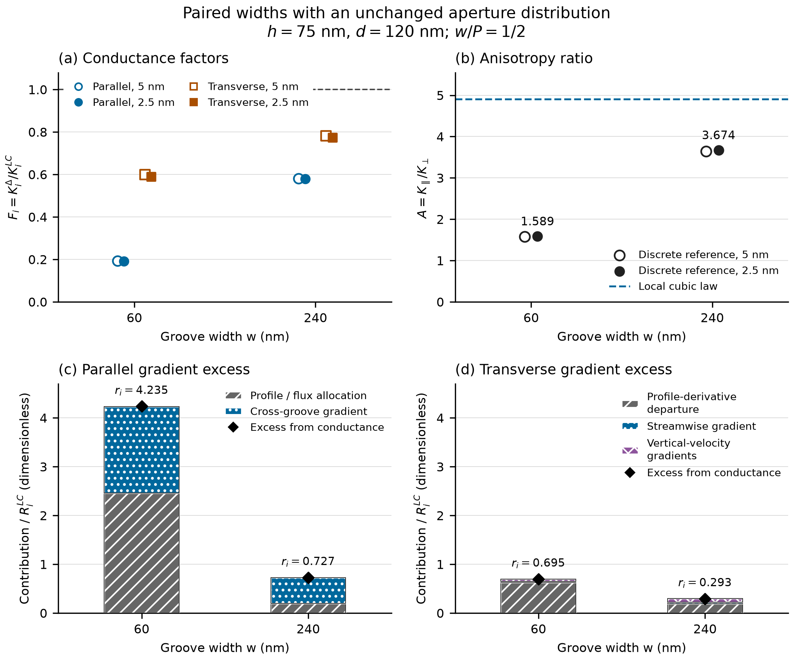

# 第一篇图件与汇报文件

2026-11-12按既有缺项清单复核：4张正文主图、S1中英文PNG/PDF/SVG六份图件、PPT与HTML两份汇报文件，共12项，均已在远端且与本地字节一致。本轮补正过时的缺项说明，并同步第2、9、11页预览。

- [中文投稿正文](../PAPER1_submission_manuscript_20261110/SIM240_submission_CN.md)
- [英文投稿正文](../PAPER1_submission_manuscript_20261110/SIM240_submission_EN.md)
- [中文补充材料](../SIM240_Supplementary_Methods_20261024/SUPPLEMENTARY_METHODS.md)
- [英文补充材料](../SIM240_Supplementary_Methods_20261024/SUPPLEMENTARY_METHODS_EN_20261028.md)
- [14页汇报图文预览](../PPT_论文汇报_20261109/README.md)
- [下载PPT](../PPT_论文汇报_20261109/论文汇报.pptx)
- [HTML伴读件](../PPT_论文汇报_20261109/PPT全文_14页.html)：下载后与preview文件夹一起使用。

## 正文图1

## 正文图2

## 正文图3

## 正文图4

## 补充图S1：中文

[PDF](../SIM240_Supplementary_Methods_20261024/figures/Figure_S1_paired_widths_CN.pdf) · [SVG](../SIM240_Supplementary_Methods_20261024/figures/Figure_S1_paired_widths_CN.svg)

## 补充图S1：英文

[PDF](../SIM240_Supplementary_Methods_20261024/figures/Figure_S1_paired_widths_EN.pdf) · [SVG](../SIM240_Supplementary_Methods_20261024/figures/Figure_S1_paired_widths_EN.svg)

此处“齐全”仅针对上述12项及伴读图像依赖，不代表整个项目、原始场数据或所有历史链接的完整备份，也不构成数值验证或投稿放行。
