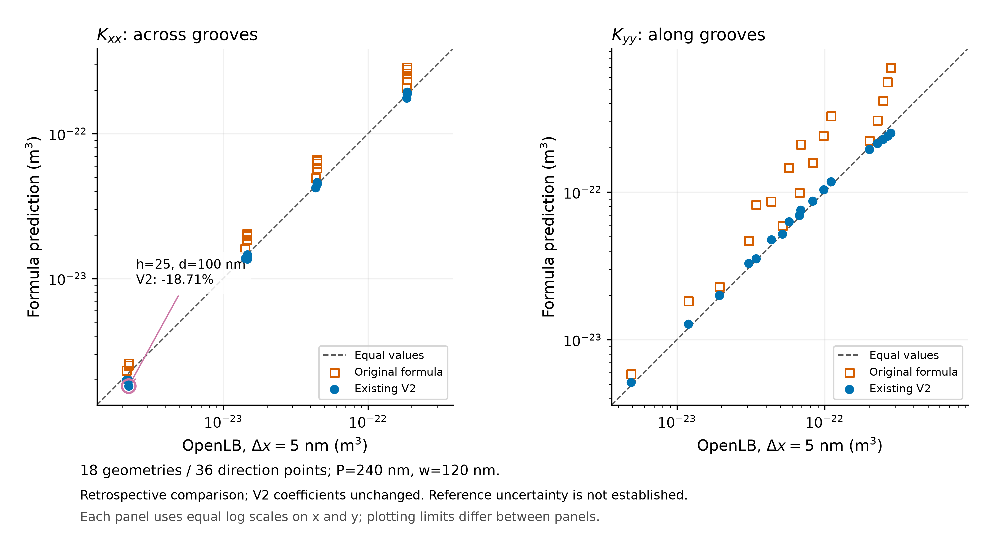

# 原公式、现有V2与OpenLB同条件比较：结合OpenFOAM C系列和S0–S4

日期：2026-11-05，Asia/Shanghai。范围：用户授权的现有结果整理与标量重算；未新增求解、编译、拟合或Gate放行。本报告为AI辅助科研分析工作稿，最终科学主张由作者与导师审定。

**判断：现有工作已形成“公式基线—显式槽数值比较—修正公式—平均模型接入”的实质证据链。原公式提供方向性导度的解析基线；V2在历史36个方向点中的35个缩小偏差；C01–C04/GDI01证明两套系数可以按正确方向、单位和通量口径接入平均模型。剩余核心问题是修正规律的适用条件和独立预测能力：V2薄隙横槽有反例，修正倍数不能随间隙变化，历史来源及参考精度也未完全闭合。不能将已有接入核验当作公式准确性的第二份独立验证。**

这里的OpenLB是显式矩形槽数值结果，不是实验真值。本轮“比较”指既有5nm离散结果的回顾性分析，不改变正式`MODEL_COMPARISON=NOT_EVALUATED`、`reference_qualified=false`与`physical_validation=NOT_EVALUATED`。老师暂不围绕1%追加计算的研究优先级保持；不追改S4历史FAIL。

## 1. 首先统一比较的对象、方向和单位

槽沿y，沿槽为Kyy，横槽为Kxx。h为平台上方最小间隙，d为槽深；槽内高度h+d。当前半槽占比：槽宽w=120nm，周期P=240nm，平均液体厚度H=h+d/2。

本项目的K是深度积分导度，单位m³：

\[
J_i=\frac{1}{A_{\rm plan}}\int_{\Omega_f}u_i\,dV,
\qquad K_i=\frac{\mu J_i}{G_i}=\frac{\nu J_i}{a_i}.
\]

J单位m²/s，G是压力梯度的驱动幅值；体力驱动时G=ρa。平均速度U=J/H，通常单位m²的渗透率为κ=K/H。m³与m²不可直接比较。

原公式、V2和OpenLB逐点使用相同h、d、w、P、方向及K定义。36点均来自固定间隙、全充液、单相、静壁、xy周期的主地图5nm结果，tau=1、ForcedBGK、加速度1e5m/s²。它们是：h25nm下d25/50/100nm的3组；h50/75/125nm下各d25/50/75/100/120nm的15组，合计18种几何、每种P/T两个方向。

“同条件”表示每一条公式值与其对应数值值的物理和统计定义一致；不代表18种几何全由同一历史构建产生。历史9组标定几何/18方向点与9组扩展几何/18方向点分别属于两个二进制哈希组，且分组完全重合；现有D2程序只匹配后者。不能从当前源码反推全部历史构建身份，也不能把组间差异唯一归为程序版本效应。详见[历史构建裁决](../Historical_build_adjudication_20261028/REPORT.md)。

## 2. 原公式已解决什么

在槽和平台各占一半时，局部平板立方律组合为：

\[
K_{yy}^{0}=\frac{(h+d)^3+h^3}{24},\qquad
K_{xx}^{0}=\frac{h^3(h+d)^3}{6\{h^3+(h+d)^3\}}.
\]

沿槽近似把高、低两区作为并行通道，横槽近似把两区作为串联阻力。因此它已提供：几何到两个方向K的明确映射、方向性差异的解析基线、d=0时退化为h³/12的平板极限，以及可直接输入平均模型的量纲一致系数。

它采用局部平板近似，不能自动充分表示矩形槽侧壁、台阶附近和区域之间的完整速度场耦合。本轮没有执行耗散或受控机制分析，因此“具体哪一部分作用主导偏差”仍是待检验的物理解释。已发现公式高估输运，不等于已定量分解各项阻力来源；仅证明沿槽与横槽不同也不构成新增结论。

## 3. V2是什么，本轮怎样复算

保持现稿给出的舍入系数，不重拟合：

\[
K_{yy}^{V2}=F_{yy}K_{yy}^{0},\qquad
F_{yy}=\frac{1}{1+1.7685(d/w)^{1.6331}},
\]

\[
K_{xx}^{V2}=F_{xx}K_{xx}^{0},\qquad
F_{xx}=\frac{1}{1+0.4900(d/w)^{0.6990}}.
\]

V2是数据知情的修正公式。历史扩展点在形式选择过程中已知，不能因名叫“扩展”就充当真正未见验证。上述“现稿给出”不表示论文已发表。定义带符号偏差：

\[
E=100\left(\frac{K_{\rm formula}}{K_{\rm OpenLB,\,5nm}}-1\right)\%.
\]

正值为公式偏高，负值为公式偏低；改善按绝对偏差变小计算，不另设5%、10%或20%的通过线。

## 4. 36点重算：已经支持的结论

|方向|原公式带符号偏差范围|V2带符号偏差范围|原公式平均绝对偏差|V2平均绝对偏差|改善点数|
|---|---:|---:|---:|---:|---:|
|Kxx，横槽，18点|+8.11%至+54.19%|−18.71%至+4.18%|30.63%|4.42%|17/18|
|Kyy，沿槽，18点|+10.30%至+204.85%|−10.50%至+10.11%|88.85%|6.40%|18/18|

原公式在这36点全部偏高；V2显著改善已有地图的整体贴合，但改善不是每点必然成立。最大绝对偏差：Kxx由54.19%降至18.71%，Kyy由204.85%降至10.50%。这些是有限样本的描述统计，不是误差上界或连续域精度保证。

单独展示h≥50nm的15种几何只是定位薄隙问题，不能删除h25：该子集Kxx的V2最大绝对偏差为6.92%，Kyy为10.50%；所有30方向点改善。不能据此承诺“所有h≥50nm均满足此范围”，当前w固定、h/d只覆盖所列离散点。

图：橙色空心方块为原公式，蓝色圆点为现有V2；越接近对角虚线越接近对应OpenLB结果。每个方向18个点，无删点。两轴均为对数，同一面板内范围及比例一致；两个方向的显示范围不同。参考不确定度尚未建立，因此没有虚构误差棒。紫圈保留V2变差点。PNG、PDF、SVG与绘图脚本一并保存。

## 5. 一个与OpenFOAM输入完全同几何的具体例子

取h75/d100/w120/P240nm，与C01–C04的几何参数一致。下表OpenLB来自历史D2主地图5nm结果，不用另一个h60/d80的URV网格例替代。

|量|原公式|现有V2|显式槽OpenLB，5nm|
|---|---:|---:|---:|
|Kxx / m³|6.518159e−23|4.553795e−23|4.449022e−23|
|Kyy / m³|2.408854e−22|1.041401e−22|9.834076e−23|
|A=Kyy/Kxx|3.695605|2.286887|2.210390|
|Kxx偏差|+46.51%|+2.35%|比较分母|
|Kyy偏差|+144.95%|+5.90%|比较分母|

这是可直接向导师解释的成功例：原公式对两个方向都给得过大；V2同时改善Kxx、Kyy及方向比。S0修复回归使用同一h75/d100，P/T结果分别约9.834076003e−23/4.449022023e−23，支持该控制点回归一致；S0不是整个18几何历史来源或精度的替代证明。

## 6. V2的失败条件与结构性局限

### 6.1 已核实的局部反例：薄间隙深槽横向

h25/d100/w120nm，Kxx的5nm结果为2.220208447e−24m³。原公式2.583498677e−24（+16.36%），V2为1.804915190e−24（−18.71%），V2绝对偏差反而增大。这只证明“V2在这个已知离散点未改善”，并未冻结一条连续失败边界。

该点已有2.5nm结果2.121836964e−24m³；相应原公式约+21.76%，V2约−14.94%，改善结论会随参考网格改变。因此5nm反例和细档必须并列，不能挑一档宣布V2普遍失败或普遍有效，也不能将两档差4.43%当连续误差界。两档完整审核见[h25既有参考审核](../PAPER1_h25_reference_candidate_audit_20261104_225645/REPORT.md)；本轮引用其结果，没有再次解码三维场。

### 6.2 修正倍数缺少间隙依赖

原公式已经含h；问题在于V2额外修正F只依赖d/w。同d100/w120时，不论h如何变化，Fxx恒为0.698632、Fyy恒为0.432322。已有地图呈现以下残差：

|h / nm|d / nm|V2横槽偏差|V2沿槽偏差|
|---:|---:|---:|---:|
|25|100|−18.71%|+3.39%|
|50|100|−4.19%|+9.91%|
|75|100|+2.35%|+5.90%|
|125|100|+4.18%|−9.91%|

沿槽在大间隙一侧出现过度修正，横槽在最薄间隙出现过度修正，这是研究F应否含h/w的直接动机。它尚不能唯一排除网格、历史构建组等影响，不能把相关残差趋势写成唯一因果证明。

V2保留d→0的平板极限及正值，但不具备任意h/w下精度的证明。大间隙、固定d/w时相对修正应怎样回归平板主导行为，是下一版结构检查候选，需要明确极限和推导；本轮不冻结新的渐近结论。

### 6.3 证据适用范围的限制

仅有w120/P240与占比1/2，不支持任意宽度、占比、滑移、非牛顿、自由液面、两相或动态填充精度。V2已见数据的回顾性好看，也不支持新条件的预测保证。OpenLB当前也没有全图合格参考及连续误差界，不能把表中偏差全部定义为纯模型误差。

## 7. OpenFOAM C系列确实已经闭合了哪一段

保存的完成编号是C01–C04，另有GDI01。本轮所查实际完成清单未核到C00；不为“C0–C4”补造C00身份。五例均存在真实执行与原接受记录，不需要为证明已接入而重复求解。

共同问题：h75/d100/w120/P240nm、H125nm，平均平面域24×48μm，16×32×1共512单元，μ=.001Pa·s，x两端表压24/0Pa，y无流，静态V=0。几何输入含槽参数，但网格不逐槽解析。

|例|公式及物理方向|OpenFOAM保存出口Q / m³·s⁻¹|已经核验的作用|
|---|---|---:|---|
|C01|V2，横槽Kxx|2.185821681393e−18|二维与OpenFOAM平均模型同输入核对|
|C02|V2，沿槽Kyy|4.998726758168e−18|旋转槽向后的方向映射核对|
|C03|原公式，横槽Kxx|3.128716216217e−18|原公式横向系数接入对照|
|C04|原公式，沿槽Kyy|1.156250000000e−17|原公式沿向系数接入对照|
|GDI01|V2，横槽Kxx|2.185821681361e−18|grooveDarcy通过真实动量阻力源接入|

C02将槽转到全局x方向，局部程序分量可标为Kxx，但在本报告槽固连坐标下对应物理沿槽Kyy；不可直接按全局下标误判方向。

物理接口是J=−K∇p/μ、U=J/H、D=HK⁻¹，D单位m⁻²。总阻力已包含未解析壁面作用，不能再加同一份厚度剪切。原公式换成V2后，出口Q横槽下降30.14%、沿槽下降56.77%；这正是相同平均模型对K输入变化的响应，说明修正有实际输出影响。

本轮重新从9端保存faces.csv的xHigh面流量求和，与已有报告一致，并核对原接受绑定的69项原始文件哈希、manifest及完成/退出记录。原接受均为NUMERICAL_GATE=PASS、RESULT_PASS=true、geometry_PASS=true，但geometry_scope为synthetic_average_domain_only，physical_validation为NOT_EVALUATED，independent_human_acceptance=false。本轮不重跑整套接受器。

C01最初检查器记录与后来几何识别修正版分开保留；引用修正版接受，不删除原NOT_EVALUATED。准确run_id、原接受路径及9端数值见OpenFOAM_saved_cases.csv和OpenFOAM_outlet_Q.csv。

**因此，已闭合的是“公式→K/D→平均求解器→通量”的实现及静态接入链。** 两个程序输入同一公式系数，结果吻合不能独立判断该系数是否准确。恒系数、固定压差主轴问题的压力线主要受边界决定，应比较Q/U，不能凭压力线重合选公式。本组静态流阻Δp/Q与挤压阻力F/V也不同，V=0的这些例不承担挤压验证。

## 8. S0–S4属于另一段：OpenLB数值参考的可信度

|阶段|实际检查的核心问题|已有证据与当前结论|能否代替公式预测验证|
|---|---|---|---|
|S0|修复后h75/d100 P/T控制点能否回归|已接受，控制点K回归一致|不能；只覆盖该回归对象|
|S1|无槽平板能否复现解析速度和h³/12|h30/d0，K偏差约0.173%，速度L2偏差约0.079%；已接受|不能；支持基础求解实现|
|S2|常规间隙显式槽网格是否稳定|h60/d80三档、两方向共6条；中细K变化P0.203234%、T0.744252%；已接受|不能；支持该控制族的离散可信度|
|S3|改变驱动力时K是否基本不变|h60/d80三档驱动力；4新条加2条S2复用；线性指标P8.30e−8、T3.81e−8；已接受|不能；支持低速线性响应|
|S4|薄间隙显式槽网格是否稳定|h30/d80六条单例均接受；P中细0.165169%通过，T1.328387035%>1%，阶段FAIL|不能；保留薄隙参考证据缺口|

这些不是OpenFOAM的五个算例，而是显式OpenLB候选参考的检查链。S4横槽fine-GCI约0.912233%通过不抵消中细变化的原FAIL；单例接受也不等于阶段接受。S0/S1/S2/S3已接受是实质进展，不应因S4未过而全部归零；也不应拿h60或h30控制族为18种历史几何全部背书。S5未开始，不自动读取保留预测或新增求解。

来源依次为：[S0](../URV_A1_S0_results_review_20261102/REPORT.md)、[S1](../URV_S1_results_review_20261102/REPORT.md)、[S2](../URV_S2_completed_review_20261103_095422/REPORT.md)、[S3](../URV_S3_completed_review_20261103_172033/REPORT.md)、[S4](../URV_S4_completed_review_20261104_143205/REPORT.md)。

## 9. 最小改进方向与最少缺什么

### 9.1 不新增仿真，现在已经能完成的论文内容

可以形成“局部平板原公式的偏差—V2改善与反例—现有证据适用范围—平均模型接入”的回顾性论文结果章节。36点、h75成功例、h25反例以及网格敏感性共同展示；C系列放在实现与应用输出核对，S系列放在数值方法可信度，不将它们丢弃或重复计算。此定位能支撑有限结论；是否达到目标期刊发表标准，还取决于创新性、文献对照与论证完整性，本轮不能保证投稿就绪。

### 9.2 若需要改公式，最小的结构变化是让相对修正可响应间隙

保留原公式作为基线，考察K_i=K_i^0 F_i(h/w,d/w;φ=.5)。这是变量结构建议，不是已经推导、拟合或验证的新公式，也不是增加一个参数就足够的保证。先规定正值、无槽退化、连续性及目标适用域；再用尽可能少的额外自由度处理间隙效应，避免为了这36点贴合而不断加项。

项目已有C4/H4/G4/G6等含间隙候选，不能无视已有工作从零再造。2026-11-04审核表明C4/H4含h25训练，G4/G6对h25属于目标域外已知补充，锁状态仍为CANDIDATE_FROZEN_NOT_VALIDATED；较小旧残差不等于应当替换V2。本轮只引用已有审核，不重拟合、改锁、选冠军或读取保留预测。下一步先审“已有候选的结构和原目标域是否满足本次问题”，再决定是否另立版本。

### 9.3 若主张预测新几何，最少还缺独立检验

先固定公式版本、变量、系数、目标域和已用数据名单；再确定真正未参与选择的条件及参考资格。仅将已知h25重算得更细，不会使它重新成为未见点；改变软件却继续输入同一K，也不会产生独立精度证据。新增条件数量需随主张与参考协议确定，本轮不承诺“补一条就全闭环”。

历史来源、网格/数值不确定度和未见性是不同缺口。若仍走原严格URV路线，则保留其既定资格与S4停点；老师改变优先级不等于更改原门槛。本轮没有授权/启动0.625nm、S5、新OpenFOAM宿主或其他长算。

**建议接续动作：先对照已有含间隙候选与原公式/V2的变量结构、极限和冻结目标域，形成可审阅的候选选择依据与独立检验设计；此动作先不拟合、不读取保留结果、不启动仿真。** 分区通量/耗散只在需要检验某条明确机制时成为辅助，不再作为公式比较的前置。

## 10. 本轮验证与复用入口

- `comparison_36_points.csv`：36点原公式/V2/同条件OpenLB、偏差、来源路径与二进制身份。
- `paired_18_geometries.csv`：18几何双方向配对及方向比。
- `direction_summary.csv`、`by_gap_summary.csv`：全图、h≥50子集与各间隙统计。
- `OpenFOAM_saved_cases.csv`、`OpenFOAM_outlet_Q.csv`：5例身份/接受来源及9端实际出口流量。
- `summary.json`、`verification.json`、`source_manifest.json`：236项输入哈希无变动；36条原结果/manifest/预检摘要/原独立退出及代数一致，69项OpenFOAM原接受绑定原文件哈希一致。
- `build_comparison.py`：标准库标量核对脚本，不导入历史拟合器或求解器；`plot_comparison.py`及`figure_metadata.json`：图形生成与环境。

本轮没有重新积分36条场、逐条重放全部诊断/接受器或给出新的科学Gate；图示与汇总来自这些保存标量。源报告公式见[导师审阅稿§2.2–2.3、§4.4](../SIM240_中文稿_导师审阅版_20261022.md)，原数据索引见[表S1](../SIM240_Supplementary_Methods_20261024/Table_S1_run_inventory.csv)，OpenFOAM核对解释见[已有报告](../OpenFOAM_comparison_clarification_20261104/REPORT.md)。

新增仅本目录报告、CSV/JSON、分析/绘图脚本和图件，以及共享状态更新。无新仿真run_id、CASE/原结果/系数/阈值修改、编译、求解、拟合、保留预测读取、提交或推送。S4原FAIL、reference_qualified=false、strict_error_bound_established=false、正式MODEL_COMPARISON/physical_validation未评价、submission_ready=false及全部历史FAIL保持。

方法组织采用scientific-writing、scientific-critical-thinking，图形采用scientific-visualization、matplotlib；技能不构成物理或精度证据。下一模型建议GPT-6.1 Sol｜High用于已有候选结构与独立检验设计；最终公式/理论结论冻结按项目要求GPT-6 Astra｜High，本轮不声称已切换或完成终审。
