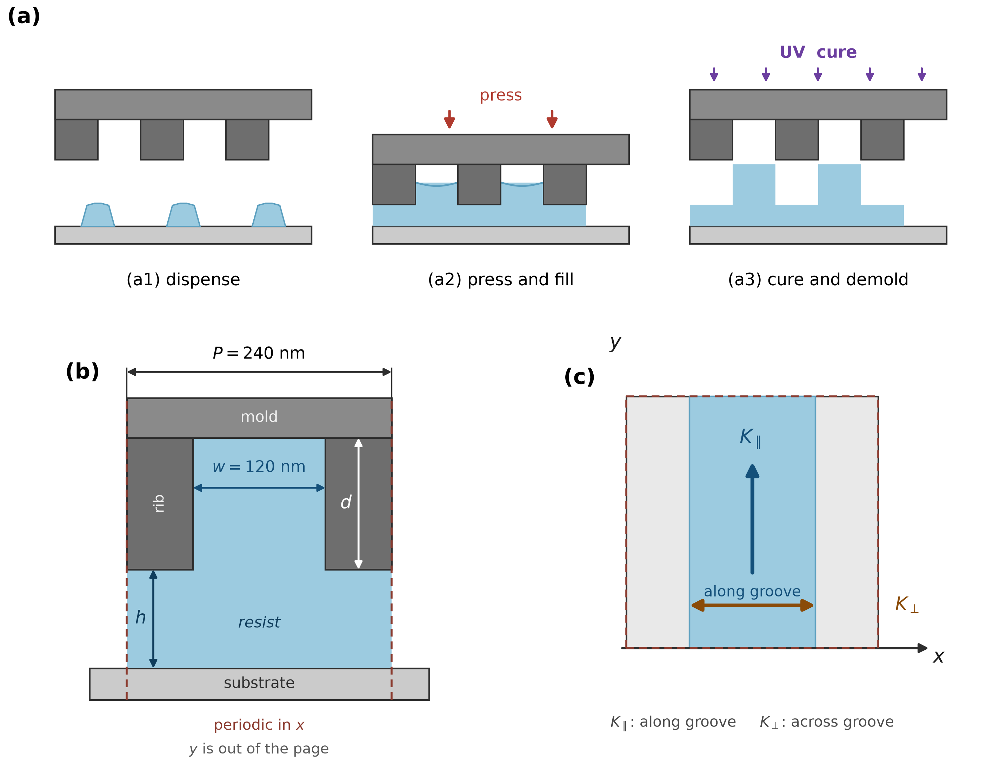
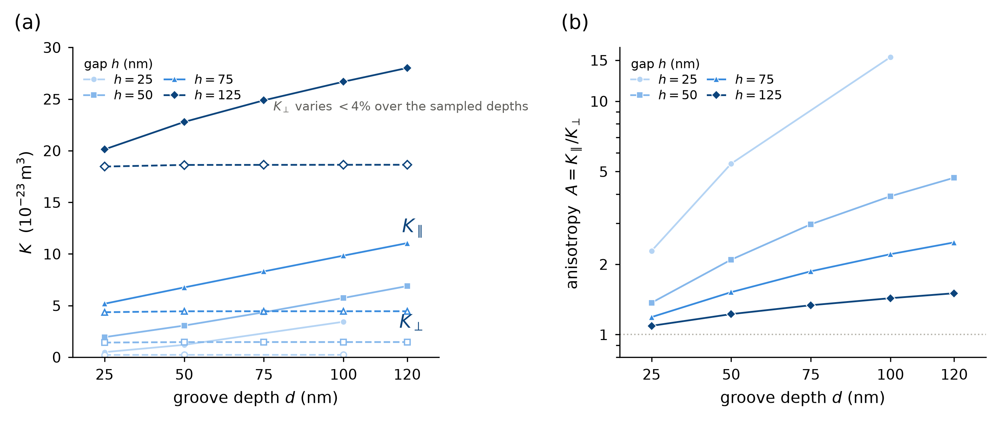
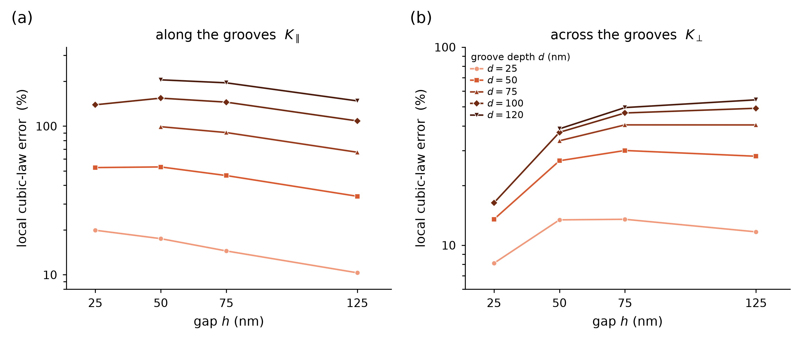
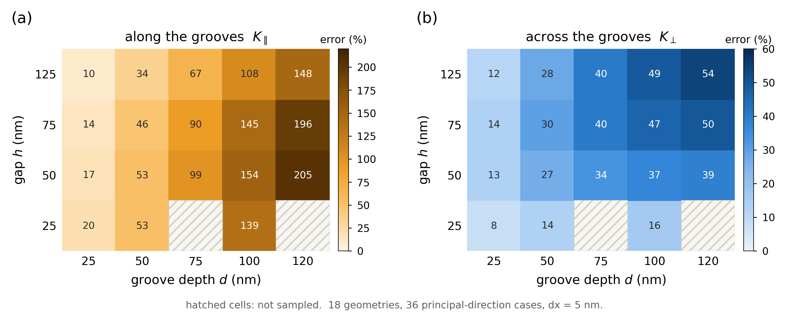

# 有限间隙矩形沟槽中局部立方律的双向导度偏差及经验修正

---

## 摘要

局部立方律常用于纳米压印降阶模型，但其沿槽与横槽导度需要分别评价。本文采用格子玻尔兹曼方法，计算平面基底与周期矩形沟槽之间的稳态输运，假设间隙固定、牛顿液体完全充满且壁面无滑移。主参数图的沟槽周期为240 nm，槽与凸台等宽；主数据包含18种几何的36个主方向导度结果，网格间距为5 nm，其中4种几何另以2.5 nm网格检查敏感性。

相对于5 nm离散参考，局部立方律在全部主方向结果上高估导度，沿槽和横槽最大相对偏差分别为+204.85%和+54.19%。在h=75 nm、d=100 nm的基准几何下，原公式与离散参考的各向异性比分别为3.70和2.21；以同一线性张量关系重建相对槽轴45°驱动下的平均通量方向，角差为9.20°。本研究标定的经验修正（V2）在回顾性评价中将沿槽和横槽的最大绝对相对偏差分别降至10.50%和18.71%，但一个薄隙横槽点的改善判断随参考网格改变。在一个新增间隙的两方向比较中，保持V2系数不变也减小了相对偏差绝对值。在一套独立的有限元离散对照中（17个横槽成对几何），5 nm OpenLB横向导度均高于所列有限元值，差为+1.26%至+7.28%；固定V2的横槽平均绝对偏差为4.21%、有符号均值为+1.83%，方向比与45°重建角的平均绝对偏差亦明显减小，但3个几何出现局部恶化。该集合与本文36条5 nm主统计分属不同参考与不同几何集合，不作合并。

理论推导表明，局部立方律给出所述周期Stokes模型中两主方向连续导度的上界，但不确定偏差幅度或V2准确度。上述定量结果限于采样几何与指定离散参考，尚未建立连续参数范围或实际压印过程的精度保证；结果提示，评价此类降阶模型时，应同时考察两主导度、其比值和参考敏感性。

**关键词：** 纳米压印；矩形沟槽；各向异性输运；格子玻尔兹曼方法；局部立方律；模型偏差

---

## 1 引言

### 1.1 问题从哪来

纳米压印中，液体要在基底与图案化模具之间重新分布。大面积压印不可能逐条解析每一个沟槽，工程模型因此普遍采用等效输运系数——把一段图案化表面替换成一块"等效的"均匀间隙，让它在同样的压差下给出同样的流量。

对平行线槽，最常用的做法是局部立方律：把每一处局部高度当作一段独立的平行平板通道，其导度按 $h^3/12$ 计算；沿槽方向把深槽与浅凸台的导度作算术平均，跨槽方向作调和平均。这一处理简洁、无需拟合、只依赖几何，因而被广泛采用。

问题在于，这一局部平板组合未显式解析侧壁附近的横向速度耦合和深浅区域连接处的流动。在槽深与槽宽相近、凸台下仍有连通液层的几何中，该近似能否准确给出整体输运，需要直接检验。

### 1.2 这件事和已有工作的关系

以等效输运系数描述未解析图案，在压印建模中已是常规做法：Jain 等将各向异性输运用于图案化模板下的液体流动计算，后续压印模型也沿用这一处理 [1–3]。Patir 与 Cheng 的平均流模型给出了流量因子的来源，其条纹平均关系正是本文比较的对象之一 [4]。

受限沟槽的有效输运张量本身已有解析与数值研究。Dewangan 与 Datta 采用谱分析结合区域摄动，在小形貌尺度与周期比的展开下建立张量关系，并对代表形貌作了数值评价 [5]；同一作者还研究了一面正弦起伏壁与一面平壁之间的沿槽流动，其完整谱方法不以小振幅为前提，并另行给出受相应极限条件约束的渐近近似 [6]。这些工作说明"沟槽带来各向异性输运"本身不是新发现。

矩形槽的双向流动已有半解析研究。Ng[7]通过区域分解和特征函数匹配，求解两面矩形槽壁之间的无滑移压力驱动Stokes流，并研究两壁图案相移及壁距的影响。该问题与本文一平壁、一槽壁不同；其对称配置的中面不能替换为本文的无滑移平板。其沿槽等效滑移长度又使用两壁包络之间的清流层流量、明确排除槽腔流量，因此不能仅凭滑移长度直接取得本文包含全部流体的深度积分导度。

Mohammadi与Floryan[8]的压力损失研究采用可表示上下壁形状的傅里叶框架，允许一壁为平面，并在几何降阶检验中纳入矩形槽；矩形形状本身不能作为排除该研究的理由。其详细参数结果主要针对小幅正弦槽，区分平均壁位变化和几何引起的流动调制。首模态近似、完整数值解及实际展示的参数范围需要分开；这些结果尚未在本文的矩形几何、低惯性条件、参考尺度和通量定义下建立匹配，本文不将其直接作为逐点精度基准。

Stroock等[9]对一平壁、一小幅正弦起伏壁的压力驱动Stokes流进行分析，给出各向异性有效边界及斜槽引起横向流的解释，并作实验核查。因此，双向响应、有限壁距作用和各向异性引起的流向偏转本身均不作为本文的新发现。本文仍限于特定矩形槽族中局部立方律偏差及其后果的评价，以及单列补充组在指定分解下的梯度结构诊断，不由几何或分组形式不同推断首创。

Wilkening[10]为二维周期光滑高度函数给出润滑展开的截断误差估计；理想矩形台阶不满足其正则性假设，不能直接套用该估计。Dennis与Fai[11]在静壁、给定流量的二维台阶算例中发现Reynolds模型低估压降，在线性压力驱动下对应导度高估。该比较提供相关模型偏差的前作证据，但不是本文周期槽的双主导度参数图；光滑性条件的差异也不构成首创依据。

平均化方法之间的差异还需与局部润滑近似相对Stokes的偏差区分。Rom等[12]以精细Reynolds解比较Patir–Cheng平均流模型与均匀化：非对称纹理的耦合项及局部压力恢复会影响结果，对称纹理则可给出相同平均压力。Bayada与Chambat[13]说明膜厚与粗糙周期的相对尺度影响极限模型；Fourt与Arghir[14]比较的是可压缩Reynolds问题中的均匀化与多尺度算法。因此，这些平均化结果不能直接用来认证本文有限间隙Stokes导度的精度。

已有工作在所解问题和系数定义上与本文各有区别。Jain等[1]以图案化模板下的各向异性输运组织压印流动模型；本文将问题收窄为固定、全充液单胞中的系数比较，不借用过程模型结果认证这些系数。Patir–Cheng[4]印刷第15页式（23）、（24）在局部Reynolds模型中给出横向调和与纵向算术平均；乘回其归一化高度的三次方后才可与本文深度积分导度比较，不能直接混用流量因子与单位为m³的K。Dewangan–Datta[5]的§4.2已报告沿槽算术、横槽调和平均预测在其考察条件下不准确，但未展示该组结果；§4另指出方波形貌的特定谱级数发散，相应展开式不能直接作为本文矩形台阶的同条件解。矩形槽特征函数匹配及有效滑移亦有相关研究[15]，但本轮未取得该文全文，尚不能认证其结果与本文有限间隙、全流体通量定义直接对应。本文增加的是这一固定矩形槽族中原公式双向偏差、各向异性后果及本研究标定经验修正的配套评价，不认领双向平均规则失准或侧壁作用的首次发现；相关来源的核读范围见补充材料S11。

本文比较局部立方律与显式数值主值的偏差幅度及方向差异，并检查经验修正的剩余残差。理想Stokes模型中的主导度上界另见附录E；本文不把正偏差本身作为新颖性的充分依据。当前比较以5 nm离散结果为参考，为评价降阶模型提供数值证据，尚不能据此认定其已具备工艺预测精度。

### 1.3 本文做了什么

本文针对固定周期、等宽槽与凸台的全充液矩形沟槽，量化局部立方律相对于显式沟槽计算的两主方向导度偏差，以及这些偏差对各向异性和张量重建流向的影响。本研究采用以 $d/w$ 为因子自变量的双方向乘性经验修正V2，并用9种标定几何标定其四个系数，回顾性评价固定V2的总体改善与局部失效。另列有限元和有限体积法数值对照，检查主要观察对离散实现的依赖；这些对照承担验证职责，分别保留候选参考、有限采用建议与既有合格参考的身份，不能推广为全图参考资格。

主比较分别施加沿槽与跨槽驱动，以5 nm网格得到的两个主值为离散参考，在相同几何、通量定义与物性下评价原公式及V2经验修正。四个几何的加密结果用于报告参考敏感性，不构成全地图连续解精度证书。理想Stokes问题中的主导度上界提供连续模型约束，不给出离散偏差幅度或修正精度。参数趋势用于描述所采样残差的结构；另对两种槽宽的已知开发几何作梯度能量诊断，为所测条件的方向性偏差提供受限定量解释，见第5.1节和补充材料S14。理论、数值核对与这些补充解释各有证据范围，不能相互替代。

研究限定于固定间隙、全充液、牛顿液体、无滑移壁面。**不涉及自由表面、润湿、困气、真实胶流变或移动模具**；这些内容需要另外的模型与证据，本文不对其作任何断言。

---

## 2 研究对象与比较方法

### 2.1 几何与计算条件

计算域取周期线槽的一个单胞。图案沿 $x$ 方向重复，沟槽沿 $y$ 方向延伸，因此沿槽输运记作 $\parallel$（对应 $K_{yy}$），跨槽输运记作 $\perp$（对应 $K_{xx}$）。

主参数图的周期 $P=240$ nm、槽宽 $w=120$ nm，槽与凸台等宽。凸台底面距平面基底为 $h$（残余间隙），槽顶距基底为 $h+d$（$d$ 为槽深）。全部可用空间由液体充满。

**图 1**　压印工艺与计算单胞的几何。(a) 工艺三阶段：滴胶→下压填充→固化脱模；(b) 单胞横截面，槽宽 $w$、槽深 $d$、间隙 $h$、周期 $P$，计算域为全充液、无自由液面；(c) 俯视图与坐标约定，槽沿 $y$ 延伸，故 $K_{yy}$ 为沿槽、$K_{xx}$ 为跨槽。

采样矩阵见表 1。**参数组合未完全覆盖**：在 $h=25$ nm 时仅计算 $d=25$、$50$、$100$ nm，未计算 $d=75$ 与 $120$ nm。

> 此处"覆盖"指参数组合的取样范围，与后文 5 nm 的计算网格无关，二者不可混用。

**表 1　采样几何与样点数**

| 间隙 $h$ (nm) | 已算槽深 $d$ (nm) | 几何数 | 主方向样点 |
|---|---|---:|---:|
| 25 | 25, 50, 100 | 3 | 6 |
| 50 | 25, 50, 75, 100, 120 | 5 | 10 |
| 75 | 25, 50, 75, 100, 120 | 5 | 10 |
| 125 | 25, 50, 75, 100, 120 | 5 | 10 |
| **合计** | — | **18** | **36** |

**注：** 本表所列几何的槽宽 $w=120$ nm、周期 $P=240$ nm 及槽/凸台等宽（占空比0.5）全部固定，表中仅间隙 $h$ 与槽深 $d$ 变化。本表仅列18种主比较几何及其36条5 nm主方向结果，每种几何沿槽、横槽各一条；不包括2.5 nm加密、新增h=100 nm几何及其他控制检查。未采样组合及其他槽宽、周期、占空比不属于本表覆盖范围。

求解采用 OpenLB [16] 的 D3Q19 速度集、带体力修正的单松弛时间 BGK 模型，松弛参数 $\tau=1$；体力项采用 Guo 方案 [17]。固壁使用 Bouzidi–Firdaouss–Lallemand 插值反弹，壁面交点由解析几何给出 [16,18]；该格式针对任意分数壁面距离提出，以在曲线及离格壁面处保持边界动量传递精度 [18]，OpenLB 项目另以解析基准用例与自动回归测试维护其实现的正确性 [16]。

主地图的计算域平面尺寸 $L_x=L_y=240$ nm，即恰好一个图案周期；$x$、$y$ 双向周期，基底与模具表面无滑移。驱动以均匀体积力施加，加速度 $a=1\times10^{5}$ m s⁻²，主地图全部算例取同一幅值（该幅值的基准几何检查见 §2.4）。宏观速度通过 OpenLB 的 `computeU` 提取，包含与所用 Guo 体力方案一致的半时间步力修正。稳态判据取连续 1000 步的通量窗口：主通量相对标准差 $\le10^{-6}$、相对极差 $\le5\times10^{-6}$，主轴驱动另要求横向通量 $\le10^{-12}$ m²/s 的绝对值。该判据的性质与限度（它是停止条件而非独立验收指标）见 §3.1。现存运行清单保存了二进制哈希，参数、结果与日志可按[补充材料表 S1](../SIM240_Supplementary_Methods_20261024/SUPPLEMENTARY_METHODS.md#table-s1)定位；部分历史运行的源码、编译配置及 OpenLB 依赖版本绑定尚未完整核实，作为来源限制保留（见[补充材料 S10](../SIM240_Supplementary_Methods_20261024/SUPPLEMENTARY_METHODS.md#sm-s10)）。

V2仅在离散标定集合 $h\in\{50,75,125\}$ nm × $d\in\{25,50,100\}$ nm（9种几何，$w=120$ nm，5 nm网格，二进制身份285f67a0…）上按各方向最大绝对相对残差的极小化目标标定；这一集合不构成连续精度域，也不支持跨 $h$ 的定量外推。$h=100$ nm、$d=100$ nm在该九点集合之外，但在 $h=75$ 与125 nm之间作参数位置上的内插，$d=100$ nm为已标定槽深及标定矩形范围的上边界；该位置关系不保证内插精度。

**采用单胞的前提是图案严格重复。** 对理想、严格周期的图案内部，一个周期单胞即可表示重复区域的流动，这正是单胞缩减计算量的依据。该前提**不涵盖**完整模具边缘、图案接缝处的过渡区，也不涵盖实际供液条件；本文未对这些情形作任何验证。

**物理黏度先行设定，时间步由物性与离散参数共同确定。** 取 $\tau=1$，格子运动黏度为

$$
\nu^*=c_s^2\left(\tau-\tfrac12\right)=\frac{1}{3}\cdot\frac{1}{2}=\frac{1}{6}.
$$

物理运动黏度取 $\nu=1.0\times10^{-6}$ m²/s、网格 $\Delta x=5$ nm，则时间步由

$$
\Delta t=\frac{\left(\tau-\tfrac12\right)\Delta x^{2}}{3\nu}=4.1667\times10^{-12}\ \mathrm{s}
\tag{1}
$$

唯一确定；再取 $\rho=1000$ kg m⁻³，动力黏度即为 $\mu=\rho\nu=1.0\times10^{-3}$ Pa·s。

本文先设定液体密度与物理运动黏度，由 $\mu=\rho\nu$ 得到动力黏度；在此物性下选取 $\tau=1$ 与 $\Delta x=5$ nm，再由式 (1) 确定时间步。网格加密时按式 (1) 调整时间步，以保持物理黏度与松弛参数不变。本文未做 $\tau$ 敏感性扫描，故不声称结果与松弛参数无关。

主地图采用 $\Delta x=5$ nm，最小间隙 $h=25$ nm 对应 $h/\Delta x=5$，其分辨率需要特别关注。在 $(h,d)=(25,100)$ nm 处，加密至 2.5 nm 后，沿槽与跨槽输运系数分别变化约 −0.386% 与 −4.431%，变化率以 5 nm 结果为分母。因此，本文将 5 nm 结果作为指定分辨率下的离散参考，并单独报告最薄间隙的加密敏感性；现有双网格比较不能确定观测收敛阶，也不能证明全图网格无关，详见 §3.3。

壁面分数距离由几何解析给出并逐一核对：旧边界审计集合的46条运行记录（36个主结果＋8个加密结果＋2个黏度对照；不含新增h=100 nm）满足 $q_{\min}=q_{\max}=0.5$（容差 $10^{-10}$），无一例外。这表明解析壁面交点位于相邻格点连线的中点，所用 Bouzidi 规则对应半程反弹情形。该几何一致性检查不能单独证明边界处理无误差。第 3 章平壁基准的收敛行为反映整个离散计算与通量提取过程的综合误差，本文不据此分解各项误差来源，也不将该结果推广到任意分数距离壁面。

各算例的最大 Mach 数介于 $5.7\times10^{-10}$ 与 $4.1\times10^{-7}$ 之间，比 0.05 的可压缩性判据低约五个数量级，流动处于不可压缩区间。

另有两个 $\mu=15$ mPa·s 的黏度对照工况，物性与主地图分列。用于 D2/D3 主地图与附加检查的运行清单共 52 项，包括 36 个主方向样点、8 次加密、2 次黏度对照和 6 次斜向驱动（[补充材料 S1、表 S1](../SIM240_Supplementary_Methods_20261024/SUPPLEMENTARY_METHODS.md#sm-s1)）；**运行数不等于几何数**。周期复制与多力检查、历史平板与三网格基准分别列于[补充材料 S8](../SIM240_Supplementary_Methods_20261024/SUPPLEMENTARY_METHODS.md#sm-s8)和[S9](../SIM240_Supplementary_Methods_20261024/SUPPLEMENTARY_METHODS.md#sm-s9)，不计入这 52 项。历史构建来源的核实范围见[S10](../SIM240_Supplementary_Methods_20261024/SUPPLEMENTARY_METHODS.md#sm-s10)。

本文使用的数据集合分工如下；相同记录可用于不同检查，不能将各行相加称为独立几何：

| 集合 | 构成 | 用途 |
|---|---|---|
| 主比较集合 | 18种几何、36条5 nm主方向结果 | 原公式与V2的主统计 |
| 加密比较 | 上述4种几何的8条2.5 nm结果 | 参考敏感性，另列 |
| 新增间隙 | h=100 nm、d=100 nm的2条5 nm结果 | 固定公式补充比较 |
| 构建复现 | h=75 nm、d=100 nm的2条新记录与历史结果对照 | 单几何复现，不新增比较几何 |
| 旧附加检查 | 2条黏度、6条斜向结果 | 分别核物性响应与张量内部自洽 |
| 补充梯度诊断 | h75/d120、w60/240两几何的10份目标末态，另2份平板控制 | 已知开发组，单列于S14，不并入主统计 |

主图及新增间隙的公式比较合计19种几何、46条离散记录（36＋8＋2），有别于旧边界审计的46条（36＋8＋2黏度）。46条是比较记录总数，不是46种几何或46次独立验证；原36条主结果的统计分母不变。原表S1的52条清单保留，新增与构建对照见补充表S6。

为检查方向性偏差对应的速度梯度结构，另使用已知开发组中 $h=75$ nm、$d=120$ nm、槽与凸台等宽的两种几何，槽宽 $w=60$ 和240 nm，对应真实周期 $P=120$ 和480 nm。两种几何均有沿槽、横槽的5和2.5 nm末态，窄槽另有1.25 nm末态，共10份目标流场；另用已有 $h=75$ nm平板的两方向5 nm末态作后处理控制。该组作为补充诊断单独报告，不并入18种几何、36个主方向导度结果的误差统计，也不作为未参与开发的预测检验。

本章支持资料按S1—S14编号，正文位置与数据表的对应关系见[补充材料总目录](../SIM240_Supplementary_Methods_20261024/SUPPLEMENTARY_METHODS.md#sm-index)。

### 2.2 输运系数怎么定

令 $A_{\rm plan}$ 为单胞平面面积，$\Omega$ 为流体区域。沿驱动方向的深度积分通量与系数由

$$
J_i=\frac{1}{A_{\rm plan}}\int_\Omega u_i\,\mathrm dV,
\qquad
K_i=\frac{\mu J_i}{G_i},
\qquad G_i=\rho a_i
\tag{2}
$$

式（2）的计算分三步，单位由此确定。

**第一步**，在流体区域 $\Omega$ 内对沿驱动方向的速度作体积分 $\int_\Omega u_i\,\mathrm dV$。
**第二步**，除以单胞平面面积 $A_{\rm plan}$ 归一化，得到单位平面面积上的通量 $J_i$，单位为 **m²/s**。
**第三步**，乘以动力黏度 $\mu$ 并除以等效驱动强度 $G_i=\rho a_i$，得到输运系数 $K_i$，单位为 **m³**。

$K_i$ 是**深度积分导度**，不是渗透率。在线性输运关系下，同一黏度、同一驱动时，$K_i$ 越大表示通流能力越强。

两种定义可以互相换算，但必须同时统一平均速度与参考高度的口径：

$$
J_i=H_{\rm ref}\langle u_i\rangle_\Omega,
\qquad
K_i=H_{\rm ref}\,\kappa_i,
\qquad
H_{\rm ref}=h+d/2,
$$

其中 $\langle u_i\rangle_\Omega$ 为流体体积平均速度，$\kappa_i$ 为通常的渗透率（单位 m²）。**本文统一用 $K_i$ 比较**，避免参考截面不同引入额外差异；引用文献数据或换算为 m² 时，须核对对方用的是哪一种高度定义。

本文的 $H_{\rm ref}=V_f/A_{\rm plan}=h+d/2$ 是等宽槽与凸台下的几何平均开度，用于平均速度、深度积分通量与 $\kappa$ 的换算；它不同于通过匹配水力阻力定义的等效光滑通道开度，例如Mohammadi与Floryan[8] §4.4.2的 $EC_h$。

### 2.3 局部立方律与偏差定义

对等宽条纹，局部立方律给出

$$
K_{yy}^{\rm mod}=\frac{1}{24}\left[(h+d)^3+h^3\right],
\qquad
K_{xx}^{\rm mod}=\frac{1}{6}\,\frac{(h+d)^3\,h^3}{(h+d)^3+h^3}.
\tag{3}
$$

其构造如下。设深区与浅区的局部平板导度分别为

$$
k_{\rm shallow}=\frac{h^{3}}{12},
\qquad
k_{\rm deep}=\frac{(h+d)^{3}}{12} .
$$

等宽条纹沿槽取算术平均、跨槽取调和平均，即得式 (3)。这一组合在纳米压印降阶模型中已有使用 [1]，其中条纹模板的平均高度与两方向有效渗透率以同一算术／调和组合给出。令 $d=0$，两式均退化为平行平板的 $h^{3}/12$，这一基本一致性成立。在共同的局部深度、边界与平均定义下，二者与一维 Reynolds 单胞关系一致 [4]。

这一模型把深区与浅区分别视为局部平行平板，再组合两者的导度。实际沟槽还包含侧壁及深浅区域之间的连接段，相邻区域的横向黏性作用与台阶附近的流动重分布未被局部平板组合显式解析。第5.1节对单列的两宽度补充组作全域梯度能量分解，以检查相对该基线的额外阻力；该分解不把侧壁与台阶作用视为可独立计量的原因。

在附录E所列的理想Stokes假设下，式（3）给出两个主导度的上界；这一性质不提供具体偏差值，也不替代沟槽数值参考的空间精度检查。本文的偏差幅度仍相对于指定离散参考报告。补充分解量化的是按明确定义分组的梯度项，不据此认定某个空间区域或某个独立机制支配整个主参数图。

保留无量纲记号，原公式偏差与修正后有符号偏差定义为

$$
E_i=\frac{K_i^{\rm mod}}{K_i^{\rm ref}}-1,
\qquad
r_i=\frac{F_iK_i^{\rm mod}}{K_i^{\rm ref}}-1,
\tag{4}
$$

其中 $K_i^{\rm ref}$ 是同几何、同方向、同网格的离散**数值参考值**，$F_i$ 为乘性修正因子。**正值表示高估，负值表示低估。** 该参考值自身的可靠性（网格、停止条件、实现方式）由第 3 章另行检查；故由式 (4) 得到的是**相对于该数值参考**的偏差，不等同于相对于真实物理的全部误差。

本文统一按百分数报告公式相对偏差，并显式保留参考网格：

$$
\varepsilon_i(\Delta x)=\left(\frac{K_i^{\rm formula}}{K_{i,\Delta x}^{\rm OpenLB}}-1\right)\times100\%.
$$

这里 $K_i^{\rm formula}$ 可取原公式或固定V2的导度，分母为同几何、同方向、网格间距为 $\Delta x$ 的OpenLB离散值。式（4）的 $E_i$、$r_i$ 保留为无量纲比值，表中的百分比偏差按上述定义显示。主比较采用5 nm参考，加密对照采用2.5 nm参考，两者分别报告。

**误差本身带参考网格依赖，必须先界定。** 由式 (4)，$E_i$ 以 $K_i^{\rm ref}$ 为分母，而后者本身含离散误差，故同一几何换用不同参考网格会得到不同误差。对同时具备两种网格的四个几何，该影响为：

**表 2　误差对参考网格的敏感性**

| 几何 $(h,d)$ (nm) | 方向 | $E$（5 nm 参考） | $E$（2.5 nm 参考） | 差值（百分点） |
|---|---|---:|---:|---:|
| (25, 100) | 沿槽 | 139.14% | 140.07% | +0.93 |
| (25, 100) | 跨槽 | 16.36% | **21.76%** | **+5.39** |
| (50, 100) | 沿槽 | 154.24% | 155.57% | +1.33 |
| (50, 100) | 跨槽 | 37.14% | 40.10% | +2.96 |
| (125, 25) | 沿槽 | 10.30% | 10.67% | +0.37 |
| (125, 25) | 跨槽 | 11.68% | 12.48% | +0.80 |
| (125, 120) | 沿槽 | 147.77% | 148.78% | +1.01 |
| (125, 120) | 跨槽 | 54.19% | 55.46% | +1.27 |

> **注**：基准几何 (75,100) 的三网格归档结果见第 3 章，不在本表内。

表 2 对应的未取整数值与变化定义见[补充材料 S7、表 S2](../SIM240_Supplementary_Methods_20261024/SUPPLEMENTARY_METHODS.md#table-s2)。

最坏情形出现在 $(h,d)=(25,100)$ 的跨槽分量：误差由 16.36% 变为 21.76%，相差 5.39 个百分点，相对变化 33%。该最大变化发生在最薄间隙的跨槽方向。在这四个已检查几何中，沿槽偏差对参考网格的变化较小（≤1.33 个百分点）；这一观察不外推至其余未加密几何。

主比较中18种几何、36条主方向结果的公式偏差区间，均以5 nm生产网格的OpenLB结果为离散参考。加密对照按各自标明的参考网格报告；平板解析基准的误差以解析值为参考。对有双网格的四个几何，模型偏差随参考网格改变而变化 0.37—5.39 个百分点。该范围描述已检查条件下的网格敏感性，不作为离散误差界或不确定度估计，也不能据此推断未做双网格的其余 14 个几何具有同等网格敏感性。

### 2.4 离散实现的一致性检查

单胞周期假设与线性响应这两条前提与模型比较无关，但若不成立，后文全部结果都失去意义。本文分别检查。

**横向周期复制的数值不变性。** 将基准几何 $(h,d)=(75,100)$ nm 沿 $x$ 方向复制为 $N_x=2$、4、8 个周期（$N_y=1$），在相同物性、网格与驱动下比较水力阻力 $R$。三档驱动力（$5\times10^4$、$1\times10^5$、$2\times10^5$ m s⁻²）与两个主方向全部通过预设门禁。阻力相对差为：$2\to4$ 周期，沿槽与跨槽均为 **0（逐位相同）**；$4\to8$ 周期，沿槽 $8.7\times10^{-14}$、跨槽 $3.8\times10^{-14}$。

**这条检查的适用边界必须写明，否则会被误读。** 在双向周期边界与周期体积力驱动下，$N_x$ 个严格周期的解按构造即为单周期解的复制，阻力与 $N_x$ 无关是数学必然。因此该检查验证的是**周期接缝的数值完整性与大域质量审计**——实现没有在复制时引入误差；它**不构成物理代表性尺度或 RVE 收敛证据**。换言之，"单胞够用"在这里指的是数值一致性，不是指 240 nm 的单胞足以代表真实器件的尺度。

**驱动力线性。** 上述同一组算例在驱动力相差四倍的三个档位下给出同一系数，最大相对偏差 $3.7\times10^{-8}$（沿槽 $2.5\times10^{-8}$、跨槽 $3.7\times10^{-8}$）。这支持基准几何 $(h,d)=(75,100)$ nm、2.5 nm 网格在被检力范围内的线性响应；本文未对全部 36 个 5 nm 主地图样点逐一做多力检查，不据此声称已逐点验证其驱动力独立性。逐项数据见[补充材料 S8、表 S3](../SIM240_Supplementary_Methods_20261024/SUPPLEMENTARY_METHODS.md#table-s3)。

**与主地图的交叉核对。** $N_x=2$ 在 2.5 nm 网格、$1\times10^5$ m s⁻² 下给出 $K_{yy}=9.7824236970\times10^{-23}$ m³，与归档三网格分析中 2.5 nm 网格的基准值高度一致（相对差 $6.9\times10^{-14}$）。这一比较支持该基准点的批次间结果一致性，不据此外推全部工况的来源一致性。

**术语界定。** 本文报告的是**数值验证（verification）**检查——检查离散实现及数值解与所设定方程的一致性，包括解析基准、网格敏感性与周期一致性；各项检查的覆盖范围和限制分别报告。独立求解器对照属于数值交叉核验，不能单独建立物理验证；同一平均流动模型的 OpenFOAM 独立实现已与本项目二维实现互核（见 §5.3），§4.5 另以一套二维有限元离散对显式沟槽几何作独立对照，两者同样只支持数值交叉核验。本文**不涉及物理验证（validation）**——尚未与目标物理系统的实验测量等证据作比较。除明确写作"物理验证"外，文中"验证"均指数值验证。因此本文的结论限于"在这个数值模型内，局部立方律偏差有多大"，不涉及该模型对真实压印过程的保真度。

补充诊断采用 $R_{\mathrm{diag}}=\mathcal P_{\mathrm{diag}}/(A J^2)$，其中 $\mathcal P_{\mathrm{diag}}$ 为积分功率、$A=P L_y$ 为投影面积，$J$ 为深度积分通量；驱动阻力为 $R=G/J=\mu/K$。这一归一化使不同宽度的结果对应相同 $J$ 下的单位投影面积功率，比较基线为 $R_i^{LC}=\mu/K_i^{LC}$。原生应力矩耗散、由速度梯度得到的对称应变耗散及梯度能量分别保留。对已保存三维速度的槽向一致性、切面对应关系及通量作核查后，使用双精度切面计算梯度；内部采用中心差分，壁邻点按真实半格无滑移位置与两个流体节点作二次插值导数，另用半格奇延拓检查导数处理的敏感性。该插值阶数不构成台阶角点精度声明。连续分解公式、逐运行来源、两种模板、所有网格及能量余额见[补充材料S14](../SIM240_Supplementary_Methods_20261024/SUPPLEMENTARY_METHODS.md#sm-s14)。

---

## 3 数值参考的可信范围

讨论误差之前必须先确定参照本身可信。本章只陈述已完成的检查及其边界，不把任一检查当作整体不确定性预算。

### 3.1 收敛与守恒判据

各工况采用连续 1000 步的通量窗口判断稳态：主通量相对标准差不超过 $10^{-6}$，相对极差不超过 $5\times10^{-6}$；主轴驱动工况另要求横向通量绝对值不超过 $10^{-12}$ m²/s。斜向驱动存在真实横向通量，改用相对标准差判据。质量、密度、Mach 数与边界连线检查与通量收敛分别记录。这些检查的通过不构成导度相对于连续解的误差界。

36 个主方向样点全部满足上述门槛。**但这里必须说清一件事：该门槛是计算停止条件，不是独立验收指标。** 程序在窗口统计量首次落入门槛时即退出，因此"全部满足"在构造上必然成立。

定义相对余量 $m=1-\mathrm{rel\_std}/10^{-6}$。实测 36 个样点的窗口相对标准差介于 $3.87\times10^{-7}$ 与 $1.000\times10^{-6}$ 之间，其中 **27 个距门槛的余量不足 1%**，9 个不足 0.1%（最小余量 $2.1\times10^{-5}$）。这一分布与"首次达标即停"的停止方式相符。

需要强调的是：**停止量靠近阈值这一事实，本身既不能证明结果不可信，也不能证明误差很小。** 它只说明程序按预定规则终止。数值结果有多准确，须结合解析基准（§3.2）、网格加密（§3.3）与边界连线审计另行判断——这些才是本文的独立证据。

### 3.2 平壁解析基准

在间隙 75 nm 的平行平板中，数值系数应恢复 $K_0=h^3/12$。三套网格的结果见表 3；原始结果定位及历史横槽失败记录见[补充材料 S9、表 S4](../SIM240_Supplementary_Methods_20261024/SUPPLEMENTARY_METHODS.md#table-s4)。

**表 3　平壁解析基准（$h=75$ nm）**

| 网格 $\Delta x$ (nm) | 数值 $K$ (m³) | 解析 $h^3/12$ (m³) | 相对误差 |
|---:|---:|---:|---:|
| 5 | $3.531250\times10^{-23}$ | $3.515625\times10^{-23}$ | 0.444% |
| 2.5 | $3.519529\times10^{-23}$ | $3.515625\times10^{-23}$ | 0.111% |
| 1.25 | $3.516580\times10^{-23}$ | $3.515625\times10^{-23}$ | 0.0272% |

网格每加密一倍误差约降至四分之一。这一"解析对照—加密序列—误差约按四分之一递减"的验证结构与 OpenLB 官方基准用例（Poiseuille 解析对照与自动回归测试）一致 [16]，区别在误差度量：官方为速度场 L2 范数，本文为总积分输运系数。这一结果检验的是平直壁配置下的总积分输运误差，其中包含速度离散与求积等影响，**不能全部归因于体相或边界处理**；它也不说明插值反弹格式对任意分数距离壁面都是二阶，本文计算只用到 $q=1/2$ 这一情形。

### 3.3 网格分辨率：沟槽几何

平壁基准不能代替沟槽几何的分辨率检查。四个几何做了 5 nm 与 2.5 nm 的双网格对比，结果见表 4。

**表 4　网格加密一倍后的系数变化（以 5 nm 值为分母）**

| 几何 $(h,d)$ (nm) | $K_{yy}$ 变化 | $K_{xx}$ 变化 |
|---|---:|---:|
| (50, 100) | −0.52% | −2.11% |
| (125, 25) | −0.33% | −0.71% |
| (25, 100) | −0.39% | **−4.43%** |
| (125, 120) | −0.41% | −0.82% |

在这四个已检查几何中，沿槽分量的双网格变化幅度均 < 0.6%；跨槽变化幅度更大，最大为最薄间隙处的−4.43%。这些是已查几何的敏感性记录，不表示全图均具有相同的网格响应。

对间隙125 nm的槽深25→120 nm配对，两端均有加密结果：跨槽增幅由5 nm参考下的0.9405%变为2.5 nm参考下的0.8335%，沿槽对应39.1978%与39.0928%。两级比较支持该配对趋势在已检查分辨率上的一致性，但仍不能给出连续解误差界。

两级网格比较仅表征已查几何的分辨率敏感性。h=75 nm、d=100 nm基准另有5、2.5、1.25 nm三网格历史数据，其按观测阶计算的条件性Richardson外推与GCI及运行限制见[补充材料 S9、表 S5](../SIM240_Supplementary_Methods_20261024/SUPPLEMENTARY_METHODS.md#table-s5)，方法参照 [19]。其中1.25 nm横槽记录未通过冻结质量门；本研究不以该表确认渐近区，不将细网格估计外推至全部生产网格样点。

补充材料[S12、表S8](../SIM240_Supplementary_Methods_20261024/SUPPLEMENTARY_METHODS.md#sm-s12)另列S0–S4控制链：S0检查h=75 nm、d=100 nm基准几何的实现与统计修订回归，S1检查平板解析解；后续包括常规几何h=60 nm、d=80 nm的网格与驱动力检查，以及薄隙h=30 nm、d=80 nm的网格检查。薄隙横槽中细变化1.328387035%超过原1%判据，S4阶段仍为FAIL；这与上文h=75 nm、d=100 nm历史细网格的质量FAIL是不同记录。控制几何不并入主比较集合，其他几何的网格差不能作为主地图误差条。

### 3.4 已知限制

既有输出审查对保存的通量、质量、密度、收敛及边界诊断作了复核，原 48 次审查与后增 4 次加密分别记录。历史细跨槽运行的质量 FAIL 仍保留；后续方案 C 存在通过的输出，但所引用独立放行报告的路径缺口与历史构建来源绑定尚未完全闭合。**本文的显式沟槽几何对照仍限于数值方法。** §4.5 新增的有限元参考是与格子玻尔兹曼不同的一套离散（变分形式、二次速度/线性压力单元），可用于检验结论是否依赖单一方法；但它自身也是离散近似，本文没有解析解或实验可作为真值。同一平均模型的 OpenFOAM 独立实现互核（§5.3）只支持接入一致性，不构成显式解的独立参照。现有证据支持对所存离散结果作比较，不支持宣称每个样点都已空间收敛。

**单几何的构建复现。** 为检查历史构建差异在指定几何上的影响，使用当前可核对身份的程序对 $h=75$ nm、$d=100$ nm 的两主方向进行了同条件复算：两次构建记录中的横槽导度均为 $4.449022\times10^{-23}$ m³、沿槽导度均为 $9.834076\times10^{-23}$ m³，各方向的稳态停止步数与逐步主通量数值一致；截面流量诊断存在末位差别，最大绝对差为 $3.66\times10^{-33}$ m³/s。该对照支持此几何下主要输运结果的复现，不等价于全部历史几何的构建等价或完整源码与依赖的历史绑定。

---

## 4 结果

### 4.1 槽深对两个主方向的作用不同

先考察显式数值参考中的几何响应。在固定间隙下，增加槽深带来的通流收益具有方向差异。表5比较槽深由25增至120 nm时两个主系数的变化。

**表 5　槽深由25增至120 nm时的系数倍率**

| 间隙 $h$ (nm) | 沿槽 $K_{yy}$ | 跨槽 $K_{xx}$ |
|---:|---:|---:|
| 50 | 3.55 | 1.034 |
| 75 | 2.13 | 1.021 |
| 125 | 1.39 | 1.009 |

在这三档间隙中，沿槽相对增益随间隙增大而减弱，但在 $h=125$ nm 时仍约为39.2%。跨槽增幅分别约为3.39%、2.14%与0.94%，远小于对应沿槽增幅。最薄的25 nm间隙没有计算120 nm槽深；在已覆盖的25—100 nm槽深范围内，跨槽系数的最大值与最小值之比为1.037。因此，增深所增加的流体容积没有带来两个方向相同的通流收益。

局部模型中的并联与串联关系可提供定性理解：沿槽深区和浅区共同承载通量，跨槽液体则依次通过交替区域。但这些图像不能单独证明显式流动的阻力集中位置。本文未独立分解侧壁剪切与台阶附近流动重分布的贡献，不将上述弱响应归因于已证实的单一机制。

**图 2**　矩形沟槽阵列在5 nm离散参考下的输运系数与各向异性。(a) $K_{yy}$（实心）与 $K_{xx}$（空心）随槽深的**变化**，四个间隙各一组；$K_{xx}$ 在各间隙已采样槽深上的变化小于4%，该范围不包含未计算几何。$h=25$ nm时仅采样 $d=25$、50、100 nm。(b) 各向异性比 $A=K_{yy}/K_{xx}$，对数纵轴，点线为 $A=1$。

### 4.2 局部立方律在全部36条5 nm主方向结果上均高估

将式（3）与5 nm生产网格的显式数值参考逐点比较，18种几何的两个主方向相对偏差均为正，范围见表6。这一结果限定于本文采样条件及参考分辨率。

**表 6　局部立方律的相对偏差范围**

| 量 | 沿槽 $K_{yy}$ | 跨槽 $K_{xx}$ |
|---|---:|---:|
| 偏差范围 | +10.30%至+204.85% | +8.11%至+54.19% |
| 最大偏差位置 | $h=50,d=120$ nm | $h=125,d=120$ nm |
| 最小偏差位置 | $h=125,d=25$ nm | $h=25,d=25$ nm |
| 高估样点数 | 18/18 | 18/18 |

**注：** 相对偏差按（局部立方律导度/OpenLB离散导度−1）×100%计算，参考为同几何、同方向的5 nm结果；正值表示公式值较高。每方向18条，合计36条；8条加密与2条新增间隙结果不并入本表。所列范围不代表连续参数域或真实物理误差范围。

沿槽最大偏差出现在 $(h,d)=(50,120)$ nm：模型值约为数值参考值的3.05倍，即相对高估约204.85%。沿槽最大偏差约为最小偏差的20倍，其范围宽于跨槽方向。

上述 36 条 5 nm 主记录之外，其中 4 种几何另有 8 条 2.5 nm 加密记录（§3.3 表 4），另有 §4.4 末新增的 $h=100$ nm 两主方向结果；三类合计 19 种几何的 46 条离散记录均低于对应局部立方律值，与附录 E 连续模型上界的方向一致。加密与新增记录单列，不并入表 6 的统计口径。

附录E约束的是相同理想边值问题的连续解K*，不是离散K_LB。上述46条数值记录与上界方向相容，不是46个独立物理条件，也不建立全图连续解误差界；上界本身不确定偏差幅度、方向比偏差符号或V2准确度。

在固定间隙的已采样槽深序列中，沿槽偏差随 $d/w$ 增大而增大。在 $h=50$、75、125 nm三档间隙中，固定槽深的沿槽偏差随间隙增大而减小；但加入 $h=25$ nm后，并非所有槽深都保持单调。例如，$d=100$ nm时，沿槽偏差由 $h=25$ nm的139.14%上升至 $h=50$ nm的154.24%，随后在 $h=75$、125 nm降至144.95%与108.38%。这些数据支持偏差具有参数依赖，尚不能据此确定唯一机制或排除离散误差的影响。

**图 3**　相对于5 nm离散参考，局部立方律的偏差随间隙变化（按槽深分组）。局部立方律见式（3），误差定义见式（4）；两面板纵轴均为对数且范围不同。用于说明误差的参数依赖。

**图 4**　相对于5 nm离散参考，局部立方律偏差的 $d$–$h$ 分布。两面板采用各自的色标，颜色深浅不能跨面板直接比较。斜线格为未计算几何，**不得填补或插值**。

### 4.3 两方向的偏差改变各向异性与重建通量方向

相对于基准几何的5 nm数值主值，局部模型给出的各向异性与同一线性张量关系（式（5））下重建的通量方向存在偏差。表7报告这一基准比较，不代表实验测得的流向误差。

**表 7　基准几何（$h=75$ nm，$d=100$ nm）的各向异性与重建通量方向**

| 项 | 由5 nm OpenLB主导度计算 | 由局部立方律主值计算 | 差异 |
|---|---:|---:|---:|
| 各向异性 $A=K_{yy}/K_{xx}$ | 2.21 | 3.70 | 模型高估约67% |
| 45°驱动下的流向角 $\beta$ | 24.34° | 15.14° | −9.20° |

**注：** 通量方向由两组主导度按同一线性张量关系重建，不表示实验测得的流向误差。各向异性相对偏差以OpenLB方向比为分母；约67%是h=75 nm、d=100 nm基准几何下的相对增幅，不是百分点，不推广到所有几何。角差为公式重建角减去OpenLB主导度重建角。

若驱动角 $\theta$ 与通量角 $\beta$ 均从槽轴量起，在线性张量描述下

$$
\tan\beta=\frac{K_{xx}}{K_{yy}}\tan\theta .
\tag{5}
$$

在 $\theta=45^\circ$ 时，两组主值重建的通量方向相差−9.20°。因此，即使某一驱动角下的总通量接近，仅比较总量也不足以保证方向准确；需同时检查两个主值及其比值。

现有30°、45°与60°斜向驱动结果检查的是同一数值模型主值用于张量预测的内部自洽性，不构成对局部立方律主值准确性的验证。

为区分导度的总体幅值偏差与方向比失真，另考察第2.1节单列的两宽度开发组。在 $h=75$ nm、$d=120$ nm及等宽槽/凸台条件下，槽宽 $w=60$ 和240 nm分别对应周期 $P=120$ 和480 nm。两者具有相同的局部开度及其面积占比，式(3)因而给出相同的两个主导度，方向比均为 $A_{LC}=4.90822$。这里采用单位投影面积归一的深度积分通量；槽向周期长度随 $P$ 改变，保存末态的槽向一致性核查见补充S14。

以 $F_i=K_i^\Delta/K_i^{LC}$ 表示相对于指定网格结果所需的导度倍率。在2.5 nm网格上，窄槽沿槽、横槽的 $F_i$ 分别为0.19101和0.58994，宽槽分别为0.57915和0.77365（图S1a）。对应的离散方向比为1.58922和3.67428，局部立方律分别高估208.85%和33.58%（图S1b、表S10）。5 nm结果保持相同的两宽度顺序，具体数值在表S10列出。该补充组与表7的 $h=75$ nm、$d=100$ nm基准几何分开报告。

对同一几何，给两个主导度乘以任一共同正倍率，都不会改变其方向比。因此，本组偏差不能仅由整体幅值校准同时消除；这也不否定使用不同方向修正因子的V2。上述比较来自已知开发结果，是对指定离散参考的回顾性诊断，不构成连续解误差保证。共同倍率的最小剩余偏差另见补充S14.4及表S11。

完整配对结果及诊断定义见[补充S14.4、图S1与表S10—S13](../SIM240_Supplementary_Methods_20261024/SUPPLEMENTARY_METHODS.md#sm-s14-paired)。

### 4.4 经验修正的改善与局部失效

本文所用V2关系的四个系数由本研究标定，标定集为 $h\in\{50,75,125\}$ nm × $d\in\{25,50,100\}$ nm（9种几何，$w=120$ nm；二进制285f67a0…）。每个方向分别使用这9种几何的5 nm OpenLB导度结果，以最小化最大绝对相对残差为目标拟合两个参数，共四个参数。标定集包含于18种几何、36条主方向结果的主比较集中；扩展数据在形式选择时已可见，因此本节评价属于回顾性比较，不构成独立预测精度证明。采用乘性因子 $F_i$ 修正式（3），固定系数的舍入表达为

$$
F_{yy}^{\rm V2}=\frac{1}{1+1.7685(d/w)^{1.6331}},
\qquad
F_{xx}^{\rm V2}=\frac{1}{1+0.4900(d/w)^{0.6990}}.
\tag{6}
$$

式（6）的V2形式与四个系数在本研究中保持固定，本节据此进行评价。乘性结构保留了局部立方律基线，该表达式保持正值并在d=0回到平板值；这些性质不能替代系数、指数或仅选d/w作为因子变量的精度证据。现存记录未完整保存排除其他变量和函数族的事前论证，本文不补写此类选择依据，也未据新增结果重选形式或系数。

按固定系数直接计算，以 $d/w$ 为唯一因子自变量的经验修正残余，沿槽全18点最大绝对值为10.50%；跨槽全18点为18.71%，其中 $h\ge50$ nm的15点为6.92%。表8在相同样点范围内比较修正前后的最大、平均绝对偏差及改善条数。 这些是指定样点与5 nm参考下的残余，不表述为修正精度保证。

**表 8　修正前后的偏差比较（5 nm参考）**

| 方向及样点范围 | 原公式最大绝对相对偏差 | V2最大绝对相对偏差 | 原始平均绝对偏差 | V2平均绝对偏差 | 绝对偏差减小 |
|---|---:|---:|---:|---:|---:|
| 沿槽，全部18点 | 204.85% | 10.50% | 88.85% | 6.40% | 18/18 |
| 跨槽，全部18点 | 54.19% | 18.71% | 30.63% | 4.42% | 17/18 |
| 跨槽，$h\ge50$ nm，15点 | 54.19% | 6.92% | — | — | — |

**注：** 除单列的15点子集外，每方向统计同一组18条5 nm主结果。最大与平均值均针对相对百分比偏差的绝对值，平均值为算术平均，不是有符号偏差均值。最大绝对相对偏差为所列样点的 $\max|\varepsilon_i|$，只表示幅度，不保留正负号。“绝对偏差减小”表示固定V2相对于原公式更接近同一离散参考，两方向合计35/36条。8条加密和h=100 nm新增2条不纳入本表。15点子集用于定位薄隙影响，不能据此承诺所有h≥50 nm条件满足6.92%，也不构成连续适用范围或精度保证。本表及正文的百分比统一保留两位小数；$h\ge50$ nm 子集的最大绝对相对偏差未取整值为 6.9207%。

整体最坏偏差下降，并不意味着每个点均得到改善。在 $(h,d)=(25,100)$ nm跨槽点，原始有符号偏差为+16.36%，修正后为−18.71%，其绝对偏差反而增大约2.34个百分点。这是5 nm主地图中唯一绝对偏差增大的主方向样点。改用2.5 nm参考时，同一点的原始偏差为+21.76%、修正后为−14.94%，局部改善判断也受参考网格影响。因此，不能把修正精度与数值参考精度混为一谈；两档原公式/V2偏差并列见补充表S7。

V2 的乘性修正因子仅以 $d/w$ 为自变量（完整公式 $K_i^{V2}=F_i(d/w)\,K_i^{LC}(h,d)$ 仍含间隙 $h$），而残差仍随间隙变化，提示这一变量选择尚不足以覆盖已采样的间隙响应；本文未进一步分解模型形式、参数估计与离散参考对剩余残差的贡献。

当前拟合的9个标定几何与9个扩展几何分别对应两组不同二进制SHA，几何分组与程序身份完全重合。扩展数据中，d=75 nm位于标定槽深范围内，d=120 nm与h=25 nm分别超出标定的槽深与间隙范围。跨这两组程序的同条件对照现仅有一处：$h=75$ nm、$d=100$ nm 的单几何复算（§3.4 与补充 S10，两方向 $K$ 差异均为0.0%），该处两构建的主要输运结果一致，但截面流量及横槽截面相对差存在浮点末位差，不表述为所有输出逐字节相同；由于仅覆盖一个几何，现有记录仍不能完全分离潜在构建差异与几何、模型及数值参考因素对残差的贡献。扩展数据在模型形式选择时已经可见，因此这些残差继续作为回顾性描述，不作为独立预测精度证明。V1、各数据组残差与拟合记录另存支持资料，不与V2混用。

**新增间隙的固定公式对照（$h=100$ nm）。** 为考察本研究标定的经验修正在新增间隙下的表现，保持槽宽 $w=120$ nm、周期 $P=240$ nm 与槽深 $d=100$ nm，补充了 $h=100$ nm 的两主方向计算，网格间距为 5 nm。该间隙未包含在原九种标定几何的系数标定集中；本次比较使用原先固定的 V2 系数，未据新增结果重新拟合。横槽与沿槽的 OpenLB 深度积分导度分别为 $9.914424\times10^{-23}$ m³ 与 $1.654764\times10^{-22}$ m³。以同条件 OpenLB 离散值为分母，原公式的相对偏差分别为 +49.43% 与 +126.62%，V2 的偏差为 +4.39% 与 −2.03%。方向比 $A=K_{yy}/K_{xx}$ 的 OpenLB 值为 1.6690，V2 预测为 1.5664，按与主值一致的"公式/参考−1"口径其相对偏差为 −6.15%。这组结果为固定 V2 在一个新增间隙下的表现提供了补充数值证据；其精度比较限于所用 5 nm 网格，不构成连续参数范围的精度保证，现有记录亦不据以认证严格盲测身份。

在固定 $d=100$ nm、$w=120$ nm的已采样序列中，沿槽残余随 $h$ 系统性漂移：$h=75$ nm为+5.90%，$h=100$ nm为−2.03%，两点间发生变号，变化7.93个百分点，大于该批次记录的5个百分点结构筛查门槛，故结构筛查FAIL保留。现有离散点不能确定精确变号位置。以指定网格结果定义的所需因子 $F_i^\Delta=K_i^\Delta/K_i^{LC}$ 随间隙变化，而V2乘性因子仅保留 $d/w$；在固定占空比的Stokes尺度关系下，被省略的独立几何变量是 $h/w$。这是单变量因子的表达能力限制，不能仅归结为系数估计误差；完整的 $K_i^{V2}=F_i^{V2}K_i^{LC}$ 仍含 $h$。h75与h100可同取57611b21…构建，故该对漂移并非由切换二进制身份造成。但h100尚无同几何的OpenLB加密证据；另列的有限元网格对照不能替代这一OpenLB加密检查，尚不能排除离散参考对漂移的贡献，不能将变量缺失认定为连续问题残差的唯一成因。

### 4.5 独立有限元离散对照：横向导度的补充比较

上述统计均以 OpenLB 的 5 nm 结果为参考。为检验结论是否依赖单一离散方法，另用一套二维有限元参考，在同一固定几何、同一深度积分导度定义（单位 m³）下求解：沿槽方向为标量 Poisson 方程 $-\Delta U=1$，横槽方向为不可压 Stokes 方程 $-\Delta U+\nabla\pi=\mathbf{e}_x$、$\nabla\cdot U=0$；速度取二次元、压力取线性元（Taylor–Hood），周期边界以自由度归并施加，压力零空间以 $\int\pi\,\mathrm{d}A=0$ 消除。对本轮新增横槽有限元记录，三档网格 5.0、2.5、1.25 nm 逐档求解，不重试、不自动加密。以下冻结门槛与最坏值仅对应该新增批次，事后由保存场逐档复核；以粗一级导度为分母的相邻两档导度变化最坏为 0.192%（粗→中）与 0.091%（中→细），重组直接残差最坏 $1.16\times10^{-11}$；各项均在既定门槛内，最紧一项余量约 5.2 倍。相邻网格变化不是连续解的误差上界。

**计数口径必须先说清。** 本补充对照共 36 条方向比较 ＝ 19 条沿槽 ＋ 17 条横槽；其中 34 条参考为有限元结果，2 条沿槽参考（$h=50$、$d=120$ 与 $h=125$、$d=120$）沿用既有的合格有限体积法记录。17 种几何具备成对主值；$h=25$ nm 的 $d=25$、50 nm 两个槽深只有沿槽值，按作者决定不补算横槽。**本集合与 §4.2 的 36 条主统计不是同一集合**：后者为 18 种几何 × 2 方向、参考为 5 nm OpenLB。两者几何数、参考方法与配对方式均不同，不得合并统计或互相替换。

在 17 个成对几何上，以各自的有限元值为对照：

**表 9　17 个横槽样点相对有限元对照的偏差**

| 方法 | 有符号均值 | 平均绝对偏差 | 范围 | 正/负 |
|---|---:|---:|---|---:|
| 5 nm OpenLB | +2.71% | 2.71% | +1.26% 至 +7.28% | 17/0 |
| 局部立方律 | +37.64% | 37.64% | +13.09% 至 +56.42% | 17/0 |
| 固定 V2 | +1.83% | 4.21% | −12.78% 至 +6.48% | 12/5 |

**注：** 偏差按（方法导度/有限元导度−1）×100% 计算；正负号保留。平均绝对偏差为绝对值的算术平均，有符号均值为带符号算术平均。

这 17 个横槽样点的 5 nm OpenLB 导度均高于相应的有限元数值对照，差 +1.26% 至 +7.28%。**这不等于格子玻尔兹曼方法的真实误差**：有限元结果本身也是离散近似，这些点没有严格连续解误差界，只能说"相对所列有限元对照偏高"。局部立方律的平均绝对偏差约为这一差值的 13.9 倍，可说明公式偏差与跨方法差异是不同量级；这是本样本的量级比较，不是已完成的误差分解。固定 V2 把平均绝对偏差降至 4.21%，但其**有符号均值为 +1.83%**，说明剩余偏差仍是正负混合的，**不能表述为已证明无偏**；有正有负只说明并非所有点朝同一方向偏。

方向比与重建角的改善同样不是逐点成立的。17 对中，方向比 $A$ 的平均绝对偏差由 42.72% 降至 7.63%，45° 驱动重建角 $\beta$ 的平均绝对角差由 5.02° 降至 1.51°。但：

- **局部立方律的方向比并非全部高估。** $h=75$、$d=25$ nm 为 −0.37%，$h=125$、$d=25$ nm 为 −1.94%，其余 15 对为正。两主导度均偏高并不保证其比值也偏高；分子分母同时偏大时比值的符号取决于偏大幅度，连续主导度的上界也不自动给出方向比排序。
- **V2 不是逐点改善 $A$ 与 $\beta$。** 下列 3 对的两个指标绝对偏差同时增大（其余 14 对减小）：

**表 10　$A$ 与 $\beta$ 同时恶化的 3 个几何**

| 几何 $(h,d)$ (nm) | 原公式 $A$ 偏差 | V2 $A$ 偏差 | 原公式 $\beta$ 角差 | V2 $\beta$ 角差 |
|---|---:|---:|---:|---:|
| (50, 25) | +1.76% | +4.19% | −0.47° | −1.11° |
| (75, 25) | −0.37% | +2.02% | +0.10° | −0.56° |
| (125, 50) | +3.51% | −7.95% | −0.96° | +2.34° |

因此可以说：V2 **总体**改善了两主导度与方向性指标，但**导度改善不保证方向比和重建流向逐点改善**。$\beta$ 由同一对主值按式（5）重建，不是 17 次独立的斜向仿真，不能当独立验证。

**槽深敏感性（限于本采样）。** 固定 $w=120$ nm、占空比 0.5，在 $h=50$、75、125 nm 各自的 $d=25$ 至 120 nm 样点内，横槽导度变化分别为 2.90%、1.75% 与 0.76%；$d=75$ 至 120 nm 一段仅 0.006%、0.028% 与 0.066%，已小于各点相邻网格变化（0.077% 至 0.192%）。这些数字支持"在所列采样条件下，横槽导度对槽深变化较弱，并呈现随槽深增大而趋缓的趋势"。它们**不支持**"槽深无效"或"抑制横槽流动只能减小间隙"：未比较槽宽、占空比、槽形等其余可调变量；所列深槽增量小于报告的相邻网格变化；在缺少针对该增量的不确定性评估时，不据此认定连续饱和阈值。

**参考身份。** 上述 12 条横槽计算（含 36 个网格场）的数值门槛与来源记录逐项通过，最紧余量约 5.2 倍；其状态为**待正式采用的候选参考**，正式参考资格须由独立的方法、精度与来源审查签署，本文不据此声称"已验证"或"真值"。本对照提供的是数值比较参照，不构成物理验证，也不构成连续适用域保证。

### 4.6 独立参考下的描述性趋势分解

§4.2 至 §4.4 的偏差、漂移与变号判断，参考均为 5 nm OpenLB 离散本身。为判断这些趋势是否依赖该参考，在 §4.5 的独立参考上对同一批已采样几何重做一遍描述性分解。所用为 15 个确定性几何的平衡矩阵：$h\in\{50,75,125\}$ nm × $d\in\{25,50,75,100,120\}$ nm，两方向均有记录，共 30 条。参考构成为沿槽 13 条有限元值加 2 条已合格有限体积法值（$h=50$、$d=120$ 与 $h=125$、$d=120$），横槽 15 条全部为有限元值。混用参考在 $h=75$、$d=100$ nm 上可直接检验：两种方法同条件并存的偏差为 0.032%（沿槽）与 0.005%（横槽），远小于本节讨论的百分比差异；这一局部一致性不证明两法在全部几何上可互换。$h=25$ nm 的三个槽深与 $h=100$、$d=100$ nm 仍按单列处理，不插补未采样组合。

**分解口径。** 对四个响应（原公式与固定 V2 各自的沿槽、横槽有符号偏差）在 15 个格点上作等权分解：主效应平方和按边际均值与总均值之差计算（$h$ 侧乘 5、$d$ 侧乘 3），交互项取总平方和减去两个主效应，其中边际均值指固定一档时另一变量的算术平均偏差。**不报 $F$ 检验或 $p$ 值**：每个组合只有一个确定性结果，包含完整交互的两因素模型以 15 个单元均值参数表示，为饱和模型，没有独立残差自由度。下表的份额是**描述性份额**，不是物理控制比例，也不是能量分配。

**表 11　独立参考下 15 点平衡矩阵的描述性份额**

| 响应 | $h$ 份额 | $d$ 份额 | 交互余项 | 有符号总均值 |
|---|---:|---:|---:|---:|
| 原公式，沿槽 | 5.03% | 93.40% | 1.58% | +94.07% |
| 固定 V2，沿槽 | 88.98% | 0.60% | 10.43% | +2.41% |
| 原公式，横槽 | 2.53% | 93.77% | 3.70% | +37.52% |
| 固定 V2，横槽 | 22.19% | 42.54% | 35.27% | +2.50% |

**注：** 份额按等权描述性分解计算，四行合计均为 100%（个别行两位小数显示为 100.01%，属舍入显示误差）。偏差符号约定与式（4）一致，分母为各自的独立参考值。有符号总均值为 15 个有符号偏差的算术平均。不报显著性检验的理由见正文；份额不是控制率，不得用于比较槽深与间隙的物理重要性。

在所列等权矩阵中，**原公式有符号偏差的槽深主效应平方和份额在两个方向均最大**（93.40% 与 93.77%）；对于**固定 V2 的沿槽有符号偏差，间隙主效应份额最大**（88.98%）。原公式已经含有槽深和间隙，乘性修正不等于扣除了槽深依赖。该分解与仅依赖 $d/w$ 的乘性因子仍保留间隙相关残余的观察一致，但不能确定唯一的缺失变量、改进函数形式或物理原因。完整公式仍含 $h$；§4.4 对残差随间隙变化的观察，在这里得到本采样矩阵内的描述性量化。

三条原先建立在 5 nm 参考上的判断，在独立参考下同样成立：

1. **固定 $h$ 时原公式偏差随 $d$ 严格单调上升。** 沿槽与横槽、三个 $h$ 档共 6 条序列全部单调递增，无例外。
2. **V2 沿槽残差在 $h=75$ 与 $h=125$ nm 之间变号。** 边际均值为 +5.09% 与 −7.00%；逐点更强：$h=75$ nm 的 5 个槽深全为正（+1.63% 至 +7.59%），$h=125$ nm 的 5 个槽深全为负（−2.43% 至 −9.94%）。本文不据此给出精确过零点。
3. **$h\ge50$ nm 的已采样序列中，原公式沿槽偏差随 $h$ 增大而减小**（+107.64%、+100.09%、+74.47%）；$d=100$ nm 上的非单调仍然存在：$h=25$、50、75、125 nm 依次为 +140.50%、+156.30%、+147.00%、+109.77%，$h=25\to50$ nm 先上升。§5.1 引用的 139.14% 与 154.24% 是 5 nm 口径，与本组可并列陈述，不可互相替换。

另有一条在 5 nm 参考下未算过的形状：**V2 的横槽残差不随 $d$ 单调。** 在 $d=25$ nm 一列三个 $h$ 档为 +0.55%、−0.38% 与 −2.82%（边际均值 −0.88%，为五档中唯一负值），对间隙平均后的槽深边际均值在所采样的 $d=75$ nm 档最大（+4.75%），随后回落。这些是所列偏差响应的描述性特征，不确定横槽输运的物理主控参数：小槽深处出现偏差反向，槽深边际均值的最大值位于采样中段。

**份额的可读范围必须与数字同时写明。** ① 份额依赖所采样的范围与等权选点；② 本节 $h$ 只采 50 至 125 nm、$d$ 采 25 至 120 nm，两者跨度不同，故 93% 与 5% 的对比**不能读作槽深在物理上比间隙更重要的控制率**，只能说明在所覆盖的参数盒内偏差的主要变异方向为槽深；③ 份额对参考敏感：同一算法在 5 nm 参考上曾给出 V2 横槽的 40.08%、30.52% 与 29.40%，本轮为 22.19%、42.54% 与 35.27%，$h$ 由最大项降为最小项。因此本节份额只作描述性趋势呈现，不进入结论，也不作为模型形式选择的依据。本节结论不外推至 $h=25$ nm 与 $h=100$ nm 两个单列点。

**参考身份同 §4.5。** 本节所含 12 条新增横槽有限元计算仍为**待正式采用的候选参考**；其余既有有限元结果保留经保存场复核后的有限采用建议及历史运行溯源限制。2 条合格有限体积法记录保留既有参考资格，不能因共同用于本节而一并降级或将有限元结果一并提升。各来源的身份区别见 §4.5。本节仅说明所列趋势在更换数值对照后仍保留，不据此排除全部离散影响，不构成对 V2 的独立验证或连续适用域保证；5 nm 比较基线的限定保持不变。

---

## 5 讨论

### 5.1 局部平板偏差的梯度结构及宽度依赖

主参数图中两方向均出现相对于离散参考的导度高估。全局系数能够确定偏差，却不能单独说明其对应的流动结构。为补充这一解释，对第2.1节单列的 $h=75$ nm、$d=120$ nm两宽度组进行固定通量归一化下的离线诊断。理想Stokes模型中，导度相对偏差与归一化额外阻力满足 $K_i^{LC}/K_i-1=R_i/R_i^{LC}-1$，因此可用相对局部平板基线的能量差额联系两者。

Dewangan–Datta[5]已讨论侧壁附近梯度与双向输运差异；Dennis–Fai[11]的角区遮挡对照也提示，观察到回流并不足以认定其独自控制整体阻力。对于沿槽平移不变的直槽，横截面的二维Poisson问题仍保留侧壁速度梯度，不能把二维润滑近似与这种降维求解混同。以下分解用于量化所选基线下的梯度结构，不是侧壁或角区的独立因果消融。

沿槽方向的连续差额可分为跨槽速度梯度平方项，以及厚度方向速度导数相对局部平板基线的平方偏离项。后者同时包含剖面形状与深浅区通量分配的改变。在2.5 nm诊断中，窄槽两项占正项和的比例分别约41.9%与58.1%，宽槽约73.2%与26.8%。跨槽梯度项的相对份额虽增大，其除以局部平板阻力后的贡献却由约1.775降至0.532。因此，份额增加不能解释为变宽使该项阻力增加。

横槽方向利用恒定截面流量，将差额分为主速度厚度导数相对局部抛物线基线的偏离、主速度沿程梯度以及垂直速度梯度三组。在2.5 nm诊断中，三组在窄槽占正项和的比例约90.2%、2.7%和7.1%，在宽槽约64.0%、10.9%和25.1%。剖面导数偏离项在这两个条件下均为最大项，但这些组受不可压缩约束，并非彼此独立的原因。它们也不同于真实局部耗散中剪切与法向应变分量的划分。

方向比失真可与同一组几何的额外阻力联系。令 $r_i=K_i^{LC}/K_i^\Delta-1$；在2.5 nm结果中，窄槽的沿槽与横槽 $r_i$ 分别为4.23524和0.69510，宽槽分别为0.72666和0.29257。它们满足 $A_{LC}/A_\Delta=(1+r_\parallel)/(1+r_\perp)$。因此，两方向均出现导度高估并不足以确定方向比偏差；还须比较各方向相对于自身局部平板阻力的额外阻力。

图S1c、d将已有非负梯度项直接除以各方向的 $R_i^{LC}$，不再除以正项和。沿槽剖面/通量分配偏离项与跨槽梯度项在窄槽分别为2.45739和1.77488，在宽槽分别为0.19485和0.53205。横槽剖面偏离、主速度沿程梯度与垂直速度梯度三组分别为0.62678、0.01903、0.04932，以及0.18837、0.03202、0.07374（表S12）。两方向分组不同，不能将同色项视为相同的独立物理原因。

记正项和为 $S_i$、保留的离散账差为 $b_i=r_i-S_i$，则 $A_{LC}/A_\Delta=(1+S_\parallel+b_\parallel)/(1+S_\perp+b_\perp)$。图中的堆叠高度为 $S_i$，菱形为 $r_i$，未通过缩放强制重合；全部账差及另一导数模板见表S13。这一联系将方向比失真对应到指定分解下的梯度结构，但不赋予各组独立因果含义。

绝对归一化分量和账差的完整数值见[补充图S1及表S12、S13](../SIM240_Supplementary_Methods_20261024/SUPPLEMENTARY_METHODS.md#sm-s14-paired)。

以上份额的分母为已列非负项之和，并非离散驱动额外阻力的精确值。主模板下，正项和相对驱动额外阻力的余额的绝对值在5 nm目标中最大约1.56%，在2.5 nm目标中最大约0.53%；两种壁邻导数方法所得份额的最大差约0.43个百分点。主要大小关系在已检查网格上保留，但宽槽只有两档网格，窄槽历史网格目标未通过，故不宣称份额已经网格独立。角点邻域占总耗散的比例还随所选半径改变，不能作为尖角独立贡献率。

这些结果支持所测条件下方向与宽度相关的梯度结构解释：沿槽额外阻力同时涉及跨槽梯度和相对局部平板基线的偏离；横槽所定义分解中的剖面导数偏离项较大，其余梯度项的相对份额也随宽度改变。这一结论限于指定基线、分解和几何，不确立唯一的物理归因。固定 $h,d$ 而改变 $w$ 时，$h/w$ 与 $d/w$ 同时变化，本对照不能辨识它们各自的独立作用或给出唯一控制尺度。

主地图的间隙趋势仍需限定：加入25 nm间隙后，沿槽偏差不再对所有槽深都随间隙增大而单调减小；$d=100$ nm时，偏差由 $h=25$ nm的139.14%上升至 $h=50$ nm的154.24%。在 §4.6 所列替代数值对照下，同一序列仍由 140.50% 上升至 156.30%，说明这一非单调观察并非仅见于以 5 nm OpenLB 为基线的比较；该结果不单独确定其机制或连续解精度。上述补充诊断不解释所有这些变化。相关矩形线栅挤压研究已报告简单润滑模型的局限 [20]，但其加载方式、填充状态和比较基线不同，不能把其力比直接用于解释本研究的固定间隙系数偏差。

分解推导、逐运行诊断及来源见[补充材料S14、表S9](../SIM240_Supplementary_Methods_20261024/SUPPLEMENTARY_METHODS.md#sm-s14)。

在附录[E.1](#appendix-e-lower)的相同连续模型下，真实主导度满足式（E8）的上下界约束；该区间用于呈现理论范围和比较基线，不提供机制份额或通用点预测精度。

### 5.2 对降阶挤压模型的含义

固定间隙系数可以作为降阶挤压模型的候选局部输入。对方形场，在同一时刻取空间均匀的主系数、常黏度和给定闭合速度 $V=-\dot h>0$，并采用沿槽与跨槽主轴坐标及给定边缘压力，深度积分质量守恒给出

$$
K_{yy}\,p_{\xi\xi}+K_{xx}\,p_{\eta\eta}=-\mu V,
\tag{7}
$$

其中 $\xi$、$\eta$ 分别沿槽与跨槽。保持相同几何、闭合速度和常环境边缘压力 $p_b$ 时，若两个系数按同一倍率变化，过压 $p-p_b$ 及其面积积分得到的净荷载按该倍率的倒数缩放。若两方向倍率不同，一般还会改变压力分布。因此主值误差与各向异性误差都可能影响降阶预测；本节属于模型含义讨论，尚未验证动态挤压过程。

恒速与恒载还对应不同输出：恒速下行程时间由运动条件确定，系数误差主要反映在压力与荷载；恒载下闭合速率依赖阻力，时间需沿变化间隙积分。**不能把单一固定间隙的误差直接当作整个行程的时间误差。**

### 5.3 静态平均模型中的系数接入

为核验公式生成的系数能否正确进入降阶流动模型，在基准几何（$h=75$ nm、$d=100$ nm、$w=120$ nm、$P=240$ nm）下，采用平均液体厚度 $\bar H=h+d/2=125$ nm，将原公式与 V2 的主导度输入静态平均模型。接口采用

$$
\mathbf J=-\frac{\mathbf K}{\mu}\nabla p,\qquad
\bar{\mathbf u}=\frac{\mathbf J}{\bar H},\qquad
\mathbf D=\bar H\,\mathbf K^{-1},
\tag{8}
$$

式（8）中 $\mathbf D$ 的单位为 m⁻²。合成平均平面域为 24×48 μm，采用 16×32×1 单元；黏度 0.001 Pa·s，驱动方向两端表压为 24 与 0 Pa，另一平面方向无通量，壁面没有闭合运动。

C01–C04 分别以原公式或 V2 的两个主导度为输入，核对二维实现与 OpenFOAM 平均压力求解器的出口通量；沿槽工况通过旋转槽方向实现，本文所称 $K_{yy}$ 始终按槽附着坐标定义；接入检查范围另见补充材料S13。GDI01 另以 V2 跨槽系数经实际动量阻力源接入，并核对其输出与 C01 基线的一致性。将原公式换为 V2，跨槽与沿槽的出口流量分别下降 30.14% 与 56.77%；在相同静态边界下，这是输入导度变化的输出响应。

这些检查支持上述已测试算例中的单位、方向及通量接入一致性。平均域未逐槽解析，且输入系数来自同一公式，因而程序间一致性不构成导度准确性的独立验证；所测输出为静态压差驱动通量，不能作为动态挤压、载荷或填充时间准确性的证据。

### 5.4 适用范围与未验证内容

主参数图的响应与误差统计来自固定周期240 nm、固定槽宽120 nm、等宽槽/凸台的18种几何、36个主方向结果；$h=100$ nm另作为一个新增几何单列，合计19种比较几何。另有 $h=75$ nm、$d=120$ nm、$w=60$ 和240 nm两种补充几何用于本节机制诊断，按独立集合报告，不改变上述主图统计范围。这些结果尚未覆盖其他占空比、图案交界或任意连续参数组合。补充分解受所选基线、梯度分组和已检查网格限制，不能外推为整个参数域的机制贡献率。

本文报告的倍率、参数趋势及各向异性来自已保存的5 nm离散运行记录。各几何的沿槽与跨槽结果使用相同二进制，但不同几何分属两组程序身份；同程序配对不保证两个方向的误差抵消，跨几何趋势也尚未排除构建差异的影响。

在四个已检查加密几何中，最薄间隙 $(h,d)=(25,100)$ nm的跨槽分量网格敏感性最大（−4.43%，以5 nm结果为分母）；现有几何特定加密尚不能转化为全地图不确定度上界。

修正效果同样需要按样点范围与参考网格分别报告。跨槽全18点的最大绝对相对偏差为18.71%，6.92%只适用于 $h\ge50$ nm的15点子集。最薄间隙 $d=100$ nm跨槽点在5 nm参考下的绝对偏差由16.36%增至18.71%；换成2.5 nm参考后，则由21.76%降至14.94%。因此，整体最坏偏差下降不能替代逐点评价，局部改善判断还受到数值参考分辨率影响。V2 的乘性因子未显式包含间隙（完整公式仍含 $h$），且剩余残差随间隙变化；这提示其表征范围受限，但不能单独证明间隙缺项是残差的唯一来源。

§4.5 的有限元对照给出一组独立的横向偏差读数，其限制需单独列明：其一，该集合的 36 条与 §4.2 的 36 条是**两个集合**，参考分别为有限元/有限体积法组合与 5 nm OpenLB，几何数与配对方式不同，**不得合并、不得互推**；其二，17 个横槽点的对照值均为离散近似，只能支持"相对所列对照偏高或偏低"的陈述，不构成任何一方的真值判定，也不构成连续解误差界；其三，方向比与重建角的平均值改善伴随已列出的 2 个方向比低估、3 个逐点恶化，不能以平均值代替逐点结论；其四，槽深弱响应的观察限于 $w=120$ nm、占空比 0.5 与三档间隙的所列样点，未覆盖其余可调变量，深槽间差异小于相邻网格变化，不给出连续饱和阈值；其五，新增有限元计算仍为待正式采用的候选参考，既有有限元结果保留有限采用建议和历史溯源限制，既有合格有限体积法记录保留原参考资格；本比较不构成物理验证。

经验关系的限制与数值参考的限制应分别评价：前者需要在模型与适用范围冻结后用未参与选择的条件检验，后者需要与所声称精度匹配的网格或独立参考。**目前两者均未在整个参数范围内完成。**

本稿亦未验证自由表面、润湿、困气、真实胶流变或移动模具；固定间隙结果用于这些问题时需要另行建立模型与证据。

---

## 6 结论

**一、** 本文研究固定图案族（槽宽120 nm、周期240 nm、槽与凸台等宽）中，全充液、单相、稳态条件下局部立方律在沿槽与横槽两个主方向上的导度偏差，并评价本研究标定的经验修正V2的改善程度。数据规模为18种主几何的36条5 nm主方向结果，另有8条2.5 nm加密与h=100 nm新增2条，合计19种几何、46条比较记录；46条是记录总数，不是46次独立验证，统计分母仍为36条。 本文的贡献限于所采样矩形槽族的双向定量评价，不以双向平均规则失准、侧壁作用或纳米长度本身认领首创。

**二、** 相对于5 nm离散参考，局部立方律在全部主方向结果上高估导度，沿槽偏差为+10.30%至+204.85%，横槽为+8.11%至+54.19%；沿槽最大约为最小的20倍，范围宽于横槽。

**三、** 两个方向的几何响应及公式偏差不同。间隙50 nm时，槽深从25增至120 nm，5 nm结果的Kyy增至3.55倍，Kxx增至1.034倍；间隙125 nm时沿槽增幅仍约39.2%，该配对两端已有加密结果支持趋势。在h=75 nm、d=100 nm基准几何下，公式各向异性相对5 nm参考高约67%（相对增幅），45°驱动时同一线性张量关系重建的平均通量方向相差9.20°。这些结果说明模型比较需要同时检查两主值及其比值，尚未确定单一耗散机制或实际布胶误差。

**四、** 使用固定V2系数回顾性比较同一主集合，沿槽平均绝对偏差由88.85%降至6.40%，横槽由30.63%降至4.42%，合计35/36条绝对偏差减小；该 $d/w$ 单变量经验修正的残余最大绝对值分别为10.50%与18.71%。h=25 nm、d=100 nm横槽条件的改善判断随5/2.5 nm参考改变，h≥50 nm子集的6.92%不是连续适用范围承诺。V2残差的间隙依赖仍需与模型选择、参数估计和参考误差分别评价。 固定d100的沿槽残余在h75与h100间变号，漂移7.93个百分点>5个百分点；缺少h/w的因子表达能力有限，离散参考贡献仍待排除。在与本文主集合并列的有限元独立离散对照中（§4.5，17个横槽成对几何），固定V2的横槽平均绝对偏差为4.21%、有符号均值+1.83%，方向比与45°重建角的平均绝对偏差亦由42.72%与5.02°降至7.63%与1.51°；但3个几何的这两项指标同时恶化，局部立方律的方向比在2个几何上本就低估，故改善是总体性的而非逐点的。该集合与本文36条5 nm主统计分属不同参考与不同几何集合，不作合并；其中新增有限元计算待正式采用，既有有限元结果保留有限采用建议及溯源限制，既有合格有限体积法记录保留资格；本比较不构成物理验证。 在所列等权采样矩阵中，固定 V2 的沿槽有符号残余仍呈间隙相关差异；所列参数趋势在更换数值对照后保留。这支持按采样条件评价单变量因子的局限，不单独确定唯一的缺失变量、物理原因或连续参数域精度。

**五、** 保持V2系数不变，在h=100 nm、d=100 nm新增几何的横槽、沿槽及方向比上，相对5 nm参考的偏差分别为+4.39%、−2.03%和−6.15%。这是一个新增间隙的固定公式补充比较，未建立普遍预测精度。静态平均模型中的OpenFOAM接入检查支持已测单位、方向和通量一致性，不构成显式导度或动态压印过程准确性的独立验证。

**六、** 理想连续Stokes问题中的两主导度上界由附录E单独证明，不确定这些百分比；已有8条加密及2条新增记录同样位于公式值下方，这些数值相容性不构成全图连续精度认证。在单列的 $h=75$ nm、$d=120$ nm两宽度补充组中，固定通量归一化的梯度能量分解显示，沿槽跨槽梯度项与平板剖面导数偏离项的相对份额随宽度改变；横槽在所定义分解中以主速度剖面导数偏离项为最大项。这为所测条件下的方向性偏差提供了定量结构解释，但不构成侧壁或尖角的独立因果份额、唯一控制尺度或整个参数域的精度证明。

---

## 数据与代码可用性

部分代码、图片和小型原始数据已保存于私有仓库[SIM240_code_figures_data](https://github.com/yuanyuanxu1022/SIM240_code_figures_data)，已核固定快照为[e05b3f21171ce52a66af41dfe172e79c0a099c20](https://github.com/yuanyuanxu1022/SIM240_code_figures_data/commit/e05b3f21171ce52a66af41dfe172e79c0a099c20)，入口为 `07_第一篇代码数据更新_20261107/`。该快照仅对有权限人员开放，含保存数字的只读复核脚本；不等于历史构建环境完整复现，也不是公众可下载的数据发布。稿件修订副本与上述代码数据快照分别保全于私有作者工作分支。

---

## 参考文献

编号按本文首次出现顺序排列；各来源的核读范围与限制见补充材料S11。

[1] Jain A., Spann A., Cochrane A., Schunk P.R., Bonnecaze R.T. Fluid flow in UV nanoimprint lithography with patterned templates. *Microelectron. Eng.*, 2017, **173**: 62–70. DOI: 10.1016/j.mee.2017.04.001

[2] Ban Y.H., Bonnecaze R.T. Optimal placement of droplets for UV nanoimprint lithography. *J. Vac. Sci. Technol. B*, 2020, **38**(2): 022601. DOI: 10.1116/6.0000030

[3] Ban Y.H., Bonnecaze R.T. Minimizing filling time for ultraviolet nanoimprint lithography with templates with multiple structures. *J. Vac. Sci. Technol. B*, 2021, **39**(1): 012601. DOI: 10.1116/6.0000648

[4] Patir N., Cheng H.S. An average flow model for determining effects of three-dimensional roughness on partial hydrodynamic lubrication. *J. Lubr. Technol.*, 1978, **100**(1): 12–17. DOI: 10.1115/1.3453103

[5] Dewangan M.K., Datta S. Effective permeability tensor of confined flows with wall grooves of arbitrary shape. *J. Fluid Mech.*, 2020, **891**: A12. DOI: 10.1017/jfm.2020.134

[6] Dewangan M.K., Datta S. Flow through microchannels with topographically patterned wall: A spectral theory for arbitrary groove depths. *Eur. J. Mech. B/Fluids*, 2018, **70**: 73–84. DOI: 10.1016/j.euromechflu.2018.02.004

[7] Ng C.-O. Effective slip for Stokes flow between two grooved walls with an arbitrary phase shift. *Fluid Dyn. Res.*, 2017, **49**(2): 025516. DOI: 10.1088/1873-7005/aa5b58

[8] Mohammadi A., Floryan J.M. Pressure losses in grooved channels. *J. Fluid Mech.*, 2013, **725**: 23–54. DOI: 10.1017/jfm.2013.184

[9] Stroock A.D., Dertinger S.K., Whitesides G.M., Ajdari A. Patterning Flows Using Grooved Surfaces. *Anal. Chem.*, 2002, **74**(20): 5306–5312. DOI: 10.1021/ac0257389

[10] Wilkening J. Practical Error Estimates for Reynolds' Lubrication Approximation and its Higher Order Corrections. *SIAM J. Math. Anal.*, 2009, **41**(2): 588–630. DOI: 10.1137/070695447

[11] Dennis S., Fai T.G. Comparison of Lubrication Theory and Stokes Flow in Corner Geometries with Flow Separation. *arXiv preprint*, 2025, arXiv:2501.18575; v4 revised 2026-03-04. https://arxiv.org/abs/2501.18575v4

[12] Rom M., König F., Müller S., Jacobs G. Why homogenization should be the averaging method of choice in hydrodynamic lubrication. *Appl. Eng. Sci.*, 2021, **7**: 100055. DOI: 10.1016/j.apples.2021.100055

[13] Bayada G., Chambat M. Homogenization of the Stokes system in a thin film flow with rapidly varying thickness. *M2AN*, 1989, **23**(2): 205–234. https://www.numdam.org/item/M2AN_1989__23_2_205_0/

[14] Fourt E., Arghir M. Comparison between the homogenization and the multiscale methods for the analysis of very thin compressible flow between rough surfaces. *Tribol. Int.*, 2022, **165**: 107251. DOI: 10.1016/j.triboint.2021.107251

[15] Wang C.Y. Flow over a surface with parallel grooves. *Phys. Fluids*, 2003, **15**(5): 1114–1121. DOI: 10.1063/1.1560925

[16] Krause M.J., Kummerländer A., Avis S.J., et al. OpenLB — Open source lattice Boltzmann code. *Comput. Math. Appl.*, 2021, **81**: 258–288. DOI: 10.1016/j.camwa.2020.04.033

[17] Guo Z., Zheng C., Shi B. Discrete lattice effects on the forcing term in the lattice Boltzmann method. *Phys. Rev. E*, 2002, **65**(4): 046308. DOI: 10.1103/PhysRevE.65.046308

[18] Bouzidi M., Firdaouss M., Lallemand P. Momentum transfer of a Boltzmann-lattice fluid with boundaries. *Phys. Fluids*, 2001, **13**(11): 3452–3459. DOI: 10.1063/1.1399290

[19] Celik I.B., Ghia U., Roache P.J., et al. Procedure for estimation and reporting of uncertainty due to discretization in CFD applications. *J. Fluids Eng.*, 2008, **130**(7): 078001. DOI: 10.1115/1.2960953

[20] Teyssèdre H., Gilormini P., Régnier G. Limitations of simple flow models for the simulation of nanoimprint. *Int. Polym. Process.*, 2013, **28**(1): 72–78. DOI: 10.3139/217.2673

> **注**：[6]的正式题名、作者、年份、卷号、页码与DOI已核对；2026-10-28另取得其完整接收稿，已核几何、沿槽方向、主问题无滑移边界、幅度条件及目标量定义。完整谱方法与小振幅等渐近近似须区分；该文不直接验证本文矩形槽跨槽流动的数值精度。所收版本为接收稿，尚未与期刊最终排版版逐页对应，核对定位及剩余限制见补充材料S11。

---

## 附录 E　理想Stokes模型中局部立方律的上下界性质

本附录的结论只针对以下连续模型，不对本文离散数值参考的误差作保证。

设一个周期的截面为 $\Omega=\{(x,z):0<x<P,\,0<z<H(x)\}$，其中 $H(x)$ 在浅区为 $h$、槽内为 $h+d$，且 $h>0$。沟槽沿 $y$ 方向平移不变。假设液体全充满、不可压缩、牛顿且黏度恒定，固壁静止无滑移，周期面成对匹配；只施加一次均匀驱动 $G\mathbf e_i$，其中 $G>0$，流动满足Stokes方程。沿槽方向 $i=y$ 可用单向标量场，跨槽方向 $i=x$ 用二维不可压缩速度场。

这里的截面按水平壁与台阶竖壁围成的开流体域理解，周期面作成对识别；$H$在有限跳点处的取值不改变积分定义。速度取固壁零迹、周期匹配的$H^1$弱解，跨槽场在弱意义下不可压缩，压力扰动为周期函数。该表述允许台阶角点的有限能量解，不要求角点处具有经典二阶导数。

令 $\mathbf U=\mu\mathbf u/G$、$\Pi=p'/G$，其中 $p'$ 为周期压力扰动。此处 $\mathbf U$ 为有量纲的缩放速度，单位m²，与式（7）的闭合速度 $V$ 不同。则

$$
-\Delta\mathbf U+\nabla\Pi=\mathbf e_i,
\qquad\nabla\cdot\mathbf U=0,
\qquad K_i=\frac1P\int_\Omega U_i\,\mathrm dA.
\tag{E1}
$$

弱式取速度本身为测试函数，固壁边界项为零，周期面相互抵消，压力功由不可压缩条件消去，得到

$$
\mathcal D:=\int_\Omega|\nabla\mathbf U|^2\,\mathrm dA
=\int_\Omega U_i\,\mathrm dA=P K_i.
\tag{E2}
$$

在这些边界与不可压缩条件下，$\int_\Omega|\nabla\mathbf U|^2\,\mathrm dA=2\int_\Omega\mathbf D(\mathbf U):\mathbf D(\mathbf U)\,\mathrm dA$，其中$\mathbf D(\mathbf U)=(\nabla\mathbf U+\nabla\mathbf U^T)/2$；这是积分恒等式，不是逐点耗散分解。

对几乎每个 $x$，定义截面积分 $q_i(x)=\int_0^{H(x)}U_i\,\mathrm dz$。两端零壁迹及辅助函数 $\psi=z[H(x)-z]/2$ 给出 $q_i=\int_0^{H(x)}\psi'\partial_zU_i\,\mathrm dz$。由Cauchy–Schwarz不等式及 $\int_0^{H(x)}(\psi')^2\,\mathrm dz=H(x)^3/12$，

$$
\int_0^{H(x)}|\partial_zU_i|^2\,\mathrm dz
\ge\frac{12q_i(x)^2}{H(x)^3}.
\tag{E3}
$$

台阶竖壁位于有限个 $x$ 位置，不影响该几乎处处成立的截面不等式；完整场仍满足竖壁无滑移条件。

能量恒等式给出$K_i\ge0$；由于$h>0$提供贯穿周期的流体层，可用支撑于$0<z<h$的非零无散度测试场排除零解，故$K_i>0$。

沿槽的 $q_y$ 可随 $x$ 改变。对式（E3）积分，并再用加权Cauchy–Schwarz不等式，

$$
P K_\parallel=\mathcal D
\ge\frac{12\left(\int_0^Pq_y\,\mathrm dx\right)^2}
{\int_0^PH^3\,\mathrm dx}
=\frac{12(PK_\parallel)^2}{\int_0^PH^3\,\mathrm dx},
\qquad
K_\parallel\le\frac{\langle H^3\rangle}{12}.
\tag{E4}
$$

将速度在实体内延零至固定高度的周期带，固壁零迹与弱不可压缩性保证延拓场的分布散度为零，因而截面积分$q_x$对$x$的分布导数为零。故包括台阶及周期接缝在内，$q_x$为常数，由式（E1）有$q_x=K_\perp$。因此

$$
P K_\perp=\mathcal D\ge12K_\perp^2\int_0^PH^{-3}\,\mathrm dx,
\qquad
K_\perp\le\frac{1}{12\langle H^{-3}\rangle},
\tag{E5}
$$

其中 $\langle f\rangle=P^{-1}\int_0^P f(x)\,\mathrm dx$。对本文等宽槽/凸台，式（E4）和式（E5）的右端分别为正文式（3）的两个局部立方律导度，故

$$
K_{yy}\le K_{yy}^{\rm mod},
\qquad K_{xx}\le K_{xx}^{\rm mod}.
\tag{E6}
$$

以上保留非严格上界；无槽平板 $d=0$ 时可取等号。该结论解释了所列理想模型中的主值偏差方向，不提供具体偏差幅度，也不确定 $K_{yy}/K_{xx}$ 的模型偏差符号。本文5 nm数据相对于连续解的误差仍须由独立的数值参考证据判断。上界不构成局部耗散机制份额、V2预测精度或真实压印过程保真度的证明。

### E.1 基础下界及其适用范围

在上述相同假设与归一化下，取试探场 $\boldsymbol\phi=f_h(z)\mathbf e_i$，其中 $f_h(z)=z(h-z)/2$（$0\le z\le h$），在 $z\ge h$ 取零。该场在 $z=h$ 连续为零，属于 $H^1$，满足全部固壁（包括台阶竖壁）的零迹及周期匹配；两个水平主方向均为弱无散度。内部界面的导数跳变不影响可容许性，试探场无需满足动量方程。

记 $a(\boldsymbol v,\boldsymbol w)=\int_\Omega\nabla\boldsymbol v:\nabla\boldsymbol w\,\mathrm dA$，$\ell_i(\boldsymbol v)=\int_\Omega v_i\,\mathrm dA$。由式（E1）的弱式和式（E2），

$$
P K_i-\bigl[2\ell_i(\boldsymbol\phi)-a(\boldsymbol\phi,\boldsymbol\phi)\bigr]
=a(\mathbf U-\boldsymbol\phi,\mathbf U-\boldsymbol\phi)\ge0.
\tag{E7}
$$

本试探场满足 $\ell_i(\boldsymbol\phi)=a(\boldsymbol\phi,\boldsymbol\phi)=Ph^3/12$；因此，结合式（E6），两个主方向的连续导度均满足

$$
L:=\frac{h^3}{12}\le K_i\le U_i:=K_i^{\rm mod},
\qquad i\in\{x,y\}.
\tag{E8}
$$

下界等于仅保留贯通 $h$ 层、对槽腔增加零速度约束所得的平板导度，不描述真实槽内速度。它不含槽宽，不能独立解释宽度依赖。对本文19种比较几何，上下界比 $U_i/L$ 的最大值沿槽为63、横槽约为1.984；区间较窄不等于点预测已达到某一精度。不同 $h$ 的有量纲下界不同，只有除以各自 $L$ 后左端才统一为1。

原36条5 nm主记录、新增间隙两条及8条加密记录共46条不同离散记录，均位于相应上下界内；这是与连续界限的相容性，不代替下界证明或数值精度验收。另仅对原18种几何的36条5 nm主结果，以离散导度为分母，下界平均低估沿槽58.17%、横槽23.84%，局部立方律平均高估分别为88.85%和30.63%（与表8的原始平均绝对偏差为同一统计量）；两方向各11/18个几何的下界更接近。这组基线比较包含参考网格影响，不认证下界的普适预测能力。
