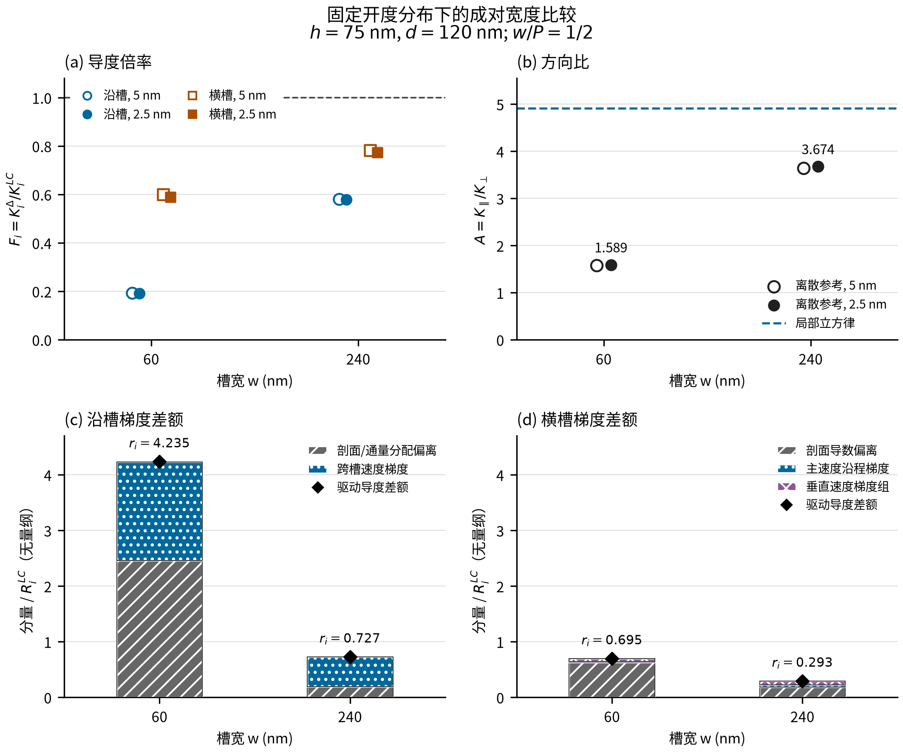

# 成对宽度图表与双语候选交付

2026-11-10，Asia/Shanghai。用户授权按上轮范围组织可审图表与双语候选。作者内部工作材料，尚未合入正式稿。无新仿真、拟合、交叉验证或原场再处理。

## 1. 可审入口

- 中文图：[PNG](width_evidence_CN.png)、[PDF](width_evidence_CN.pdf)、[SVG](width_evidence_CN.svg)。
- 英文图：[PNG](width_evidence_EN.png)、[PDF](width_evidence_EN.pdf)、[SVG](width_evidence_EN.svg)。
- [中文正文/补充/图注候选](CANDIDATE_CN.md)、[英文正文/补充/图注候选](CANDIDATE_EN.md)。
- [中文表W1—W4](TABLES_CN.md)、[英文表W1—W4](TABLES_EN.md)。
- 原精度数表：[导度与方向比](paired_evidence.csv)、[梯度分量及账差](mechanism_link.csv)、[八条运行来源](selected_records.csv)。

中英文图使用相同数据与编码。图W1、表W1—W4、式(CW1)—(CW3)仅为本目录工作标签，未占用正式稿编号。

## 2. 图表所表达的判断

图(a)给出F_i=K_i^Δ/K_i^LC，两档网格均显示窄槽沿槽所需修正明显大于横槽。图(b)显示开度分布相同并不意味着指定网格下的方向比相同：局部立方律两宽度均为4.90822，而2.5 nm结果分别为1.58922、3.67428。图(c)、(d)以相同0—4.7纵轴显示两方向的绝对归一化梯度差额，连接导度比较与既有S14诊断。

图中“绝对贡献”指分量除以各方向自身R_i^LC之后，未再除以正项和；它仍是无量纲量，不是有量纲阻力或独立因果贡献。两方向分组不同，虽然使用一致视觉语法，也不能把同色项解释成同一个独立物理原因。沿槽剖面项包含通量分配的改变。

堆叠柱为正项和S_i，菱形为驱动导度给出的r_i，未缩放到重合。可见差额很小不代表已严格闭合，符号和精确账差保留在表W3/W4。表W4的b_i=r_i−S_i与旧S14的S_i−r_i采用相反符号，候选已明确区分。

共同倍率最小剩余偏差放在表W2及补充候选，不作为主图新模型卖点：2.5 nm窄/宽为51.08%/14.38%，5 nm为51.31%/14.79%。它来自已有结果的代数诊断，不是h³/12物理下界，也不限制方向分别修正的V2。

## 3. 候选位置与范围

|建议位置|候选内容|与现稿关系|
|---|---|---|
|正文§4.3末|同开度分布的两宽度F及A对照、共同倍率不改变A|单列h75/d120组，明确区别于表7的h75/d100基准；原表7和式(5)不改|
|正文§5.1方向分组介绍之后|绝对归一化贡献、B与r/S/账差的联系|补充现有份额读数，不将分组升级成独立侧壁/尖角机制|
|补充S14末|F、B及辅助共同倍率诊断定义，全部网格和模板账差|沿用原分解及数字，不重推上下界；正式编号留待合稿|
|补充图表候选|图W1、表W1—W4、双语图注与替代文本|未新增正式图表号，不与原表S9十份目标末态混淆|

候选只回答“总体幅值能否同时修复两个方向、方向比差异与指定梯度结构如何对应”。保留已知开发/回顾性身份、两几何八方向记录的计数、面积归一及Ly随P变化；不扩大原18/36主统计、不排除h25、不重新标定V2。原窄槽网格FAIL、宽槽仅两档、连续精度未建立的限制明确保留。

本轮未增加首创性或文献排名声明，也未重新开展同条件已有解求解。当前[7]—[9]相关工作定位继续有效；候选不新增参考文献或改变全局引文号。

## 4. 实施与可复现性

[FIGURE_PLAN.md](FIGURE_PLAN.md)先固定图表编码、分母、选图范围和工作标签。[build_artifacts.py](build_artifacts.py)只读取上轮已核的三份小型数表，复制原字节并生成双语图与表，不读取原场。四图面板的全部绘图值、源SHA、软件版本、格式和输出SHA记录在[figure_manifest.json](figure_manifest.json)。

主图输出为180×150 mm，PNG为2125×1771像素、约300 dpi，PDF/SVG为矢量图；PDF字体已嵌入，SVG字形转为路径以便跨机器保持外观。目标期刊尚未指定，尺寸和格式是通用候选，不称已满足某刊要求。

显示复核中发现初版(a)的F=1参考线穿过图例，已改白底图例；英文(d)的长标签已换行。两张最终PNG和两张PDF渲染预览均已目视检查，未见缺字、图外截断或数据标签重叠。原始观察与修正属于图形呈现，不改任何数据。

[check_deliverables.py](check_deliverables.py)核对三份复制表原字节、中英文显示公式、数值小数项、表格数据、绘图数据、导出尺寸和字体、保护输入SHA。检查不是科学验收；不以其替代作者对主张和图的审定。候选润色保留了上轮数字、公式含义、单位、来源和限定语，删除了卖点式措辞；未增加“首次”“普适”“唯一机制”或盲测身份。

## 5. 完成状态与接续

本轮可审图表与双语候选已完成，均保存在本目录。正式中英文正文、双语补充、现有MANIFEST、结论文件、原分析报告与数表未改；17项保护输入前后SHA一致，原32份小型来源文件保持既有绑定。A决策、v3文献合入与14条引文状态保持。

项目状态与最新便携交接已同步。当前停点是候选待作者审阅；若接续合稿，可按上述三处定点衔接、分配正式图表/公式编号并核对双语与MANIFEST，无需为本组图表新增仿真。完整逐部分方法审读并未因局部候选完成而自动结束。

无新run_id、编译/求解、重拟合/CV、原场求导、保留预测结果读取或新Gate，无提交推送/投稿。S4/D4历史FAIL、reference_qualified=false、strict_error_bound_established=false、submission_ready=false保持；无新增长算授权或需用户启动的命令。

流程采用scientific-writing、scientific-visualization和academic-humanizer，服务于作者辅助写作与检查。流程出处：Kassis, T., Agarwal, V., He, Y., Patel, D., & Brueckner, A. M. (2026). *Scientific Agent Skills: A Library of Procedural Knowledge for Research Agents*. [doi:10.48550/arXiv.2609.00065](https://doi.org/10.48550/arXiv.2609.00065)，本会话2026-11-10已核公开记录为v2。该引用仅写入本工作报告，不加入论文物理书目、不作为CFD证据。
