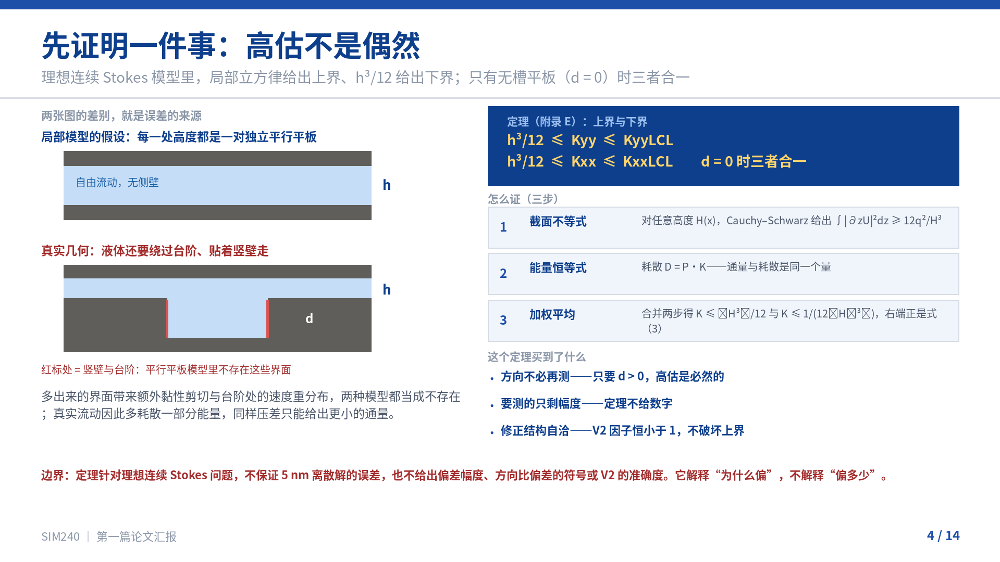
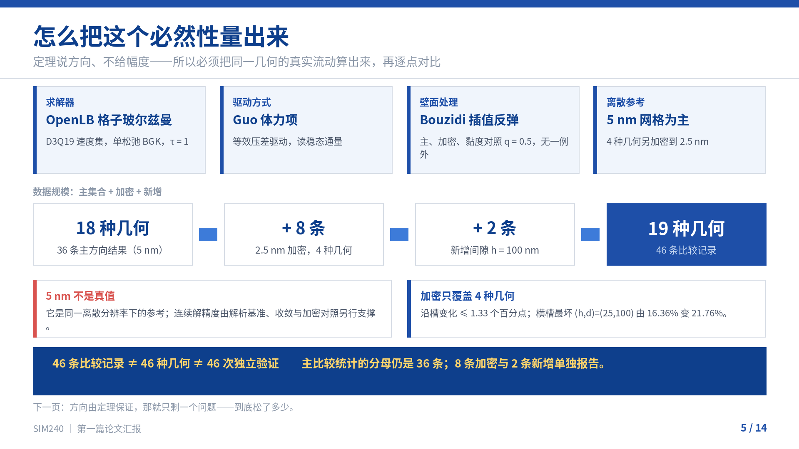
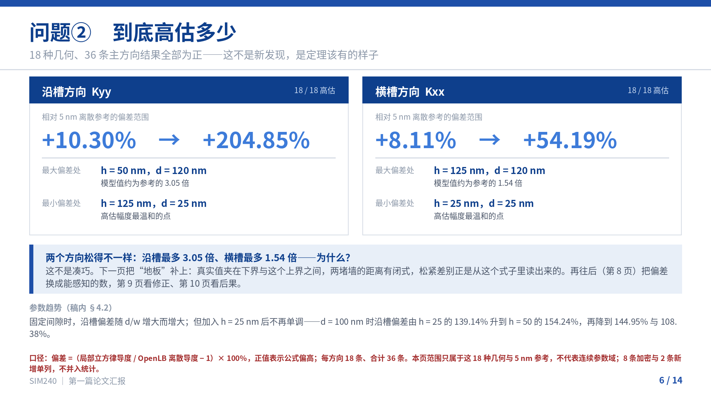
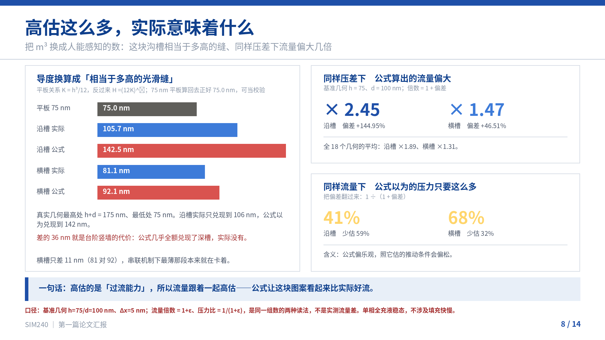
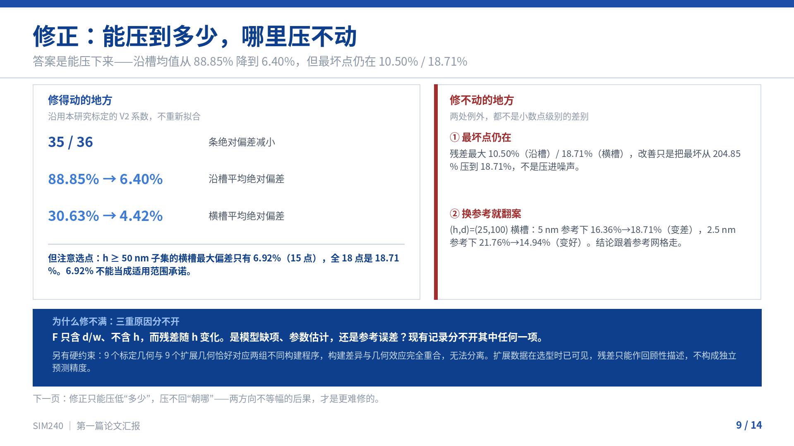
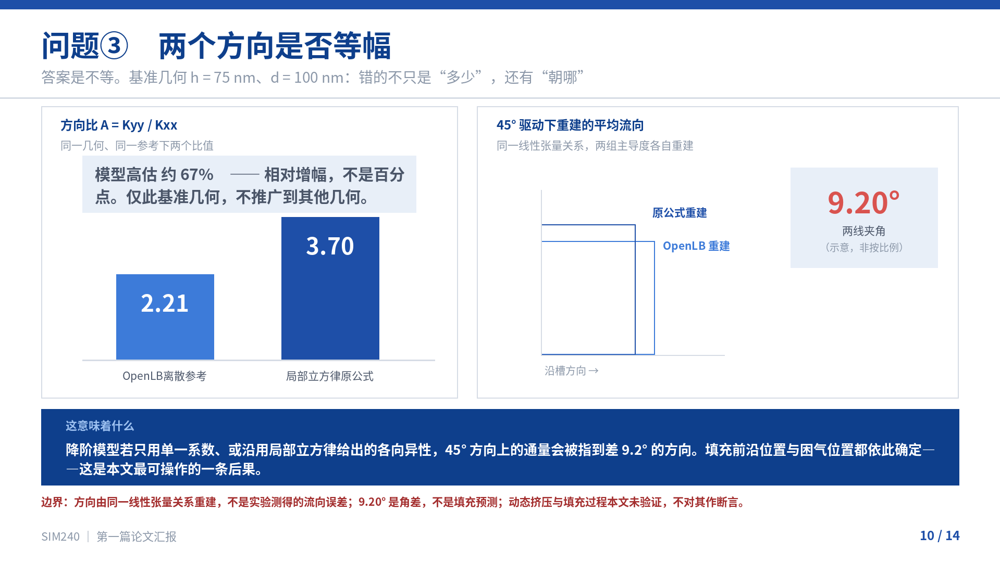
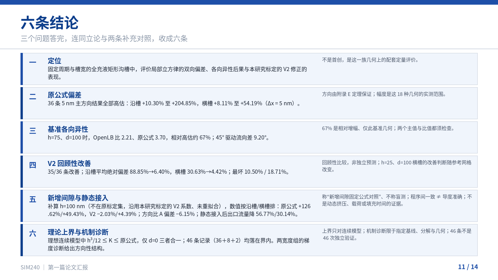
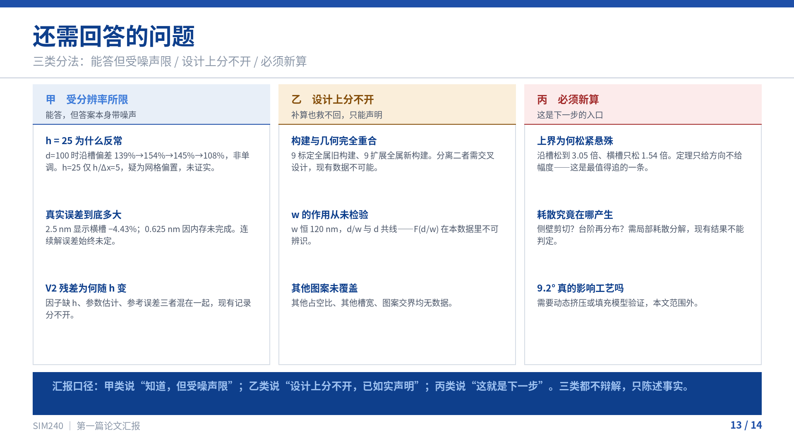
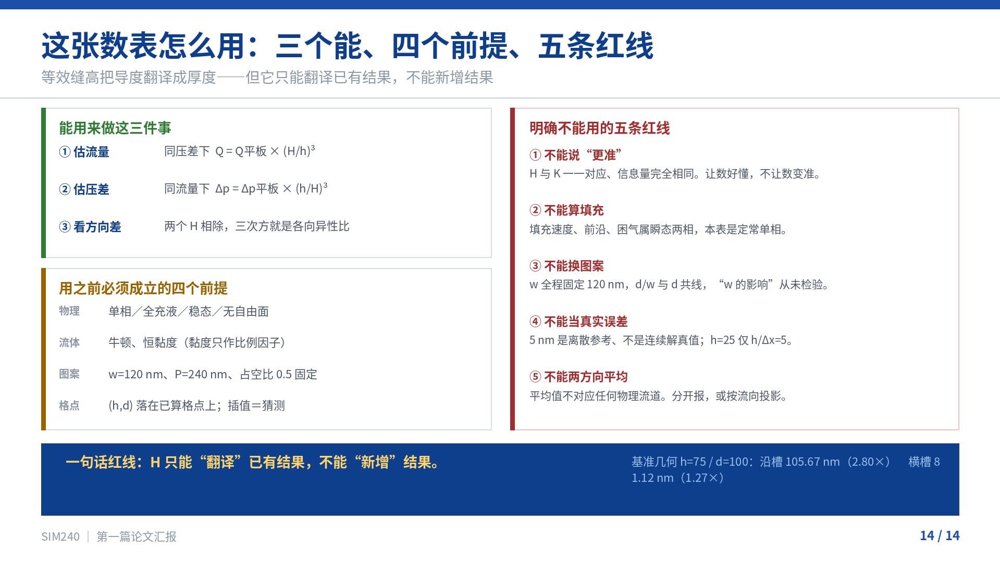

# 第一篇论文汇报：14页图文预览

[下载 PowerPoint](论文汇报.pptx) · [HTML 伴读文件](PPT全文_14页.html) · [第一篇图件入口](../PAPER1_GITHUB_ASSETS_20261112/README.md)

本页可在 GitHub 直接阅读。HTML 文件在 GitHub 文件页通常显示源码；下载后在浏览器打开，并保持 `preview/` 文件夹与它处于同一目录。也可下载整个仓库 ZIP 后打开。

以下图片按实际幻灯片页码排列，不按生成脚本的函数名编号。第2、9、11页预览已从现有PPT重新生成，以同步“本研究标定”的措辞；PPT和HTML正文原文件均未修改。图片沿用项目现有轻量预览程序，完整展示以下载的PPT为准。

## 第1页：封面

## 第2页：研究问题与对象

## 第3页：这个公式是怎么来的

## 第4页：先证明一件事：高估不是偶然

## 第5页：怎么把这个必然性量出来

## 第6页：问题②　到底高估多少

## 第7页：地板在哪里：真实值夹在两堵墙之间

## 第8页：高估这么多，实际意味着什么

## 第9页：修正：能压到多少，哪里压不动

## 第10页：问题③　两个方向是否等幅

## 第11页：六条结论

## 第12页：四条边界：六条结论各自能说到哪一步

## 第13页：还需回答的问题

## 第14页：这张数表怎么用：三个能、四个前提、五条红线

