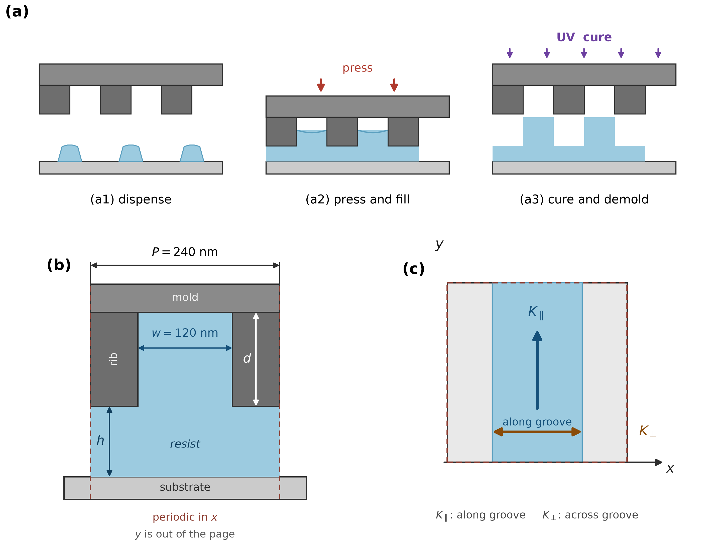
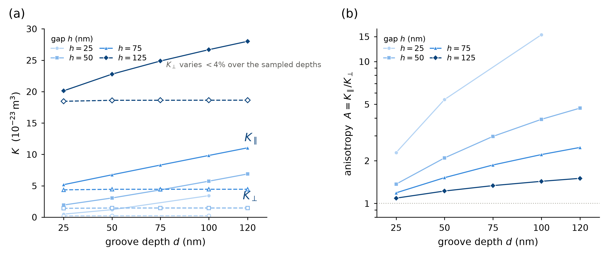
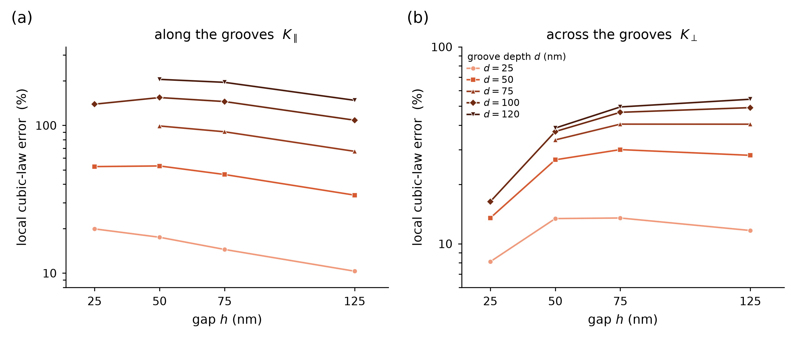
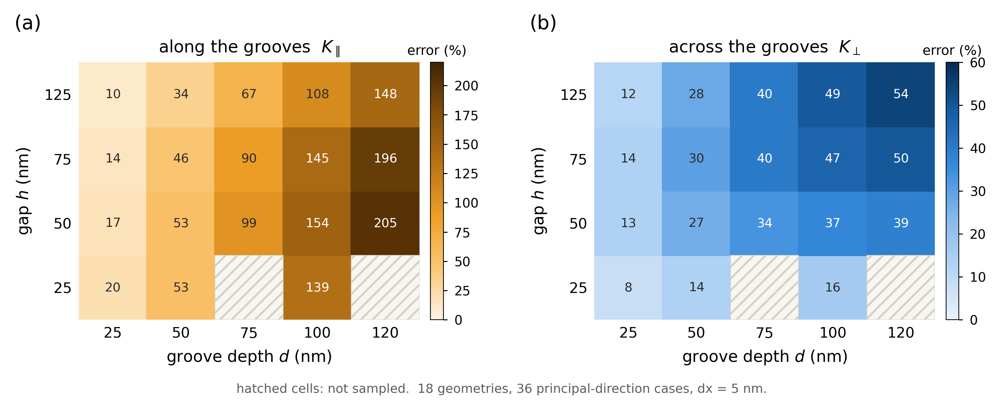

# Directional conductance discrepancies of the local cubic law in confined rectangular grooves and empirical correction

**Author-review working manuscript; synchronized on 2026-11-13.** Targeted source checks are integrated into the related-work discussion, citation scopes and contribution wording, without new numerical results. WO-1–WO-3 clarify single-variable V2 residuals, the calibration set and the one-geometry cross-build comparison; the sign change is bracketed between 75 and 100 nm and discretization remains unresolved. The 2026-11-10 integration is retained: Per the approved scope, the paired-width conductance multipliers, direction ratios and absolute gradient deficits are integrated at the end of §4.3, after the existing grouping in §5.1 and at the end of Supplement S14, adding Supplementary Figure S1, Tables S10–S13 and Eqs. (S14.3)–(S14.5). The bounded gradient-structure diagnostic for the supplementary two-width set remains integrated with Supplementary S14. Existing main-map discrepancies, continuous upper bounds, V2 assessment and static interfacing retain their respective evidence scopes. Pre-merge snapshots and differences are in `PAPER1_width_evidence_merge_20261110/`. Existing runs and offline diagnostics are used without new solver runs or fitting. Whole-manuscript scientific approval, venue formatting, declarations and access arrangements remain pending.

## Abstract

The local cubic law is commonly used in reduced nanoimprint models, but its along- and across-groove conductances require separate assessment. Using the lattice Boltzmann method, we compute steady transport between a planar substrate and a periodically grooved wall, assuming a fixed gap, a fully filled Newtonian liquid domain and no-slip walls. The main parameter map has a period of 240 nm, with equal groove and rib widths. The main dataset comprises 18 geometries and 36 principal-direction conductances on a 5 nm grid; four geometries also have 2.5 nm refinements to assess grid sensitivity.

Relative to the 5 nm discrete references, the local cubic law overestimates all main principal-direction results, with maximum relative discrepancies of +204.85% along and +54.19% across the grooves. At the reference geometry h=75 nm, d=100 nm, anisotropy ratios from the original law and the discrete reference are 3.70 and 2.21, respectively. Reconstructing mean flux directions under the same linear tensor relation for forcing at 45° to the groove axis gives a difference of 9.20°. Retrospective evaluation of the empirical correction calibrated here on nine geometries (V2) reduces the maximum absolute relative discrepancies to 10.50% along and 18.71% across the grooves, although the improvement assessment at one thin-gap transverse point changes with reference grid. A comparison in both directions at one additional gap also reduces absolute relative discrepancy with V2 coefficients unchanged.

Theoretical analysis establishes local-cubic-law upper bounds on both continuous principal conductances in the stated periodic Stokes model, without determining discrepancy magnitudes or V2 accuracy. Quantitative results concern the sampled geometries and specified discrete references, without establishing continuous-domain or real-imprint accuracy guarantees. The findings support assessing both principal conductances, their ratio and reference sensitivity together in such reduced models.

**Keywords:** nanoimprint lithography; rectangular grooves; anisotropic transport; lattice Boltzmann method; local cubic law; model discrepancy

---

## 1 Introduction

### 1.1 Motivation

During nanoimprinting, liquid redistributes between a substrate and a patterned mold. Resolving every groove over a large imprint field is impractical. Engineering models therefore use effective transport coefficients, replacing a patterned region with an equivalent uniform gap that carries the same flow under the same pressure difference.

For parallel grooves, a common construction is the local cubic law. Each local height is treated as an independent parallel-plate channel with conductance $h^3/12$; deep and shallow regions are combined by an arithmetic average along the grooves and a harmonic average across them. This construction requires only geometry and no fitted parameters.

The construction does not explicitly resolve transverse velocity coupling near sidewalls or flow through the connections between deep and shallow regions. Its overall transport accuracy requires direct assessment when groove depth is comparable to groove width and a connected liquid layer remains beneath the ribs.

### 1.2 Relation to previous work

Effective transport coefficients for unresolved patterns are established in imprint modeling. Jain et al. used anisotropic transport for flow beneath patterned templates, and subsequent models retained this treatment [1–3]. The average-flow model of Patir and Cheng provides a flow-factor framework whose stripe averages are among the relations examined here [4].

Effective transport tensors in confined grooves have also been studied analytically and numerically. Dewangan and Datta combined spectral analysis with domain perturbation to obtain tensor relations under a small pattern-size-to-period expansion and evaluate representative topographies [5]. The same authors studied along-groove flow between a sinusoidal wall and a planar wall. Their full spectral method does not assume small amplitude; separate asymptotic approximations have their own limiting conditions [6]. Groove-induced transport anisotropy is therefore not itself a new finding.

Semi-analytical studies of directional flow in rectangular grooves are available. Ng [7] used domain decomposition and eigenfunction matching to solve no-slip pressure-driven Stokes flow between two rectangular-grooved walls, examining pattern phase shifts and wall spacing. This differs from the present flat-wall/grooved-wall problem; the mid-plane of his symmetric configuration cannot replace the present no-slip plate. Moreover, his longitudinal effective slip length uses only the clear-layer flux between the wall envelopes, explicitly excluding cavity flux, so the slip length alone does not provide the present conductance integrated over all fluid.

The pressure-loss study of Mohammadi and Floryan [8] uses a Fourier framework for the two wall shapes, permits a planar wall, and includes rectangular grooves in tests of geometry reduction. Rectangular shape alone therefore cannot exclude that study. Detailed parameter results mainly concern small-amplitude sinusoidal grooves and distinguish changes in mean wall position from geometry-induced flow modulation. The leading-mode approximation, the full numerical solution and the displayed parameter range must be distinguished. A matched comparison at the present rectangular geometry, low-inertia conditions, reference scales and flux definition has not been established here; these results are not adopted directly as a pointwise accuracy benchmark.

Stroock et al. [9] analyzed pressure-driven Stokes flow between a flat wall and a sinusoidally modulated wall of small amplitude, describing anisotropic effective boundary conditions and transverse flow induced by oblique grooves, with an experimental check. Directional response, wall-confinement effects and anisotropy-induced flow deflection are therefore not presented as new findings here. Our assessment remains limited to local-cubic-law discrepancies and their consequences for a specified rectangular family, supplemented by a gradient-structure diagnostic under a defined decomposition on a separate set. Differences in geometry or grouping alone do not establish priority.

Wilkening [10] derived truncation-error estimates for lubrication expansions with smooth height functions in two-dimensional periodic domains; ideal rectangular steps do not satisfy the stated regularity assumptions. Dennis and Fai [11] found Reynolds-model pressure-drop underestimation for stationary-wall, fixed-flux two-dimensional steps, corresponding to conductance overestimation under linear pressure driving. This is relevant prior evidence of model discrepancy, rather than the present periodic-groove map of both principal conductances. The difference in regularity assumptions does not establish priority.

Differences between averaging methods must also be separated from local-lubrication discrepancies relative to Stokes flow. Rom et al. [12] compared the Patir–Cheng average-flow model and homogenization against a finely resolved Reynolds solution: coupling in nonsymmetric textures and local pressure reconstruction affect the results, while symmetric textures can give the same averaged pressure. Bayada and Chambat [13] showed that relative film-thickness and roughness-period scales affect the limiting model; Fourt and Arghir [14] compare homogenization and multiscale methods for compressible Reynolds problems. These averaging results do not directly establish the accuracy of the present finite-gap Stokes conductances.

The compared problems and coefficient definitions differ. Jain et al. [1] use anisotropic transport in a patterned-template process model; here the comparison is restricted to fixed, fully filled cells. Patir–Cheng [4, p. 15, Eqs. (23)–(24)] gives harmonic and arithmetic flow-factor averages within a local Reynolds model; the reference-height normalization must be restored before comparison with the present conductance in m³. Dewangan–Datta [5, §4.2] already reported inaccurate longitudinal arithmetic and transverse harmonic predictions under the conditions they studied, without displaying those results. Its §4 also identifies a divergent spectral sum for a square-wave profile, so the affected expansions are not a matched solution for the present rectangular steps. Related rectangular-groove eigenfunction matching and effective-slip analysis exists [15], but its full text was not obtained in this check, and a direct correspondence to the present finite gap and total-fluid flux definition has not been established. Our contribution is a paired assessment of directional discrepancies, anisotropy consequences and the performance of the empirical correction calibrated here for this rectangular family, without claiming the first observation of directional-average failure or sidewall effects. Source-check scopes are given in Supplementary S11.

We compare the magnitudes and directional differences of local-cubic-law discrepancies against explicitly resolved numerical principal values, and examine the remaining residuals of an empirical correction. The ideal-Stokes upper bounds are established separately in Appendix E. Positive discrepancy alone is not treated as sufficient evidence of novelty. The comparison uses 5 nm discrete references and informs assessment of a reduced model; it does not establish process-prediction accuracy.

### 1.3 Scope of this study

We compare both principal conductances of fully filled rectangular grooves against the local cubic law, quantify consequences for anisotropy and tensor-reconstructed flow direction, and calibrate a two-direction multiplicative empirical correction, V2, whose factors depend on $d/w$, on nine geometries. Its improvement and limitations are evaluated retrospectively against the same discrete references. Ideal-Stokes upper bounds provide theoretical context; discrepancy magnitudes and grid sensitivity are reported separately. Theoretical constraints, discrepancy quantification on specified grids and retrospective V2 performance have distinct evidential support and do not certify one another. Local checks against a separate implementation do not qualify references across the full map.

For rectangular grooves of fixed period and width, we apply along-groove and across-groove forcing separately. The principal values obtained on a 5 nm grid serve as discrete references for the local cubic law under common geometry, flux definitions and fluid properties. We retrospectively evaluate the V2 correction. Refinements at four geometries characterize reference sensitivity, rather than certifying continuous-solution accuracy across the map. A gradient-energy diagnostic on known development geometries at two groove widths provides a bounded quantitative interpretation of directional discrepancies under the tested conditions; see Section 5.1 and Supplementary S14.

The study concerns fixed gaps, fully filled Newtonian liquid and no-slip walls. **Free surfaces, wetting, trapped gas, real-resist rheology and moving molds are outside its scope.** These require separate models and evidence.

---

## 2 Configuration and comparison methods

### 2.1 Geometry and calculation conditions

The computational domain is one unit cell of periodic straight grooves. The pattern repeats in $x$, and the grooves extend along $y$. Along-groove transport is denoted by $\parallel$, corresponding to $K_{yy}$; across-groove transport is denoted by $\perp$, corresponding to $K_{xx}$.

The main parameter map uses period $P=240$ nm and groove width $w=120$ nm, with equal groove and rib widths. The rib-to-substrate residual gap is $h$, and the groove roof is at height $h+d$, where $d$ is the groove depth. Liquid fills the entire available volume.

**Figure 1.** Imprint-process context and computational unit-cell geometry. (a) Process stages: drop dispensing, pressing and filling, then curing and demolding. (b) Unit-cell cross-section, with groove width $w$, depth $d$, gap $h$ and period $P$; the computational domain is fully filled and has no free surface. (c) Plan view and coordinates: grooves extend along $y$, so $K_{yy}$ is along-groove and $K_{xx}$ is across-groove conductance.

Table 1 lists the sampled matrix. **The parameter combinations do not form a complete matrix:** at $h=25$ nm, only $d=25$, $50$ and $100$ nm were computed; $d=75$ and $120$ nm were not.

> Here, coverage refers to sampling of parameter combinations, not the 5 nm computational grid.

**Table 1. Sampled geometries and principal-direction samples.**

| Gap $h$ (nm) | Computed depth $d$ (nm) | Geometries | Principal-direction samples |
|---|---|---:|---:|
| 25 | 25, 50, 100 | 3 | 6 |
| 50 | 25, 50, 75, 100, 120 | 5 | 10 |
| 75 | 25, 50, 75, 100, 120 | 5 | 10 |
| 125 | 25, 50, 75, 100, 120 | 5 | 10 |
| **Total** | — | **18** | **36** |

**Note:** For all geometries listed, the groove width $w=120$ nm, the period $P=240$ nm and equal groove/rib widths (area fraction 0.5) are fixed; only the gap $h$ and the depth $d$ vary. This table lists only the 18 main comparison geometries and their 36 principal-direction results on the 5 nm grid, one per direction at each geometry. The 2.5 nm refinements, the added h=100 nm geometry and other controls are excluded. Unsampled combinations, other groove widths, periods and area fractions are outside this table's coverage.

Calculations use the OpenLB [16] D3Q19 velocity set and a body-force-corrected single-relaxation-time BGK model with $\tau=1$. The force term uses the Guo scheme [17]. Solid walls use Bouzidi–Firdaouss–Lallemand interpolated bounce-back, with intersections obtained from the analytical geometry [16,18]. The scheme was formulated for fractional wall distances [18]; OpenLB also maintains implementation checks through analytical benchmarks and automated regression tests [16].

For the main map, the in-plane dimensions are $L_x=L_y=240$ nm, exactly one pattern period. Boundaries are periodic in $x$ and $y$, with no slip at the substrate and mold. A uniform volume force is imposed with acceleration $a=1\times10^{5}$ m s⁻². The same amplitude is used throughout the main map; the reference-geometry check is described in §2.4. OpenLB `computeU` supplies the macroscopic velocity, including the half-time-step force correction consistent with the Guo scheme. The stopping rule uses a 1000-step flux window: main-flux relative standard deviation $\le10^{-6}$, relative range $\le5\times10^{-6}$, and, for principal-axis forcing, absolute cross-flux $\le10^{-12}$ m²/s. Its scope as a stopping rule, rather than an independent acceptance metric, is discussed in §3.1. Saved manifests contain binary hashes; parameters, results and logs are indexed in [Supplementary Table S1](SIM240_Supplementary_Methods_20261024/SUPPLEMENTARY_METHODS_EN_20261028.md#table-s1). Binding to historical application source, compiler configuration and OpenLB dependencies remains incomplete for some runs; this provenance limitation is retained in [S10](SIM240_Supplementary_Methods_20261024/SUPPLEMENTARY_METHODS_EN_20261028.md#sm-s10).

V2 was calibrated only on the discrete set $h\in\{50,75,125\}$ nm × $d\in\{25,50,100\}$ nm (nine geometries, $w=120$ nm, 5 nm grid, binary identity 285f67a0…), separately minimizing the maximum absolute relative residual in each direction. This set establishes neither a continuous accuracy domain nor quantitative extrapolation across $h$. The $h=100$, $d=100$ nm point is outside the nine-point set but lies between the 75 and 125 nm gap levels, at the already calibrated depth of 100 nm on the upper depth boundary of the calibration rectangle; this parameter-space interpolation does not guarantee accuracy.

**The unit-cell reduction assumes an exactly repeating pattern.** One period represents the interior of the ideal periodic pattern and reduces the computational domain. This assumption does not cover mold edges, pattern junctions or actual supply conditions; those configurations have not been verified here.

**Physical viscosity is specified first; physical properties and discretization together determine the time step.** With $\tau=1$, the lattice kinematic viscosity is

$$
\nu^*=c_s^2\left(\tau-\tfrac12\right)=\frac{1}{3}\cdot\frac{1}{2}=\frac{1}{6}.
$$

For physical kinematic viscosity $\nu=1.0\times10^{-6}$ m²/s and spacing $\Delta x=5$ nm, the time step is uniquely determined by

$$
\Delta t=\frac{\left(\tau-\tfrac12\right)\Delta x^{2}}{3\nu}=4.1667\times10^{-12}\ \mathrm{s}
\tag{1}
$$

Taking $\rho=1000$ kg m⁻³ then gives dynamic viscosity $\mu=\rho\nu=1.0\times10^{-3}$ Pa·s.

Density and physical kinematic viscosity are specified first, giving dynamic viscosity through $\mu=\rho\nu$. At those properties, $\tau=1$ and $\Delta x=5$ nm are selected, and Eq. (1) determines the time step. On refinement, the time step follows Eq. (1) to preserve physical viscosity and relaxation parameter. No $\tau$ sensitivity sweep was performed, so relaxation-parameter independence is not claimed.

The main map uses $\Delta x=5$ nm. The smallest gap, $h=25$ nm, has $h/\Delta x=5$, requiring particular attention to resolution. Refining $(h,d)=(25,100)$ nm to 2.5 nm changes the along-groove and across-groove coefficients by approximately −0.386% and −4.431%, normalized by the 5 nm values. We therefore retain 5 nm results as references at a specified discrete resolution and report thin-gap refinement sensitivity separately. Two grids neither determine observed convergence order nor establish grid independence of the full map (§3.3).

Fractional wall distances are determined analytically and checked individually. All 46 records in the legacy boundary-audit set (36 main-map, 8 refinement and 2 viscosity checks, excluding the added h=100 nm cases) satisfy $q_{\min}=q_{\max}=0.5$ within tolerance $10^{-10}$. Wall intersections therefore lie at the midpoints of neighboring-node links, so the Bouzidi rule reduces to its half-way case. This geometry-consistency check alone does not establish zero boundary error. The flat-wall convergence in Section 3 reflects the combined discretization and flux-extraction error; it does not separate those sources or establish accuracy at arbitrary fractional wall distances.

Maximum Mach numbers range from $5.7\times10^{-10}$ to $4.1\times10^{-7}$, about five orders of magnitude below the 0.05 compressibility criterion, placing the flow in an effectively incompressible regime.

Two additional viscosity checks use $\mu=15$ mPa·s and are recorded separately from the main-map properties. The D2/D3 inventory contains 52 runs: 36 principal-direction samples, 8 refinements, 2 viscosity checks and 6 oblique-forcing runs ([S1 and Table S1](SIM240_Supplementary_Methods_20261024/SUPPLEMENTARY_METHODS_EN_20261028.md#sm-s1)). **Run count is not geometry count.** Periodic-replication and multi-force checks are in [S8](SIM240_Supplementary_Methods_20261024/SUPPLEMENTARY_METHODS_EN_20261028.md#sm-s8); historical flat-wall and three-grid benchmarks are in [S9](SIM240_Supplementary_Methods_20261024/SUPPLEMENTARY_METHODS_EN_20261028.md#sm-s9). These are not part of the 52-run inventory. Historical-build provenance is discussed in [S10](SIM240_Supplementary_Methods_20261024/SUPPLEMENTARY_METHODS_EN_20261028.md#sm-s10).

The datasets have distinct roles; records reused across checks must not be counted as independent geometries:

| Dataset | Composition | Role |
|---|---|---|
| Main comparison | 18 geometries, 36 principal-direction results at 5 nm | Main local-law and V2 statistics |
| Refinements | 8 results at 2.5 nm for 4 of those geometries | Reference sensitivity, reported separately |
| Additional gap | 2 results at 5 nm for h=100 nm, d=100 nm | Fixed-form supplementary comparison |
| Build reproduction | 2 new records for h=75 nm, d=100 nm, paired with historical records | Single-geometry reproduction, not added comparison geometries |
| Legacy additional checks | 2 viscosity and 6 oblique results | Property response and internal tensor consistency |
| Supplementary gradient diagnostic | 10 target final states for two h75/d120 geometries at w60/240, plus 2 flat-channel controls | Known development set; reported separately in S14 and excluded from main statistics |

The main-map and additional-gap formula-comparison set contains 19 geometries and 46 discrete records (36+8+2), distinct from the 46-record legacy boundary-audit set (36+8+2 viscosity checks). The 46 records are neither 46 geometries nor 46 independent validations; the statistical denominator for the original 36 main records is unchanged. The original 52-row Table S1 is retained; added and build-comparison records are indexed in Supplementary Table S6.

To examine the velocity-gradient structure associated with the directional discrepancies, we additionally use two geometries from a known development set at $h=75$ nm and $d=120$ nm, with equal groove and ridge widths. The groove widths are $w=60$ and 240 nm, corresponding to physical periods $P=120$ and 480 nm. Along- and across-groove final states are available at grid spacings of 5 and 2.5 nm for both geometries, with additional 1.25 nm states for the narrow groove, giving ten target fields. Two existing directional flat-channel states at $h=75$ nm and a 5 nm grid provide postprocessing controls. This supplementary set is reported separately from the error statistics for the 18 geometries and 36 principal-direction conductances and is not treated as a prediction test on conditions withheld from development.

Supporting methods are numbered S1–S14. The [supplementary index](SIM240_Supplementary_Methods_20261024/SUPPLEMENTARY_METHODS_EN_20261028.md#sm-index) and the source manuscript Appendix B map text locations to supporting tables.

### 2.2 Definition of the transport coefficients

Let $A_{\rm plan}$ be the unit-cell plan area and $\Omega$ the fluid region. The depth-integrated flux and coefficient in the forcing direction are

$$
J_i=\frac{1}{A_{\rm plan}}\int_\Omega u_i\,\mathrm dV,
\qquad
K_i=\frac{\mu J_i}{G_i},
\qquad G_i=\rho a_i
\tag{2}
$$

Eq. (2) is evaluated in three steps, which establish the units.

First, integrate the driven velocity component over the fluid region $\Omega$ to obtain $\int_\Omega u_i\,\mathrm dV$. Second, divide by plan area $A_{\rm plan}$, obtaining flux $J_i$ per unit plan area, in **m²/s**. Third, multiply by dynamic viscosity $\mu$ and divide by equivalent driving gradient $G_i=\rho a_i$, obtaining coefficient $K_i$ in **m³**.

Here, $K_i$ is a **depth-integrated conductance**, rather than permeability. Under linear transport at the same viscosity and forcing, larger $K_i$ means greater flow capacity.

Conversion between the two definitions requires consistent mean-velocity and reference-height conventions:

$$
J_i=H_{\rm ref}\langle u_i\rangle_\Omega,
\qquad
K_i=H_{\rm ref}\,\kappa_i,
\qquad
H_{\rm ref}=h+d/2,
$$

Here, $\langle u_i\rangle_\Omega$ is the fluid-volume-averaged velocity and $\kappa_i$ is conventional permeability in m². **All comparisons here use $K_i$** to avoid additional differences from reference sections. Literature comparisons or conversions to m² must check the other study’s height definition.

Here, $H_{\rm ref}=V_f/A_{\rm plan}=h+d/2$ is the geometric mean aperture for equal groove and ridge widths, used to convert between mean velocity, depth-integrated flux and $\kappa$; it differs from an equivalent smooth-channel opening defined by matching hydraulic resistance, such as $EC_h$ in Mohammadi and Floryan [8], Section 4.4.2.

### 2.3 Local cubic law and discrepancy definitions

For equal-width stripes, the local cubic law gives

$$
K_{yy}^{\rm mod}=\frac{1}{24}\left[(h+d)^3+h^3\right],
\qquad
K_{xx}^{\rm mod}=\frac{1}{6}\,\frac{(h+d)^3\,h^3}{(h+d)^3+h^3}.
\tag{3}
$$

To construct it, define the shallow- and deep-region parallel-plate conductances as

$$
k_{\rm shallow}=\frac{h^{3}}{12},
\qquad
k_{\rm deep}=\frac{(h+d)^{3}}{12} .
$$

For equal widths, their arithmetic average along the grooves and harmonic average across them give Eq. (3). This combination is already used in reduced-order nanoimprint models [1], where the mean height and the two directional effective permeabilities of a striped template are given by the same arithmetic/harmonic combination. At $d=0$, both recover the parallel-plate value $h^{3}/12$. With common local heights, boundaries and averaging definitions, these are the one-dimensional Reynolds cell relations [4].

The local model treats the deep and shallow regions as parallel plates and combines their conductances. The resolved groove also contains sidewalls and connections between these regions. Transverse viscous coupling and flow redistribution near the steps are not explicitly resolved by the local-plate construction. Section 5.1 uses a global gradient-energy decomposition on the separately reported two-width set to examine resistance in excess of this baseline. The decomposition does not treat sidewall and step effects as independently measurable causes.

Under the ideal-Stokes assumptions in Appendix E, Eq. (3) bounds both principal conductances from above. This property supplies neither discrepancy magnitudes nor the spatial-accuracy evidence required for the groove-flow references. Discrepancy magnitudes are therefore reported against specified discrete references. The supplementary decomposition quantifies gradient terms grouped under explicit definitions; it does not establish that a spatial region or an independent mechanism controls the entire main parameter map.

Retaining dimensionless notation, define the original-law discrepancy and the signed corrected discrepancy by

$$
E_i=\frac{K_i^{\rm mod}}{K_i^{\rm ref}}-1,
\qquad
r_i=\frac{F_iK_i^{\rm mod}}{K_i^{\rm ref}}-1,
\tag{4}
$$

Here, $K_i^{\rm ref}$ is the discrete **numerical reference** for the same geometry, direction and grid, and $F_i$ is a multiplicative correction. **Positive values indicate overestimation; negative values indicate underestimation.** Reference reliability, including grid, stopping rules and implementation, is examined separately in Section 3. Equation (4) gives discrepancies relative to that numerical reference, rather than total errors relative to physical reality.

Formula discrepancies are reported as percentages, with the reference grid explicit:

$$
\varepsilon_i(\Delta x)=\left(\frac{K_i^{\rm formula}}{K_{i,\Delta x}^{\rm OpenLB}}-1\right)\times100\%.
$$

Here, $K_i^{\rm formula}$ is the conductance from either the original law or fixed V2. The denominator is the OpenLB discrete value for the same geometry and direction at spacing $\Delta x$. The quantities $E_i$ and $r_i$ in Eq. (4) remain dimensionless ratios; table entries display the percentage discrepancies defined above. Main comparisons use 5 nm references, whereas refinement comparisons use 2.5 nm references and are reported separately.

**Reference-grid dependence must be specified.** Equation (4) uses $E_i$ with denominator $K_i^{\rm ref}$, which contains discretization error. Changing the reference grid can therefore change the reported discrepancy at the same geometry. For four geometries with two grids, this effect is:

**Table 2. Sensitivity of model discrepancy to the reference grid.**

| Geometry $(h,d)$ (nm) | Direction | $E$ (5 nm reference) | $E$ (2.5 nm reference) | Change (percentage points) |
|---|---|---:|---:|---:|
| (25, 100) | Along | 139.14% | 140.07% | +0.93 |
| (25, 100) | Across | 16.36% | **21.76%** | **+5.39** |
| (50, 100) | Along | 154.24% | 155.57% | +1.33 |
| (50, 100) | Across | 37.14% | 40.10% | +2.96 |
| (125, 25) | Along | 10.30% | 10.67% | +0.37 |
| (125, 25) | Across | 11.68% | 12.48% | +0.80 |
| (125, 120) | Along | 147.77% | 148.78% | +1.01 |
| (125, 120) | Across | 54.19% | 55.46% | +1.27 |

> **Note:** the three-grid historical reference geometry (75,100) is discussed in Section 3 and is not included here.

Unrounded values and change definitions for Table 2 are in [S7 and Table S2](SIM240_Supplementary_Methods_20261024/SUPPLEMENTARY_METHODS_EN_20261028.md#table-s2).

The largest change is in the across-groove component at $(h,d)=(25,100)$: from 16.36% to 21.76%, a difference of 5.39 percentage points, or 33% relative change. It occurs at the thinnest gap. Among these four checked geometries, the along-groove discrepancy changes less with reference grid (≤1.33 percentage points). This observation is not extended to unrefined geometries.

The model-discrepancy ranges for the 36 main principal-direction records at 18 geometries use the 5 nm OpenLB results as discrete references. Refinement comparisons use the reference grid specified for each comparison; flat-wall benchmark errors use the analytical values as references. For the four two-grid geometries, reference-grid changes alter model discrepancies by 0.37–5.39 percentage points. This describes sensitivity at the checked conditions, rather than a discretization-error bound or uncertainty estimate. It does not establish comparable sensitivity for the other 14 geometries.

### 2.4 Numerical implementation consistency

Unit-cell periodicity and linear response are prerequisites for the subsequent comparison. We check them separately from model discrepancy.

**Invariance under transverse periodic replication.** The reference geometry $(h,d)=(75,100)$ nm is replicated along $x$ to $N_x=2$, 4 and 8 periods ($N_y=1$). Hydraulic resistance $R$ is compared at common properties, grid and forcing. Both principal directions and all three forcing levels ($5\times10^4$, $1\times10^5$ and $2\times10^5$ m s⁻²) meet the preset gates. Relative resistance differences are **0, identical to recorded precision**, for both directions from $2\to4$ periods; from $4\to8$ periods, they are $8.7\times10^{-14}$ along and $3.8\times10^{-14}$ across the grooves.

**This check has a limited interpretation.** With periodic boundaries and a periodic volume force, a solution over $N_x$ identical periods is a replication of the single-period solution by construction; resistance is mathematically independent of $N_x$. The check therefore tests **periodic-seam implementation and mass auditing in the enlarged domain**. It is not evidence of physical representative-volume convergence. A sufficient numerical unit cell here does not establish that a 240 nm cell represents a real device.

**Linearity with forcing.** The same cases give common coefficients over three forcing levels spanning a factor of four, with maximum relative differences $3.7\times10^{-8}$ ($2.5\times10^{-8}$ along and $3.7\times10^{-8}$ across the grooves). This supports linear response for the reference geometry $(h,d)=(75,100)$ nm on the 2.5 nm grid over the checked force range. Multi-force tests were not performed at all 36 main-map samples on the 5 nm grid; force independence is not claimed to have been verified sample by sample. See [S8 and Table S3](SIM240_Supplementary_Methods_20261024/SUPPLEMENTARY_METHODS_EN_20261028.md#table-s3).

**Cross-check with the main-map reference.** At $N_x=2$, 2.5 nm spacing and $1\times10^5$ m s⁻², the result is $K_{yy}=9.7824236970\times10^{-23}$ m³, agreeing with the archived three-grid baseline at 2.5 nm to relative difference $6.9\times10^{-14}$. This supports agreement between batches at that point, rather than common provenance for every condition.

**Terminology.** We report **numerical verification** of consistency between the implementation, computed solutions and prescribed equations, including analytical benchmarks, grid sensitivity and periodic consistency. Each check has its own coverage and limits. An independent-solver comparison of resolved grooves would be a numerical cross-check; no such matched comparison has been completed. Independent implementations of the same static averaged model are compared in §5.3, which tests coefficient interfacing rather than resolved-groove accuracy. **Physical validation is outside this study:** the model has not been compared with experimental measurements of the target system. Unless explicitly qualified as physical validation, verification here concerns numerical checks. Conclusions describe discrepancies within this numerical model, rather than its fidelity to real imprint processes.

The supplementary diagnostic uses $R_{\mathrm{diag}}=\mathcal P_{\mathrm{diag}}/(A J^2)$, where $\mathcal P_{\mathrm{diag}}$ is integrated power, $A=P L_y$ is the projected area and $J$ is the depth-integrated flux. The driving resistance is $R=G/J=\mu/K$. This normalization compares power per projected area at the same $J$ across widths, using $R_i^{LC}=\mu/K_i^{LC}$ as the baseline. Native stress-moment dissipation, symmetric-strain dissipation reconstructed from velocity gradients, and gradient energy are retained separately. After checking invariance along the groove, slice correspondence and flux against the stored three-dimensional velocities, gradients are computed from the double-precision slices. Interior derivatives use central differences. Near-wall derivatives use a quadratic interpolant through the actual half-cell no-slip wall and two fluid nodes, with a half-cell odd extension as a sensitivity check. The interpolation order does not establish accuracy at step corners. The continuous identities, per-run provenance, both derivative treatments, all available grids and energy residuals are documented in [Supplementary S14](SIM240_Supplementary_Methods_20261024/SUPPLEMENTARY_METHODS_EN_20261028.md#sm-s14).

---

## 3 Scope of confidence in the numerical references

Discrepancy assessment requires an assessment of the reference. This section reports completed checks and their boundaries; no single check is treated as a complete uncertainty budget.

### 3.1 Convergence and conservation criteria

Steady state is assessed over 1000 consecutive flux samples: main-flux relative standard deviation ≤$10^{-6}$ and relative range ≤$5\times10^{-6}$. Principal-axis forcing also requires absolute cross-flux ≤$10^{-12}$ m²/s. Oblique forcing generates a physical cross-flux, so a relative-standard-deviation criterion is used instead. Mass, density, Mach number and boundary-link diagnostics are recorded separately from flux convergence. Passing these checks does not establish an error bound for conductance relative to the continuous solution.

All 36 principal-direction samples meet those thresholds. **They are stopping criteria, rather than independent acceptance metrics.** The program exits at the first window satisfying them, so satisfaction at termination follows from the stopping construction.

Define relative margin $m=1-\mathrm{rel\_std}/10^{-6}$. Window relative standard deviations for the 36 samples range from $3.87\times10^{-7}$ to $1.000\times10^{-6}$. **27 samples are within 1% of the threshold**, and 9 within 0.1%, with minimum margin $2.1\times10^{-5}$. This is consistent with termination at the first qualifying window.

**Proximity of a stopping statistic to its threshold establishes neither unreliability nor small numerical error.** It shows termination according to the prescribed rule. Accuracy requires separate evidence from the analytical benchmark (§3.2), refinement (§3.3) and boundary-link audits.

### 3.2 Analytical flat-wall benchmark

For parallel plates separated by 75 nm, the coefficient should recover $K_0=h^3/12$. Table 3 reports three grids. Original results and the historical transverse-flow failure are indexed in [S9 and Table S4](SIM240_Supplementary_Methods_20261024/SUPPLEMENTARY_METHODS_EN_20261028.md#table-s4).

**Table 3. Flat-wall analytical benchmark ($h=75$ nm).**

| Grid $\Delta x$ (nm) | Numerical $K$ (m³) | Analytical $h^3/12$ (m³) | Relative error |
|---:|---:|---:|---:|
| 5 | $3.531250\times10^{-23}$ | $3.515625\times10^{-23}$ | 0.444% |
| 2.5 | $3.519529\times10^{-23}$ | $3.515625\times10^{-23}$ | 0.111% |
| 1.25 | $3.516580\times10^{-23}$ | $3.515625\times10^{-23}$ | 0.0272% |

Halving the spacing reduces the error by approximately a factor of four. The analytical-comparison/refinement structure is consistent with OpenLB Poiseuille benchmarks and regression tests [16], although the metric here is integrated conductance rather than a velocity-field L2 norm. This tests total integrated-transport error in the planar configuration, including velocity discretization and quadrature. **It cannot be attributed entirely to bulk or boundary treatment.** Nor does it establish second-order accuracy of interpolated bounce-back at arbitrary fractional wall distances: these calculations use only $q=1/2$.

### 3.3 Grid resolution in grooved geometries

The flat-wall benchmark cannot replace resolution checks for grooves. Four geometries were compared on 5 and 2.5 nm grids (Table 4).

**Table 4. Coefficient changes on halving the spacing, normalized by the 5 nm values.**

| Geometry $(h,d)$ (nm) | $K_{yy}$ change | $K_{xx}$ change |
|---|---:|---:|
| (50, 100) | −0.52% | −2.11% |
| (125, 25) | −0.33% | −0.71% |
| (25, 100) | −0.39% | **−4.43%** |
| (125, 120) | −0.41% | −0.82% |

For these four checked geometries, along-groove changes are all <0.6% in magnitude. Across-groove changes are larger, reaching −4.43% at the thinnest gap. These sensitivity records do not establish the same grid response across the full map.

At a gap of 125 nm, refinements exist at both depths 25 and 120 nm. The across-groove gain changes from 0.9405% with the 5 nm reference to 0.8335% with the 2.5 nm reference; the along-groove gains are 39.1978% and 39.0928%. This supports consistency of the paired trend at the checked resolutions, without providing a continuous-solution error bound.

Two-grid comparisons characterize resolution sensitivity only for the checked geometries. Historical data at h=75 nm and d=100 nm also use 5, 2.5 and 1.25 nm grids. Conditional Richardson extrapolation and GCI based on observed order, together with run limitations, are reported in [S9 and Table S5](SIM240_Supplementary_Methods_20261024/SUPPLEMENTARY_METHODS_EN_20261028.md#table-s5), following [19]. The 1.25 nm transverse record failed the frozen mass gate. We do not use the table to confirm an asymptotic range or extend its fine-grid estimates to every production sample.

The S0–S4 control chain is indexed separately in [S12 and Table S8](SIM240_Supplementary_Methods_20261024/SUPPLEMENTARY_METHODS_EN_20261028.md#sm-s12): S0 implementation/statistic regression at h=75 nm, d=100 nm, S1 analytical plate checks, grid and forcing checks at h=60 nm, d=80 nm, and grid checks at h=30 nm, d=80 nm. The thin-gap transverse medium-to-fine change is 1.328387035%, exceeding its original 1% criterion, so stage S4 remains FAIL. This differs from the historical mass failure at h=75 nm, d=100 nm. Control geometries are excluded from the main comparison set, and their grid changes are not error bars for other geometries.

### 3.4 Known limitations

Existing output audits checked saved flux, mass, density, convergence and boundary diagnostics. The original 48-run audit and 4 later refinements are recorded separately. The historical finest transverse mass FAIL is retained. Scheme C has saved passing outputs, but the cited independent-release-report path and historical-build binding remain incomplete. **No resolved-groove independent-solver or experimental reference is available here.** The OpenFOAM comparison in §5.3 concerns the same averaged model and supports interface consistency only. The evidence supports comparison of saved discrete results, rather than spatial convergence at every sample.

**Single-geometry build reproduction.** At $h=75$ nm and $d=100$ nm, matched calculations with the currently identifiable executable reproduce both historical principal conductances: $K_{xx}=4.449022\times10^{-23}$ m³ and $K_{yy}=9.834076\times10^{-23}$ m³. Stopping steps and stepwise main-flux values coincide in each direction; sectional-flow diagnostics have last-digit differences, with maximum absolute difference $3.66\times10^{-33}$ m³/s. This supports reproduction of the main transport results at this geometry, rather than equivalence over all historical geometries or complete binding to historical source and dependencies.

---

## 4 Results

### 4.1 Groove depth affects the two principal directions differently

We first examine geometry responses in the resolved numerical references. At fixed gap, deepening the grooves produces different transport gains in the two directions. Table 5 compares coefficients at depths of 25 and 120 nm.

**Table 5. Coefficient ratios for depth increasing from 25 to 120 nm.**

| Gap $h$ (nm) | Along $K_{yy}$ | Across $K_{xx}$ |
|---:|---:|---:|
| 50 | 3.55 | 1.034 |
| 75 | 2.13 | 1.021 |
| 125 | 1.39 | 1.009 |

Among these three gaps, the relative along-groove gain decreases with gap but remains approximately 39.2% at $h=125$ nm. Across-groove gains are approximately 3.39%, 2.14% and 0.94%, much smaller than their along-groove counterparts. The thinnest, 25 nm gap was not computed at 120 nm depth. Over its sampled 25–100 nm depth range, the maximum-to-minimum across-groove coefficient ratio is 1.037. Additional groove volume therefore does not produce equal transport gains in the two directions.

Parallel and series constructions offer a qualitative picture: along-groove flow uses deep and shallow regions together, whereas across-groove flow passes through alternating regions. These pictures alone do not locate resistance in the resolved flow. Sidewall-shear and step-redistribution contributions have not been separated, so the weak transverse response is not attributed to a demonstrated single mechanism.

**Figure 2.** Transport coefficients and anisotropy of the rectangular groove array using 5 nm discrete references. (a) $K_{yy}$ (filled symbols) and $K_{xx}$ (open symbols) against depth, grouped by four gaps. Across the sampled depths at each gap, $K_{xx}$ varies by less than 4%; uncomputed geometries are excluded. At $h=25$ nm, only $d=25$, 50 and 100 nm were sampled. (b) Anisotropy $A=K_{yy}/K_{xx}$ on a logarithmic ordinate; the dotted line marks $A=1$.

### 4.2 The local cubic law overestimates all 36 principal-direction results at 5 nm

Pointwise comparison of Eq. (3) against the 5 nm production-grid references gives positive relative discrepancies in both directions at all 18 geometries (Table 6). This result is specific to the sampled conditions and reference resolution.

**Table 6. Ranges of local-cubic-law relative discrepancy.**

| Quantity | Along $K_{yy}$ | Across $K_{xx}$ |
|---|---:|---:|
| Discrepancy range | +10.30% to +204.85% | +8.11% to +54.19% |
| Maximum location | $h=50,d=120$ nm | $h=125,d=120$ nm |
| Minimum location | $h=125,d=25$ nm | $h=25,d=25$ nm |
| Overestimated samples | 18/18 | 18/18 |

**Note:** Relative discrepancy is (local-cubic-law conductance/OpenLB discrete conductance−1)×100%, using 5 nm references for the same geometry and direction; positive values indicate larger model values. The table contains 18 records per direction, 36 in total, excluding the eight refinement and two added-gap records. The ranges do not characterize a continuous parameter domain or errors relative to physical reality.

The largest along-groove discrepancy occurs at $(h,d)=(50,120)$ nm: the model coefficient is approximately 3.05 times the reference, an overestimate of approximately 204.85%. The largest along-groove discrepancy is about 20 times its smallest, giving a wider range than across the grooves.

In addition to the 36 main records, four existing geometries have eight 2.5 nm records (§3.3), and §4.4 adds two principal-direction records at h=100 nm. All 46 comparison records for 19 geometries lie below the corresponding local-cubic-law values. Refinements and added-gap comparisons are reported separately and are excluded from the original 36-record statistics. Appendix E constrains the continuous solution K*, not discrete K_LB. These observations are compatible with the upper bounds; they are neither 46 independent physical conditions nor a map-wide continuous-error bound. The bounds determine neither discrepancy magnitudes, the sign of the ratio discrepancy nor V2 accuracy.

Within sampled depth sequences at fixed gap, the along-groove discrepancy increases with $d/w$. At gaps $h=50$, 75 and 125 nm, it decreases with gap at fixed depth. Including $h=25$ nm removes monotonicity at some depths. For example, at $d=100$ nm it rises from 139.14% at $h=25$ nm to 154.24% at $h=50$ nm, before falling to 144.95% and 108.38% at $h=75$ and 125 nm. These data support parameter dependence, but establish neither a unique mechanism nor the exclusion of discretization effects.

**Figure 3.** Local-cubic-law discrepancy against gap, grouped by groove depth, relative to 5 nm discrete references. The model and discrepancy definitions are Eqs. (3) and (4). Both ordinates are logarithmic, with different ranges. The figure describes parameter dependence of the discrepancy.

**Figure 4.** Local-cubic-law discrepancy over the $d$–$h$ matrix, relative to 5 nm discrete references. Each panel uses its own color scale; color intensity cannot be compared directly between panels. Hatched cells were not computed and **must not be filled or interpolated**.

### 4.3 Unequal directional discrepancies alter anisotropy and reconstructed flow direction

Relative to the reference geometry’s 5 nm principal values, the local model gives different anisotropy and flux direction reconstructed under the same linear tensor relation (Eq. (5)). Table 7 presents that comparison, rather than experimentally measured flow-direction error.

**Table 7. Anisotropy and reconstructed flow direction at the reference geometry ($h=75$ nm, $d=100$ nm).**

| Quantity | From 5 nm OpenLB principal conductances | From local-model principal values | Difference |
|---|---:|---:|---:|
| Anisotropy $A=K_{yy}/K_{xx}$ | 2.21 | 3.70 | Model overestimate ≈67% |
| Flux angle under 45° forcing $\beta$ | 24.34° | 15.14° | −9.20° |

**Note:** Flux directions are reconstructed from the two sets of principal conductances using the same linear tensor relation; the angle difference is not an experimentally measured error. The relative anisotropy discrepancy uses the OpenLB ratio as denominator. The approximately 67% overestimate is a relative increase at the reference geometry h=75 nm, d=100 nm, not a percentage-point difference, and is not generalized to all geometries. The angle difference is model reconstruction minus reconstruction from the OpenLB principal conductances.

When forcing angle $\theta$ and flux angle $\beta$ are both measured from the groove axis, the linear tensor description gives

$$
\tan\beta=\frac{K_{xx}}{K_{yy}}\tan\theta .
\tag{5}
$$

At $\theta=45^\circ$, the directions reconstructed from the two sets of principal values differ by −9.20°. Agreement in total flux at one forcing angle therefore does not guarantee directional accuracy; both principal values and their ratio must be checked.

Existing oblique-forcing results at 30°, 45° and 60° test internal consistency of tensor predictions using principal values from the same numerical model. They do not verify the accuracy of the local-cubic-law principal values.

To distinguish an overall conductance discrepancy from a distortion of anisotropy, we examine the separately reported two-width development set introduced in Section 2.1. At $h=75$ nm and $d=120$ nm, with equal groove and ridge widths, $w=60$ and 240 nm correspond to periods $P=120$ and 480 nm. The local apertures and their area fractions are unchanged, so Eq. (3) gives the same two principal conductances and the same ratio, $A_{LC}=4.90822$, for both widths. The depth-integrated flux is normalized by projected area. The periodic length along the grooves changes with $P$; checks of the saved final states for invariance in that direction are reported in Supplement S14.

Let $F_i=K_i^\Delta/K_i^{LC}$ denote the conductance multiplier required relative to a specified discrete result. On the 2.5 nm grid, the parallel and transverse factors are 0.19101 and 0.58994 for the narrow groove, and 0.57915 and 0.77365 for the wide groove (Figure S1a). The corresponding discrete anisotropy ratios are 1.58922 and 3.67428; the local cubic law overestimates these ratios by 208.85% and 33.58%, respectively (Figure S1b and Table S10). The 5 nm results retain the same ordering between widths, with values listed in Table S10. This supplementary set is reported separately from the $h=75$ nm, $d=100$ nm baseline geometry in Table 7.

For a given geometry, multiplying both principal conductances by any common positive factor leaves their ratio unchanged. An overall amplitude calibration therefore cannot simultaneously remove both directional discrepancies in this set. This statement does not rule out V2, which uses separate directional factors. The comparison is retrospective and uses known development results against specified discrete references; it does not provide a continuous-solution error guarantee. The smallest residual discrepancy attainable with a common factor is given in Supplement S14.4 and Table S11.

Complete paired results and diagnostic definitions are given in [Supplement S14.4, Figure S1 and Tables S10–S13](SIM240_Supplementary_Methods_20261024/SUPPLEMENTARY_METHODS_EN_20261028.md#sm-s14-paired).

### 4.4 Improvement and local deterioration under empirical correction

The four coefficients of the V2 relation used here were calibrated in this study on nine geometries: all combinations of $h=50,75,125$ nm and $d=25,50,100$ nm at $w=120$ nm. For each direction, two parameters were fitted to the 5 nm OpenLB conductances for these nine geometries by minimizing the maximum absolute relative residual, giving four parameters in total. The calibration set is contained in the main comparison set of 18 geometries and 36 principal-direction results. Extension data were already visible during model-form selection, so the evaluation in this section is retrospective and does not establish independent predictive accuracy. We apply multiplicative factors $F_i$ to Eq. (3); the rounded expression with fixed coefficients is

$$
F_{yy}^{\rm V2}=\frac{1}{1+1.7685(d/w)^{1.6331}},
\qquad
F_{xx}^{\rm V2}=\frac{1}{1+0.4900(d/w)^{0.6990}}.
\tag{6}
$$

The form and the four coefficients of the V2 relation of Eq. (6) are held fixed for the present evaluation. Its multiplicative form retains the local-law baseline, stays positive and recovers the flat-plate value at d=0. These properties do not establish accuracy of its coefficients, exponents or choice of d/w as the sole factor variable. Surviving records do not fully document an a priori exclusion of alternative variables or function families; no such rationale is reconstructed, and the added results are not used to reselect the form or coefficients.

Evaluation using the fixed coefficients gives a maximum absolute residual of 10.50% for the $d/w$-only empirical correction over all 18 along-groove samples and 18.71% over all 18 across-groove samples. The 15 across-groove samples with $h\ge50$ give 6.92%. Table 8 compares maxima, means and improvement counts over matched sample sets. These sample residuals against the 5 nm reference are not an accuracy guarantee.

**Table 8. Discrepancies before and after correction, relative to the 5 nm references.**

| Direction and samples | Original maximum absolute relative discrepancy | V2 maximum absolute relative discrepancy | Original mean absolute discrepancy | V2 mean absolute discrepancy | Absolute discrepancy reduced |
|---|---:|---:|---:|---:|---:|
| Along, all 18 | 204.85% | 10.50% | 88.85% | 6.40% | 18/18 |
| Across, all 18 | 54.19% | 18.71% | 30.63% | 4.42% | 17/18 |
| Across, $h\ge50$ nm, 15 samples | 54.19% | 6.92% | — | — | — |

**Note:** Except for the separately listed 15-sample subset, each direction uses the same 18 main records on the 5 nm grid. Maxima and means concern absolute percentage discrepancies, with arithmetic means rather than signed means. The maximum absolute relative discrepancy is $\max|\varepsilon_i|$ over the listed samples and reports magnitude without a sign. “Absolute discrepancy reduced” means that fixed V2 is closer than the original law to the same discrete reference, giving 35/36 across both directions. The eight refinement and two added-gap records at h=100 nm are excluded. The 15-sample subset identifies the thin-gap contribution; it does not guarantee a 6.92% maximum for every condition with h≥50 nm or establish a continuous applicability range or accuracy guarantee. Percentages in this table and in the text are reported to two decimal places; the unrounded maximum for the $h\ge50$ nm subset is 6.9207%.

A reduction in the overall maximum does not imply improvement at every sample. At the across-groove sample $(h,d)=(25,100)$ nm, the signed discrepancy changes from +16.36% to −18.71%, increasing its absolute value by approximately 2.34 percentage points. This is the only principal-direction sample in the 5 nm main map whose absolute discrepancy increases. With the 2.5 nm reference, the corresponding values are +21.76% and −14.94%. The assessment of local improvement therefore depends on the reference grid; correction accuracy and reference accuracy must be distinguished (Supplementary Table S7).

The V2 multiplicative factor depends only on $d/w$, while the complete formula $K_i^{V2}=F_i(d/w)K_i^{LC}(h,d)$ still contains gap $h$. Residuals still vary with gap. This variable choice does not capture the full sampled gap response. Contributions from model form, parameter estimation and discrete references have not been separated.

The 9 calibration geometries and 9 extension geometries correspond to two different binary-SHA groups: geometry grouping and program identity coincide completely. Among extension data, d=75 nm lies within the calibration depth range, whereas d=120 nm and h=25 nm extend beyond the calibration depth and gap ranges. Apart from the matched reproduction at h=75 nm, d=100 nm (§3.4), no further same-condition comparisons across the two program identities are available. Potential build effects therefore remain incompletely separated from geometry, model and reference effects on residuals. Extension data were already visible during model-form selection. These residuals therefore remain retrospective descriptions, rather than independent prediction evidence. V1, group-specific residuals and fitting records are retained separately in supporting files and are not mixed with V2. A same-condition cross-build comparison is available at $h=75$, $d=100$ nm (0.0% difference in both conductances; §3.4 and Supplementary S10), but covers only one geometry; sectional flow and the transverse relative section difference have floating-point last-digit differences, so not all outputs are byte-identical. V2 was calibrated only on the discrete set $h\in\{50,75,125\}$ nm × $d\in\{25,50,100\}$ nm (nine geometries, $w=120$ nm, 5 nm grid, binary identity 285f67a0…), separately minimizing the maximum absolute relative residual in each direction. This set establishes neither a continuous accuracy domain nor quantitative extrapolation across $h$. The $h=100$, $d=100$ nm point is outside the nine-point set but lies between the 75 and 125 nm gap levels, at the already calibrated depth of 100 nm on the upper depth boundary of the calibration rectangle; this parameter-space interpolation does not guarantee accuracy.

**Fixed-form comparison at an additional gap ($h=100$ nm).** At fixed groove width $w=120$ nm, period $P=240$ nm and depth $d=100$ nm, two principal-direction calculations were added on the 5 nm grid. This gap was absent from the original nine-geometry coefficient-calibration set. The comparison uses the previously fixed V2 coefficients without refitting. Across- and along-groove OpenLB conductances are $9.914424\times10^{-23}$ m³ and $1.654764\times10^{-22}$ m³. With the matched OpenLB discrete values as denominators, local-law discrepancies are +49.43% and +126.62%, and V2 residuals are +4.39% and −2.03%. The OpenLB ratio $A=K_{yy}/K_{xx}$ is 1.6690, compared with 1.5664 from V2; its discrepancy, using the same model/reference−1 convention, is −6.15%. These results provide supplementary evidence for the fixed V2 relation at one added gap. Comparison is restricted to the 5 nm references and provides neither a continuous-domain accuracy guarantee nor certification of a strictly blinded test.

In the sampled series at fixed $d=100$ nm and $w=120$ nm, the along-groove residual drifts systematically with $h$: +5.90% at 75 nm and −2.03% at 100 nm, changing sign between these points. The 7.93-percentage-point change exceeds the batch’s recorded five-percentage-point structural screen, whose FAIL is retained. The discrete points do not locate an exact zero crossing. The required factor $F_i^\Delta=K_i^\Delta/K_i^{LC}$ varies with gap, whereas the V2 multiplicative factor retains only $d/w$; at fixed area fraction, the omitted independent geometric variable in the Stokes scaling is $h/w$. This is a limitation of the single-variable factor’s expressive capacity and cannot be attributed solely to coefficient estimation; the complete $K_i^{V2}=F_i^{V2}K_i^{LC}$ still contains $h$. Both gap results can be taken from binary 57611b21…, excluding a binary switch as the source of this paired drift. However, no same-geometry refinement is available at h100, so a contribution from the discrete reference remains unresolved; variable omission is not established as the sole cause of the residual in the continuous problem. Supplementary Tables S6 and S7 index the added comparisons and the thin-gap two-grid assessment.

---

## 5 Discussion

### 5.1 Gradient structure and width dependence of the local-plate discrepancy

Both directions in the main parameter map show conductance overestimation relative to the discrete references. Global coefficients determine this discrepancy but cannot by themselves identify the associated flow structure. To supplement the interpretation, we analyze the separately reported two-width set at $h=75$ nm and $d=120$ nm using normalization to a fixed depth-integrated flux. In the ideal Stokes model, the conductance discrepancy and normalized excess resistance satisfy $K_i^{LC}/K_i-1=R_i/R_i^{LC}-1$, allowing the discrepancy to be related to an energy excess over the local-plate baseline.

Dewangan–Datta [5] already discuss sidewall gradients and directional transport differences. The corner-occlusion comparison of Dennis–Fai [11] also cautions that observing recirculation does not identify it as the sole control of bulk resistance. For straight grooves invariant along their axis, a two-dimensional cross-sectional Poisson problem retains sidewall velocity gradients; it must be distinguished from a two-dimensional lubrication approximation. The decomposition below quantifies gradient structure relative to a chosen baseline, rather than independently isolating sidewall or corner causation.

For along-groove flow, the continuous excess separates into a squared transverse velocity-gradient term and the squared departure of the thickness-direction velocity derivative from the local-plate baseline. The latter includes changes in both profile shape and flux allocation between deep and shallow regions. In the 2.5 nm diagnostic, these terms account for approximately 41.9% and 58.1% of their positive sum in the narrow groove, compared with 73.2% and 26.8% in the wide groove. Although the relative share of the transverse-gradient term increases, its contribution normalized by the local-plate resistance decreases from approximately 1.775 to 0.532. The increased share therefore does not imply that widening increases this resistance contribution.

For across-groove flow, constant sectional flux permits a decomposition into departure of the main-velocity thickness derivative from the local parabolic baseline, the streamwise gradient of the main velocity, and gradients of the vertical velocity. In the 2.5 nm diagnostic, these groups account for approximately 90.2%, 2.7% and 7.1% of their positive sum in the narrow groove, and 64.0%, 10.9% and 25.1% in the wide groove. The profile-derivative departure is the largest term in both conditions. The groups are constrained by incompressibility and are not independent causes. They also differ from a decomposition of actual local dissipation into shear and normal-strain components.

The anisotropy discrepancy can be related to the excess resistance of the same geometries. Define $r_i=K_i^{LC}/K_i^\Delta-1$. On the 2.5 nm grid, the parallel and transverse values are 4.23524 and 0.69510 for the narrow groove, and 0.72666 and 0.29257 for the wide groove. They satisfy $A_{LC}/A_\Delta=(1+r_\parallel)/(1+r_\perp)$. Conductance overestimation in both directions therefore does not by itself determine the anisotropy discrepancy; the excess resistance normalized by each direction's own local-plate resistance must also be compared.

Figures S1c and S1d divide the existing nonnegative gradient terms directly by the respective $R_i^{LC}$, without further division by their positive-term sum. For parallel flow, the profile/flux-allocation departure and cross-groove gradient contributions are 2.45739 and 1.77488 in the narrow groove, and 0.19485 and 0.53205 in the wide groove. For transverse flow, the profile departure, streamwise main-velocity gradient and vertical-velocity gradient groups are 0.62678, 0.01903 and 0.04932, and 0.18837, 0.03202 and 0.07374, respectively (Table S12). The directional groupings differ; components shown in the same color are not equivalent independent physical causes.

Writing the positive-term sum as $S_i$ and retaining the discrete residual $b_i=r_i-S_i$ gives $A_{LC}/A_\Delta=(1+S_\parallel+b_\parallel)/(1+S_\perp+b_\perp)$. Stacked heights in the figure represent $S_i$, and diamonds represent $r_i$; they have not been rescaled to coincide. All residuals and the alternative derivative stencil are reported in Table S13. This relation links anisotropy distortion to the gradient structure under the specified decomposition, without assigning independent causal roles to the groups.

Full absolute normalized contributions and residuals are given in [Supplementary Figure S1 and Tables S12 and S13](SIM240_Supplementary_Methods_20261024/SUPPLEMENTARY_METHODS_EN_20261028.md#sm-s14-paired).

The denominator of each reported share is the sum of the listed nonnegative terms, rather than the exact discrete driving excess resistance. For the primary derivative treatment, the largest absolute residual of this sum relative to the driving excess is approximately 1.56% among the 5 nm targets and 0.53% among the 2.5 nm targets. The largest difference in shares between the two near-wall derivative treatments is approximately 0.43 percentage points. The principal ordering of the terms is retained across the checked grids, but only two grids are available for the wide groove, and the historical grid target for the narrow groove was not met. The shares are therefore not claimed to be grid independent. The fraction of total dissipation assigned to corner neighborhoods also depends on the chosen radius and cannot be interpreted as an independent corner contribution.

These results support a gradient-structure explanation that depends on direction and width under the tested conditions. Along-groove excess resistance involves both transverse gradients and departure from the local-plate baseline. In the specified across-groove decomposition, the profile-derivative departure is the largest term, while the relative shares of the remaining gradient terms also vary with width. This conclusion is specific to the baseline, decomposition and geometries examined and does not establish a unique physical attribution. Varying $w$ at fixed $h,d$ changes $h/w$ and $d/w$ simultaneously; this comparison cannot identify their separate effects or establish a unique controlling scale.

Gap trends in the main map remain qualified. Including the 25 nm gap removes a monotonically decreasing along-groove discrepancy with increasing gap at some depths: at $d=100$ nm, the discrepancy rises from 139.14% at $h=25$ nm to 154.24% at $h=50$ nm. The supplementary diagnostic does not explain all such changes. Related squeeze-flow work on rectangular line gratings reports limitations of simple lubrication models [20], but its loading, filling state and comparison baseline differ. Its force ratios cannot directly explain the present fixed-gap coefficient discrepancies.

Derivations, per-run diagnostics and provenance are given in [Supplementary S14 and Table S9](SIM240_Supplementary_Methods_20261024/SUPPLEMENTARY_METHODS_EN_20261028.md#sm-s14).

Under the same continuous model, the principal conductances lie within the bounds in Eq. (E8), as shown in [Appendix E.1](#appendix-e-lower); this interval supplies theoretical constraints and a comparison baseline, rather than mechanism fractions or general point-prediction accuracy.

### 5.2 Implications for reduced squeeze-flow models

Fixed-gap coefficients are candidate local inputs to a reduced squeeze-flow model. For a square field at one instant, assume spatially uniform principal coefficients, constant viscosity, prescribed closure speed $V=-\dot h>0$, principal-axis coordinates and specified edge pressure. Depth-integrated mass conservation gives

$$
K_{yy}\,p_{\xi\xi}+K_{xx}\,p_{\eta\eta}=-\mu V,
\tag{7}
$$

Coordinates $\xi$ and $\eta$ run along and across the grooves. At common geometry, closure speed and constant ambient edge pressure $p_b$, multiplying both coefficients by the same factor divides the overpressure $p-p_b$ and its area-integrated net load by that factor. Different directional factors generally also change the pressure distribution. Both principal-value and anisotropy discrepancies may therefore affect reduced predictions. This is a conditional model implication; dynamic squeeze flow has not been validated.

Prescribed speed and prescribed load give different outputs. At fixed speed, motion sets the stroke time and coefficient errors primarily affect pressure and load. At fixed load, closure rate depends on resistance and time must be integrated over the changing gap. **A discrepancy at one fixed gap cannot be treated directly as the time error for an entire stroke.**

### 5.3 Coefficient interfacing in a static averaged model

To check coefficient interfacing, the local-law and V2 conductances at $h=75$ nm, $d=100$ nm, $w=120$ nm and $P=240$ nm are supplied to a static averaged model with mean liquid thickness $\bar H=h+d/2=125$ nm. The interface is

$$
\mathbf J=-\frac{\mathbf K}{\mu}\nabla p,\qquad
\bar{\mathbf u}=\frac{\mathbf J}{\bar H},\qquad
\mathbf D=\bar H\,\mathbf K^{-1},
\tag{8}
$$

In Eq. (8), $\mathbf D$ has units m⁻². The synthetic averaged domain is 24×48 μm with 16×32×1 cells. Viscosity is 0.001 Pa·s; the driving edges have gauge pressures 24 and 0 Pa, the other in-plane edges have no flux, and the walls do not move.

C01–C04 apply either local-law or V2 principal conductances and compare outlet fluxes from a two-dimensional implementation and an OpenFOAM averaged-pressure solver. Along-groove forcing is represented by rotating the groove direction; $K_{yy}$ always refers to groove-attached coordinates. GDI01 additionally inserts the V2 transverse coefficient through the momentum-resistance source and compares its output with the C01 baseline. Replacing the local law with V2 reduces transverse and longitudinal outlet flow by 30.14% and 56.77%, respectively: these are output responses to changed conductance at common static boundaries.

The checks support units, directions and flux interfacing in the tested cases. The averaged domain does not resolve individual grooves, and coefficients come from the same formulas. Agreement therefore does not independently validate conductance accuracy, dynamic squeezing, load or filling time. Supplementary S13 records the implementation-check scope.

### 5.4 Applicability and unverified conditions

Response and error statistics for the main parameter map come from 18 geometries and 36 principal-direction results at a fixed period of 240 nm, a fixed groove width of 120 nm and equal groove and ridge widths. The added $h=100$ nm geometry is reported separately, giving 19 comparison geometries. Two further geometries at $h=75$ nm, $d=120$ nm and $w=60$ and 240 nm support the supplementary mechanism diagnostic and are reported as a separate set; they do not change the main-map statistical scope. These results do not cover other duty cycles, pattern junctions or arbitrary continuous parameter combinations. The supplementary decomposition is limited by its baseline, gradient grouping and checked grids and cannot be extrapolated into mechanism fractions over the entire parameter domain.

Reported ratios, trends and anisotropy derive from saved 5 nm discrete records. Along-groove and across-groove results at each geometry share a binary, but different geometries belong to two program-identity groups. Pairing within one program does not guarantee cancellation of directional errors, and cross-geometry trends have not excluded build effects.

Among the four refined geometries, the transverse component at the thinnest gap, $(h,d)=(25,100)$ nm, has the largest grid sensitivity (−4.43%, normalized by the 5 nm value). Geometry-specific refinements cannot yet establish a map-wide uncertainty bound.

Correction performance must specify sample set and reference grid. The maximum absolute relative transverse discrepancy is 18.71% over all 18 samples; 6.92% applies only to the 15 with $h\ge50$. At the thinnest gap and $d=100$ nm, the absolute transverse discrepancy increases from 16.36% to 18.71% against the 5 nm reference, but decreases from 21.76% to 14.94% against the 2.5 nm reference. Overall maxima cannot replace pointwise assessment, and local improvement depends on reference resolution. The V2 multiplicative factor does not explicitly include gap, although the complete formula does through the local-law baseline. Residuals vary with gap. This limits its representation, but does not establish omission of gap as the sole residual source.

The empirical relation and numerical reference have separate limitations. The former requires conditions unused in model selection after the model and scope are frozen. The latter requires grid or independent-reference evidence commensurate with the claimed accuracy. **Neither has been completed over the entire parameter range.**

Free surfaces, wetting, trapped gas, real-resist rheology and moving molds have not been validated. Applying fixed-gap results to those problems requires separate models and evidence.

---

## 6 Conclusions

**1.** This study examines, in a fixed pattern family (groove width 120 nm, period 240 nm, equal groove and rib widths) under fully filled, single-phase, steady conditions, the two-direction conductance discrepancy of the local cubic law and the improvement achieved by the empirical correction V2 calibrated in this study. The dataset comprises 36 principal-direction records for 18 main geometries at 5 nm, plus eight 2.5 nm refinements and two added records at h=100 nm, giving 46 comparison records for 19 geometries; 46 is the record count, not a number of independent validations, and the statistical denominator remains 36. The contribution is a quantitative two-direction assessment of the sampled rectangular family, without claiming priority for directional-average failure, sidewall effects or nanoscale length alone.

**2.** Relative to the 5 nm discrete references, the local cubic law overestimates conductance in every principal-direction record, with along-groove discrepancies from +10.30% to +204.85% and transverse discrepancies from +8.11% to +54.19%; the along-groove maximum is about 20 times the minimum, a wider range than across the grooves.

**3.** Geometry responses and model discrepancies differ by direction. At a 50 nm gap, deepening from 25 to 120 nm multiplies the 5 nm Kyy by 3.55 and Kxx by 1.034. At 125 nm gap, the along-groove gain remains about 39.2%, with refinements at both endpoints supporting the paired trend. At the reference geometry h=75 nm, d=100 nm, the model anisotropy is about 67% higher than the 5 nm reference (a relative increase), and mean flux directions reconstructed under the same linear tensor relation differ by 9.20° for 45° forcing. Both principal values and their ratio require assessment; no unique dissipation mechanism or real dispensing error has been established.

**4.** Retrospective comparison using the fixed V2 coefficients reduces the along-groove mean absolute discrepancy from 88.85% to 6.40% and the transverse value from 30.63% to 4.42%, improving 35/36 main records. Maximum absolute residuals of this $d/w$-only empirical correction are 10.50% and 18.71%, respectively. At h=25 nm, d=100 nm, the local transverse improvement assessment changes between 5 and 2.5 nm references. The 6.92% maximum in the h≥50 nm subset is not a continuous applicability guarantee. Residual gap dependence must be assessed separately from model selection, parameter estimation and reference error. At fixed d100, the along-groove residual changes sign between h75 and h100 and drifts by 7.93 percentage points > 5 percentage points; the factor omits h/w, while the discrete-reference contribution remains unresolved.

**5.** With V2 coefficients fixed, the added h=100 nm, d=100 nm geometry gives transverse, longitudinal and anisotropy discrepancies of +4.39%, −2.03% and −6.15% against the 5 nm references. This fixed-form supplementary comparison does not establish general prediction accuracy. OpenFOAM interface checks in a static averaged model support tested units, directions and flux consistency, rather than independently validating resolved conductances or dynamic imprinting accuracy.

**6.** Appendix E separately establishes upper bounds for the two principal conductances of the ideal continuous Stokes problem, without determining these percentages; the eight refinement and two additional-gap records also lie below the model values, but this compatibility does not certify map-wide continuous-solution accuracy. In the separate two-width set at $h=75$ nm and $d=120$ nm, gradient-energy decomposition at a fixed depth-integrated flux shows width-dependent relative shares of transverse gradients and departure from the local-plate profile derivative for along-groove flow. For across-groove flow, departure of the main-velocity profile derivative is the largest term in the specified decomposition. This provides a quantitative structural interpretation of the directional discrepancy under the tested conditions, but establishes neither independent causal shares for sidewalls or corners, a unique controlling scale, nor accuracy across the full parameter domain.

---

## Data, code and author-review status

Selected code, figures and small data are retained in the private repository [SIM240_code_figures_data](https://github.com/yuanyuanxu1022/SIM240_code_figures_data), at the checked snapshot [e05b3f21171ce52a66af41dfe172e79c0a099c20](https://github.com/yuanyuanxu1022/SIM240_code_figures_data/commit/e05b3f21171ce52a66af41dfe172e79c0a099c20), under `07_第一篇代码数据更新_20261107/`. Access is restricted to authorized users. The snapshot includes a read-only checker for saved numbers; it is not a complete reconstruction of historical build environments. Manuscript revision copies are retained separately from that fixed code-and-data snapshot on the private author branch. Public release, reviewer access and a persistent identifier remain for the authors to determine under the selected venue's requirements. Author information, funding, conflicts, contributions and AI-use disclosures also require author confirmation. This remains an author-review manuscript, not a submission-readiness declaration.

## Appendix E. Upper- and lower-bound properties of the local cubic law in the ideal Stokes model

Let the cross-section over one period be $\Omega=\{(x,z):0<x<P,\,0<z<H(x)\}$, with $H(x)$ equal to $h$ in the shallow region and $h+d$ inside the groove, where $h>0$. The geometry is invariant along $y$. Assume fully filled, incompressible Newtonian liquid of constant viscosity, stationary no-slip solid walls and matched periodic faces. Apply a single uniform driving gradient $G\mathbf e_i$, with $G>0$, and impose the Stokes equations. Along-groove forcing, $i=y$, admits a unidirectional scalar field; across-groove forcing, $i=x$, requires a two-dimensional incompressible velocity field.

The cross-section is the open fluid domain bounded by horizontal walls and vertical step walls, with periodic faces identified in pairs. Values of $H$ at the finitely many jumps do not affect the integrals. Velocity is a periodic $H^1$ weak solution with zero solid-wall trace; the across-groove field is weakly incompressible and the pressure perturbation is periodic. Finite-energy solutions at step corners are allowed; classical second derivatives at the corners are not required.

Set $\mathbf U=\mu\mathbf u/G$ and $\Pi=p'/G$, where $p'$ is the periodic pressure perturbation. Here, $\mathbf U$ is a dimensional scaled velocity in m², distinct from closure speed $V$ in Eq. (7). Then

$$
-\Delta\mathbf U+\nabla\Pi=\mathbf e_i,
\qquad\nabla\cdot\mathbf U=0,
\qquad K_i=\frac1P\int_\Omega U_i\,\mathrm dA.
\tag{E1}
$$

Testing the weak formulation with velocity itself eliminates solid-wall boundary terms, cancels periodic terms and removes pressure work through incompressibility, giving

$$
\mathcal D:=\int_\Omega|\nabla\mathbf U|^2\,\mathrm dA
=\int_\Omega U_i\,\mathrm dA=P K_i.
\tag{E2}
$$

Under these boundary and incompressibility conditions, $\int_\Omega|\nabla\mathbf U|^2\,\mathrm dA=2\int_\Omega\mathbf D(\mathbf U):\mathbf D(\mathbf U)\,\mathrm dA$, where $\mathbf D(\mathbf U)=(\nabla\mathbf U+\nabla\mathbf U^T)/2$. This is an integral identity, rather than a pointwise dissipation decomposition.

For almost every $x$, define sectional integral $q_i(x)=\int_0^{H(x)}U_i\,\mathrm dz$. Zero traces at both ends and the auxiliary function $\psi=z[H(x)-z]/2$ give $q_i=\int_0^{H(x)}\psi'\partial_zU_i\,\mathrm dz$. The Cauchy–Schwarz inequality and $\int_0^{H(x)}(\psi')^2\,\mathrm dz=H(x)^3/12$ imply

$$
\int_0^{H(x)}|\partial_zU_i|^2\,\mathrm dz
\ge\frac{12q_i(x)^2}{H(x)^3}.
\tag{E3}
$$

Vertical step walls occupy finitely many $x$ locations and do not affect this almost-everywhere sectional inequality. The complete field still satisfies no slip on those walls.

The energy identity gives $K_i\ge0$. Since $h>0$ provides a fluid layer connected through the period, a nonzero divergence-free test field supported in $0<z<h$ rules out the zero solution, so $K_i>0$.

Along the grooves, $q_y$ may depend on $x$. Integrating Eq. (E3) and applying weighted Cauchy–Schwarz again gives

$$
P K_\parallel=\mathcal D
\ge\frac{12\left(\int_0^Pq_y\,\mathrm dx\right)^2}
{\int_0^PH^3\,\mathrm dx}
=\frac{12(PK_\parallel)^2}{\int_0^PH^3\,\mathrm dx},
\qquad
K_\parallel\le\frac{\langle H^3\rangle}{12}.
\tag{E4}
$$

Extend velocity by zero inside the solid to a periodic strip of fixed height. Zero wall trace and weak incompressibility give a distributionally divergence-free extension. The distributional derivative of sectional integral $q_x$ with respect to $x$ is therefore zero. Thus $q_x$ is constant across steps and the periodic seam, and Eq. (E1) gives $q_x=K_\perp$. Consequently,

$$
P K_\perp=\mathcal D\ge12K_\perp^2\int_0^PH^{-3}\,\mathrm dx,
\qquad
K_\perp\le\frac{1}{12\langle H^{-3}\rangle},
\tag{E5}
$$

Here, $\langle f\rangle=P^{-1}\int_0^P f(x)\,\mathrm dx$. For the equal-width grooves and ribs considered here, the right-hand sides of Eqs. (E4) and (E5) are exactly the two local-cubic-law conductances in Eq. (3), hence

$$
K_{yy}\le K_{yy}^{\rm mod},
\qquad K_{xx}\le K_{xx}^{\rm mod}.
\tag{E6}
$$

These are non-strict upper bounds: the ungrooved parallel-plate case $d=0$ attains equality. They establish the principal-value discrepancy direction within the stated ideal model, but provide neither discrepancy magnitudes nor the sign of the model discrepancy in $K_{yy}/K_{xx}$. Errors of the 5 nm values relative to the continuous solution still require independent numerical-reference evidence. The bounds do not certify local dissipation fractions, V2 prediction accuracy or real-imprint fidelity.

### E.1 Elementary lower bound and its scope

Under the same assumptions and normalization, choose the trial field $\boldsymbol\phi=f_h(z)\mathbf e_i$, where $f_h(z)=z(h-z)/2$ for $0\le z\le h$ and is zero for $z\ge h$. The field is continuous and zero at $z=h$, belongs to $H^1$, has zero trace on all solid walls, including the vertical steps, and is periodic. It is weakly divergence free for either horizontal principal direction. The derivative jump at the internal interface does not prevent admissibility; a trial field need not satisfy the momentum equation.

Define $a(\boldsymbol v,\boldsymbol w)=\int_\Omega\nabla\boldsymbol v:\nabla\boldsymbol w\,\mathrm dA$ and $\ell_i(\boldsymbol v)=\int_\Omega v_i\,\mathrm dA$. The weak formulation of Eq. (E1), together with Eq. (E2), gives

$$
P K_i-\bigl[2\ell_i(\boldsymbol\phi)-a(\boldsymbol\phi,\boldsymbol\phi)\bigr]
=a(\mathbf U-\boldsymbol\phi,\mathbf U-\boldsymbol\phi)\ge0.
\tag{E7}
$$

For this trial field, $\ell_i(\boldsymbol\phi)=a(\boldsymbol\phi,\boldsymbol\phi)=Ph^3/12$. Combining this result with Eq. (E6), the continuous conductance in either principal direction satisfies

$$
L:=\frac{h^3}{12}\le K_i\le U_i:=K_i^{\rm mod},
\qquad i\in\{x,y\}.
\tag{E8}
$$

The lower bound equals the parallel-plate conductance obtained by retaining only the connected layer of thickness $h$ and imposing an additional zero-velocity constraint in the groove cavity; it does not describe the actual cavity velocity. It contains no groove-width dependence and cannot independently explain width effects. Among the 19 comparison geometries, the maximum upper-to-lower ratio $U_i/L$ is 63 along the grooves and approximately 1.984 across them. A narrower interval does not establish a specified point-prediction accuracy. Dimensional lower bounds differ with $h$; only normalization by each geometry's own $L$ gives a common left endpoint of 1.

The 36 main 5 nm records, two added-gap records and eight refinement records give 46 distinct discrete records, all within their respective bounds. This is compatibility with the continuous bounds, rather than a substitute for the lower-bound proof or numerical-accuracy assessment. Separately, for only the 36 main 5 nm results from 18 geometries, with discrete conductance as denominator, the lower bound underestimates by an average of 58.17% along and 23.84% across the grooves; the local cubic law overestimates by 88.85% and 30.63%, respectively, which are the same quantities as the original-law mean absolute discrepancies in Table 8. In each direction the lower bound is closer for 11/18 geometries. This baseline comparison includes reference-grid effects and does not establish general predictive ability of the lower bound.

## References

References are numbered in order of first appearance; source-reading scopes and limits are recorded in Supplementary S11.

[1] Jain A., Spann A., Cochrane A., Schunk P.R., Bonnecaze R.T. Fluid flow in UV nanoimprint lithography with patterned templates. *Microelectron. Eng.*, 2017, **173**: 62–70. DOI: 10.1016/j.mee.2017.04.001

[2] Ban Y.H., Bonnecaze R.T. Optimal placement of droplets for UV nanoimprint lithography. *J. Vac. Sci. Technol. B*, 2020, **38**(2): 022601. DOI: 10.1116/6.0000030

[3] Ban Y.H., Bonnecaze R.T. Minimizing filling time for ultraviolet nanoimprint lithography with templates with multiple structures. *J. Vac. Sci. Technol. B*, 2021, **39**(1): 012601. DOI: 10.1116/6.0000648

[4] Patir N., Cheng H.S. An average flow model for determining effects of three-dimensional roughness on partial hydrodynamic lubrication. *J. Lubr. Technol.*, 1978, **100**(1): 12–17. DOI: 10.1115/1.3453103

[5] Dewangan M.K., Datta S. Effective permeability tensor of confined flows with wall grooves of arbitrary shape. *J. Fluid Mech.*, 2020, **891**: A12. DOI: 10.1017/jfm.2020.134

[6] Dewangan M.K., Datta S. Flow through microchannels with topographically patterned wall: A spectral theory for arbitrary groove depths. *Eur. J. Mech. B/Fluids*, 2018, **70**: 73–84. DOI: 10.1016/j.euromechflu.2018.02.004

[7] Ng C.-O. Effective slip for Stokes flow between two grooved walls with an arbitrary phase shift. *Fluid Dyn. Res.*, 2017, **49**(2): 025516. DOI: 10.1088/1873-7005/aa5b58

[8] Mohammadi A., Floryan J.M. Pressure losses in grooved channels. *J. Fluid Mech.*, 2013, **725**: 23–54. DOI: 10.1017/jfm.2013.184

[9] Stroock A.D., Dertinger S.K., Whitesides G.M., Ajdari A. Patterning Flows Using Grooved Surfaces. *Anal. Chem.*, 2002, **74**(20): 5306–5312. DOI: 10.1021/ac0257389

[10] Wilkening J. Practical Error Estimates for Reynolds' Lubrication Approximation and its Higher Order Corrections. *SIAM J. Math. Anal.*, 2009, **41**(2): 588–630. DOI: 10.1137/070695447

[11] Dennis S., Fai T.G. Comparison of Lubrication Theory and Stokes Flow in Corner Geometries with Flow Separation. *arXiv preprint*, 2025, arXiv:2501.18575; v4 revised 2026-03-04. https://arxiv.org/abs/2501.18575v4

[12] Rom M., König F., Müller S., Jacobs G. Why homogenization should be the averaging method of choice in hydrodynamic lubrication. *Appl. Eng. Sci.*, 2021, **7**: 100055. DOI: 10.1016/j.apples.2021.100055

[13] Bayada G., Chambat M. Homogenization of the Stokes system in a thin film flow with rapidly varying thickness. *M2AN*, 1989, **23**(2): 205–234. https://www.numdam.org/item/M2AN_1989__23_2_205_0/

[14] Fourt E., Arghir M. Comparison between the homogenization and the multiscale methods for the analysis of very thin compressible flow between rough surfaces. *Tribol. Int.*, 2022, **165**: 107251. DOI: 10.1016/j.triboint.2021.107251

[15] Wang C.Y. Flow over a surface with parallel grooves. *Phys. Fluids*, 2003, **15**(5): 1114–1121. DOI: 10.1063/1.1560925

[16] Krause M.J., Kummerländer A., Avis S.J., et al. OpenLB — Open source lattice Boltzmann code. *Comput. Math. Appl.*, 2021, **81**: 258–288. DOI: 10.1016/j.camwa.2020.04.033

[17] Guo Z., Zheng C., Shi B. Discrete lattice effects on the forcing term in the lattice Boltzmann method. *Phys. Rev. E*, 2002, **65**(4): 046308. DOI: 10.1103/PhysRevE.65.046308

[18] Bouzidi M., Firdaouss M., Lallemand P. Momentum transfer of a Boltzmann-lattice fluid with boundaries. *Phys. Fluids*, 2001, **13**(11): 3452–3459. DOI: 10.1063/1.1399290

[19] Celik I.B., Ghia U., Roache P.J., et al. Procedure for estimation and reporting of uncertainty due to discretization in CFD applications. *J. Fluids Eng.*, 2008, **130**(7): 078001. DOI: 10.1115/1.2960953

[20] Teyssèdre H., Gilormini P., Régnier G. Limitations of simple flow models for the simulation of nanoimprint. *Int. Polym. Process.*, 2013, **28**(1): 72–78. DOI: 10.3139/217.2673

> **Reference-version note:** the title, authors, year, volume, pages and DOI of [6] have been checked. Its complete accepted manuscript was received on 2026-10-28 and checked for geometry, along-groove direction, no-slip conditions in the main problem, amplitude conditions and quantity definitions. The full spectral method must be distinguished from small-amplitude and other asymptotic approximations. This paper does not directly verify numerical accuracy for transverse flow in the present rectangular grooves. The received accepted manuscript has not been matched page by page to the journal version of record. Locators and remaining limits are in S11.

---
