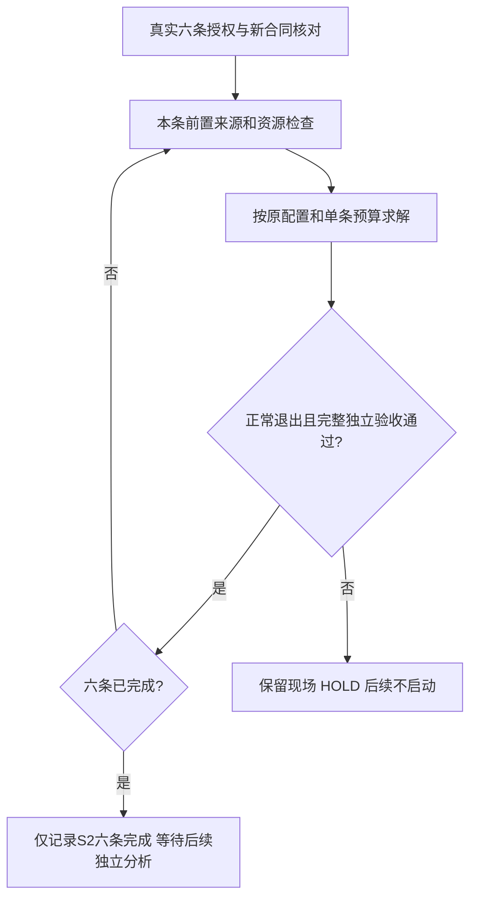

# S2-FRD-v1：正式 S2 执行范围与资源决策协议

日期：2026-11-02。状态：**工程范围已审查，推荐方案已确定；不是用户正式执行授权，不生成启动合同或命令，不启动计算。** 本协议补充S2-MIP-v1的资源决策，不替换URV-v1/MRP/A1科学口径。用户本轮原话：“另行审定正式 S2 执行范围与资源决策协议，不自动启动计算。”

## 1. 审定结论

**主方案保留原完整六配置、原顺序和原1/4/12小时单条求解预算，按每条完成并独立验收后才进入下一条。接受细网格可能触及时限而导致批次不完整的风险；不把测速充足解释为12小时完成保证。** 该方案兼容当前B及正式接口，无须为改变执行范围而修改代码或重编译。

这一选择保留三网格方向性参考的完整科学目标，且让粗/中网格先提供正式结果。成本由原预算控制，遇失败即停；无需现在承诺细网格最终一定合格。是否采用本方案并授权完整六条，由用户在后续真实执行授权中决定；本文件不能替代该授权。

不愿承担完整方案预算时，另行选择“四条粗/中网格部分执行”，但必须先准备独立的部分合同/入口。不能从当前完整六条合同删两项后绕过检查，不能发完整合同却依赖在第四条后人工杀进程来实现分批，更不能把两档网格当完整三网格参考。

## 2. 已验证依据及未证明部分

性能证据来源 `docs/reports/URV_S2_perf_results_review_20261102/independent_review.json`，两方向均PERF_EVIDENCE_SUFFICIENT，真实release SHA b675010adcc9e57627d3ff39c93d72394e16489e3713abe09851d5de31c5c7e1。仅观察到2065个完整步，非完整10368步窗。

| 细网格证据 | P沿槽 | T横槽 |
|---|---:|---:|
| 两短段秒/步 | 0.438561 / 0.437127 | 0.451677 / 0.444062 |
| 短时观察RSS峰值 | 1.834621GiB | 1.835052GiB |
| 慢区间×602112步的条件成本 | 73.350719小时 | 75.544474小时 |
| 43200秒÷慢区间秒/步 | 约98504步 | 约95644步 |

满最大步数的条件成本不是收敛时间。它既不能证明一定超时，也不能保证12小时内收敛；全窗统计、后续帧/长期系统开销未完整覆盖。两个方向在同一台机器顺序测得，不能据此保证其他日期负载或硬件表现。粗/中网格没有这轮实测速度，不能把节点数缩放当作它们的已测运行时间。

本轮已重新验证原B的1816项来源/六配置零步收据，六个正式目录均净。B SHA `2e55f3369f9445e7763ee1f9a87c57f79348d1b332c959bc038c1bcc4739081f`；同一ELF SHA `5c3836e97c99feab88cd8e41773237f6ff642a10558f151b11e112563382b07b`。实际核查清单见reviewed_inputs_sha256.json、six_config_scope.json。该只读审核不是新原生计算或新场验证。

## 3. 固定研究对象与六条范围

S2_REG_GRID / U_REG，h/d/w/period/Ly=60/80/120/240/240nm，rho1000kg/m³、nu1e-6m²/s、mu0.001Pa·s、a1e5m/s²、tau1。P=沿槽+y，T=横槽+x；单相、全充液、固定Bouzidi无滑移壁、水平周期；参考内核不使用原公式或V2修正。

J=核心液体速度体积分/平面面积，m²/s；K=nu·J/a，m³；U=J/H，H=h+d/2=100nm。原Re守卫尺度按h+d=140nm计算，保持原检查器定义。不改测量舍入路径、几何、物理、帧、统计窗或阈值。

|顺序|预留正式run_id|dx/nm|节点|窗/最大步|单条求解预算|
|---|---|---:|---:|---:|---:|
|1|URV_S2_P_dx5_reuse_v1_20261102_01|5|46080|648/37632|3600s（1小时）|
|2|URV_S2_T_dx5_reuse_v1_20261102_01|5|46080|648/37632|3600s（1小时）|
|3|URV_S2_P_dx2p5_reuse_v1_20261102_01|2.5|368640|2592/150528|14400s（4小时）|
|4|URV_S2_T_dx2p5_reuse_v1_20261102_01|2.5|368640|2592/150528|14400s（4小时）|
|5|URV_S2_P_dx1p25_reuse_v1_20261102_01|1.25|2949120|10368/602112|43200s（12小时）|
|6|URV_S2_T_dx1p25_reuse_v1_20261102_01|1.25|2949120|10368/602112|43200s（12小时）|

精确planned_case_id、配置路径/SHA及原输入见six_config_scope.json。这些run_id仅为原B预留，不是新approved身份。当前没有正式release或启动；性能输出不得续跑、改名或拼接为这六条。正式每条从原配置的新初态、原预留净目录开始。

## 4. 预算与实际监测覆盖

求解预算合计122400秒=**34小时**。独立检查器现每条最多3600秒，六条另最多6小时检查预算；来源重哈希、信号清理、文件I/O和父进程整理另计。因此“34+6小时”是预算之和，不是严格批次墙钟硬上限，也不是预计耗时。任一前项失败即停，未执行后项不消耗其求解预算。

现有控制器具体覆盖如下，不把尚未实现的监测写成已具备：

| 项目 | 冻结规则 | 现有实现与适用边界 |
|---|---|---|
| 并行规模 | 1进程、1线程、1cuboid、overlap3 | 原配置/环境保持，逐条串行；不为赶时限开启并行 |
| 进程内存 | 地址空间8GiB | child_limits使用RLIMIT_AS；不是RSS可无限增长的许可 |
| 系统可用内存 | ≥12GiB | 整批开始及每条求解前校核；原正式控制器不连续记录RSS/MemAvailable，不声称全程有PERF式观测保障 |
| 磁盘 | 整批开始≥100GiB、每条前及运行观测≥8GiB | resources前置校核；native_process运行中检查磁盘 |
| 输出 | 每条≤4GiB | 运行中合计文件字节监测，结束后重核；不自动减帧或删旧结果 |
| 求解时间 | 原1/4/12小时 | 最多5秒等待后复核预算，超限发起停止；目录遍历/I/O/调度和清理可有额外耗时，不伪称到毫秒的硬截止 |
| 停止清理 | SIGTERM、最多10秒后必要时SIGKILL | 原stop函数；保留实际原生退出/超时原因，不把−15当正式正常完成 |
| 诊断安全 | 原质量/密度/Mach/Re/有限值等 | 原生累计诊断、完整独立结束验收；正式父循环不逐行做PERF式安全扫描，不声称所有安全异常都立即被父控制器提前截获 |
| 独立检查 | 每条最多3600秒、8GiB进程地址空间 | 子检查器日志保留；超时/非零/缺接受文件即HOLD，不自动扩时或重跑 |

本协议不新增一秒监测要求，不放松任何现有数值/资源阈值。若后续希望运行中持续监测系统可用内存、逐行诊断或更严格的批次墙钟，必须另定隔离最小实现/软件检查/封存，不能在冻结run_S2.py里临时加代码后沿用原B。

真实绑定和实际启动时必须重查来源、目录及资源；历史PERF资源快照不能替代。命令应在Python启动前单进程清除LD_LIBRARY_PATH/LD_PRELOAD，并重核原15个动态库；不改全局shell，不用LD_PRELOAD插桩。资源不足则不启动，不删旧数据、不换机或提高上限。

## 5. 顺序决策和停止规则

粗/中网格通过是继续顺序的必要条件，不是细网格12小时完成的保证。现控制器没有“第四条后等人确认”功能；完整六条一旦获得授权，第四条通过后会按原顺序进入第五条。此范围必须在未来授权中讲清。

进入下一条必须同时满足：原生正常退出0、无超时/资源停止、运行前后绑定一致、原始输出完整、独立检查器退出0、其RESULT_PASS=true / NUMERICAL_GATE=PASS / geometry_PASS=true。沟槽smooth字段允许为空；原生result.txt内RESULT_PASS=false是等待独立接受的原设计，不能手改true或据其单字段判失败。

以下任一情况即停止批次：来源变化、输出占用/符号链接、前置资源不足、wall_timeout、资源停止、原生非零、检查器超时/非零、输出/接受证据不完整、原质量/密度/几何等接受失败或用户主动停止。保存旧输出和真实异常，未开始后项记NOT_STARTED。没有恢复/重启模式，不重复使用原目录或性能目录；本协议不授予新编号重跑或延时。

超时表示在给定预算内没有完成可信验收，不等于公式错误或已证明数值方法失败。若原生NUMERICAL_GATE/geometry字段已写FAIL则保留；若被信号终止且末态缺失，独立科学门保持NOT_EVALUATED/false或待核，不虚造FAIL/PASS。原生与独立字段分别记录，不覆盖历史事实。

## 6. 原验收门槛与科学边界

原common/acceptance_spec.json字节不改：corrected质量<1e-10、账本差≤1e-13、rho偏离≤1e-6、Mach<0.05、Re_H≤0.01、最终截面差≤1e-5、窗口std≤1e-6/span≤5e-6/横向通量≤1e-12m²/s；体积/q、fallback/unresolved、材料/帧/单位/有限值、来源及独立退出证据按原URV执行。旧质量轨迹继续保存，不能拿它替换修正质量门。

每条合格仅是单条接受。六条合格可以形成U_REG的方向性三网格数据，不自动升级参考资格或模型精度。原三网格正有限阶/单调要求、细格GCI≤1%及中细变化≤1%等仍按原协议；S3线性控制、其他必要阶段及跨合同聚合尚未完成。

当前aggregate入口明确要求24条和各自完整接受；不能把S2六条塞入该入口、伪造其他18条或放松计数以评分V2。F04跨合同聚合仍OPEN，本轮不实现或运行聚合器。性能数据/早期中间态不进入GCI/参考/K误差表。

## 7. 备选范围与所需准备

| 方案 | 科学价值与代价 | 当前接口与决定 |
|---|---|---|
| 完整六条，原预算 | 保留完整S2目标；最多34小时求解预算，但细格可能超时使S2不完整 | **主推荐**；与原六身份和B兼容，当前协议准备无需改代码/构建 |
| 仅5/2.5nm四条 | 取得粗/中趋势，求解预算合计10小时；不能完成三网格参考 | 备用，未采用/未实现；现入口精确要求六条，须另审独立部分执行适配/授权/封存 |
| 自动扩大细格时限或改窗/帧/网格/机器 | 会改变原资源或证据条件，短测不提供足够依据 | 本协议不采用，不为73–76小时外推直接设置新上限 |

若主方案细网格失败，只保留已接受较粗结果和失败现场，S2保持不完整；不自动退回备用方案或继续剩余细格。是否补证/变更后续范围，须在看到该正式结果后另行审查，保留原失败和原门槛。

## 8. 本轮交付与后续绑定条件

本轮仅新增本协议、六配置静态核对/资源决策JSON及验证报告，维护共享状态/交接。没有改代码/封存/原结果、构建、求解器/VTK调用、时间推进、正式授权证据、启动合同或启动命令。

未来若用户采用主方案并明确授权六条，另存AUTHORIZED_EXECUTION_LAUNCH_RELEASE与外部固定SHA，绑定原B/独立零步接受、PERF独立复核、该资源决策及真实六条授权；原B仍关闭不回写。注明用户接受的是预算内尝试，不是12小时保证完成。进行来源/净目录/届时资源/环境及原formal validator只读核对后，才交付用户手动启动命令。不能挪用性能授权。

当前simulation_authorized/native_zero_step_authorized/performance_time_stepping_authorized/formal_simulation_authorized均false，approved/actual正式列表空；NUMERICAL_GATE=NOT_EVALUATED、RESULT_PASS=false、geometry_PASS=null、REFERENCE_QUALIFIED_FOR_CASE=false，MODEL_COMPARISON/physical_validation=NOT_EVALUATED，reference_qualified/strict_error_bound_established/submission_ready=false。这里的许可字段仅描述本协议没有新增许可，不撤回已完成性能批次的历史真实授权。

S0/S1接受、旧横槽FAIL/380差异、早期MRP静态FAIL、HISTORICAL_EXCLUSIVE_ATTRIBUTION=NOT_ESTABLISHED、D4预测HOLD、F04 OPEN/作者外部声明范围及正式24项完成4/剩20保持。技能只用于AI辅助证据组织，不构成人工科学终审或发表放行。
